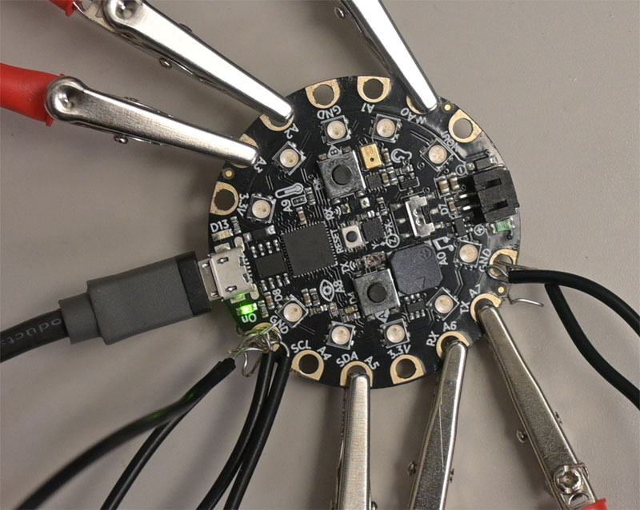

# Feeling Through Function – Designing Expressive Reactions

My biggest takeaway so far in this class, four assignments already submitted, is that my best work has been translating what I've already made and experienced, like my Circuit Tiles and my first year teaching, into code, using AI.  So this iteration, like last iteration, I'm going to start with another evocative object https://www.sherryturkle.com/evocative-objects

my Xmas lights, strings of different colored LEDs

alligator-clipped to an Adafruit Circuit Playground Express, 

https://github.com/adafruit/Adafruit_CircuitPlayground

because you can toggle from block coding into Javascript.

https://makecode.com/_PLX1LFC74KHJ
   
   So I'm using a lobotomized Mozilla, the only builtin functions stem from the Adafruit board.  But that's what I wanted!  This is the first time since September I really could follow a function through a JavaScript.  And that only happened because I was coding in a lobotomized single board kind of way.  Doing so has been the best buttress I have found so far to use AI to code, without it overwhelming me. 

   iterating/dialoging with AI through my VSCode/Continue/GenieX.

