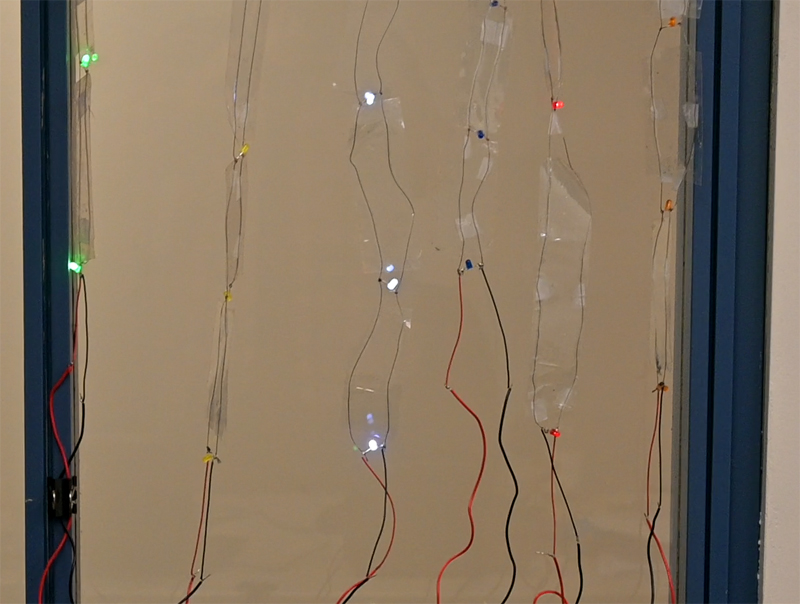

# Feeling Through Function – Designing Expressive Reactions

So here we are so quickly, four assignments already submitted, on my next to last assignment.

When I look back on my 4 assignments so far, I think my best work has been translating what I've already made and experienced, like my Circuit Tiles and my first year teaching, into code, using AI.  So this iteration, like last iteration, I'm going to start with another evocative object 

https://www.sherryturkle.com/evocative-objects

my Xmas lights, strings of different colored LEDs

alligator-clipped to an Adafruit Circuit Playground Express, 

https://github.com/adafruit/Adafruit_CircuitPlayground

because you can toggle from block coding into Javascript.

https://makecode.com/_PLX1LFC74KHJ
   
   I'm going to code my expressive functions for my XmasLights first in blocks, then JavaScript, and then, 

   iterating/dialoging with AI through my VSCode/Continue/GenieX.

