# Qualcomm® Hexagon™ NPU

Eric Mahurin
Senior Director, Technology
Qualcomm Technologies, Inc

Snapdragon and Qualcomm branded products are products of Qualcomm Technologies, Inc. and/or its subsidiaries.

Authorized licensed use limited to: Columbia University Libraries. Downloaded on November 15,2026 at 17:38:22 UTC from IEEE Xplore. Restrictions apply.

## Hexagon NPU

High Performance, Power Efficient ML Inference Processor for Qualcomm® SoCs

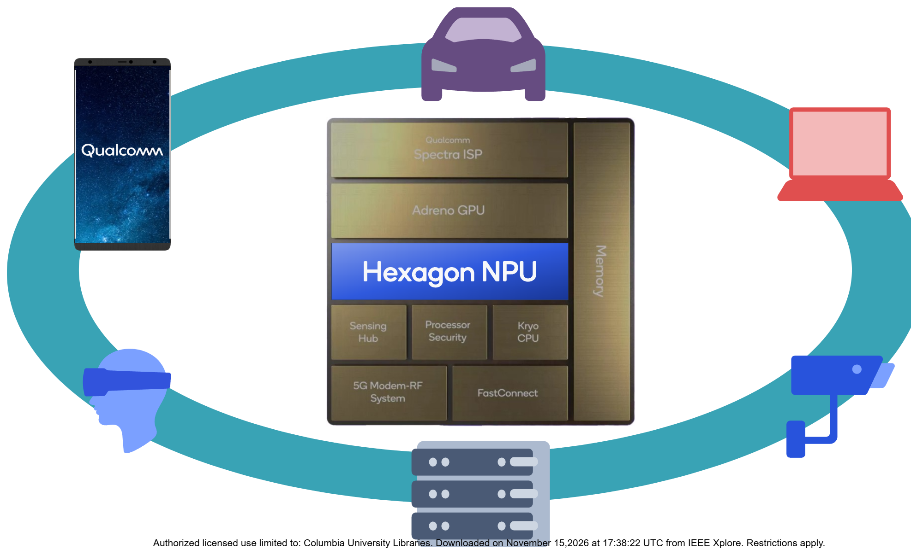

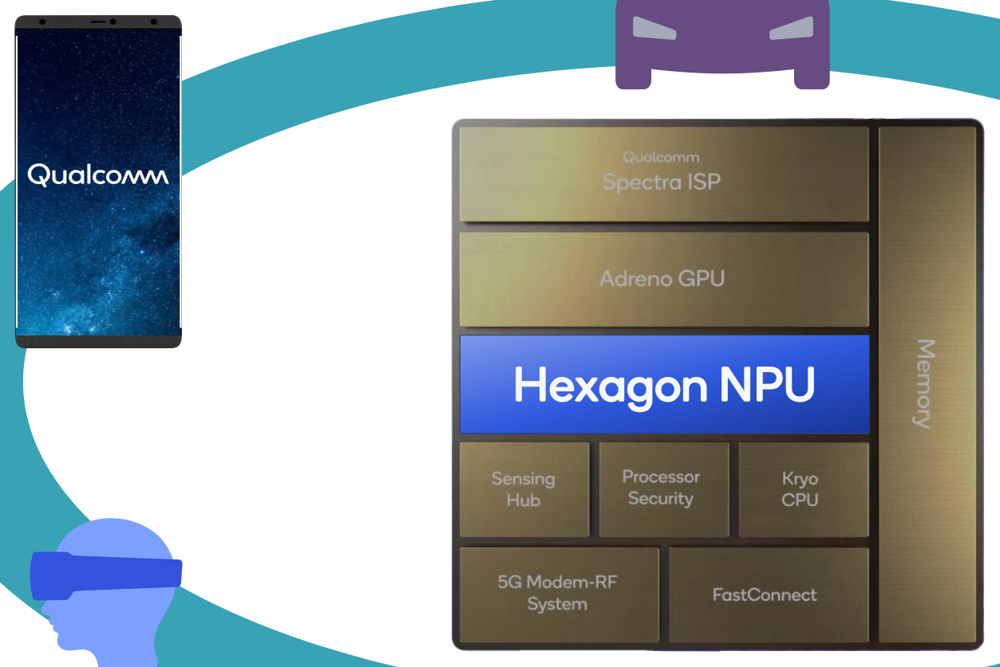

Authorized licensed use limited to: Columbia University Libraries. Downloaded on November 15,2026 at 17:38:22 UTC from IEEE Xplore. Restrictions apply.

2

2

• Processor executing 3 instruction sets:

• Scalar: For control flow and general purpose

• Vector: General purpose data-parallel compute

• Tensor: Matrix multiply and convolutional layer

• Over multiple threads using shared memories (core

local & cached DDR)

# Hardware

• DSP features:

• Targets DSP and compute-heavy workloads

• Virtual → Physical translation, security, caching

Authorized licensed use limited to: Columbia University Libraries. Downloaded on November 15,2026 at 17:38:22 UTC from IEEE Xplore. Restrictions apply.

## Hexagon NPU

- Processor executing 3 instruction sets:
  - Scalar: For control flow and general purpose
  - Vector: General purpose data-parallel compute
  - Tensor: Matrix multiply and convolutional layer
  - Over multiple threads using shared memories (core local & cached DDR)
- DSP features:
  - VLIW, hardware looping
  - Targets DSP and compute-heavy workloads
- CPU-like features:
  - Virtual → Physical translation, security, caching
  - Branching (call/return/indirect), exceptions, interrupts
  - Conventional software tools (including LLVM)

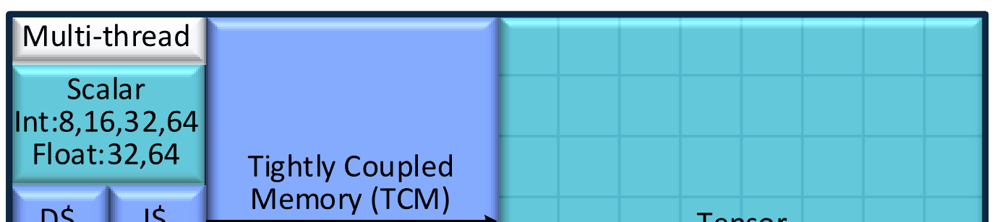

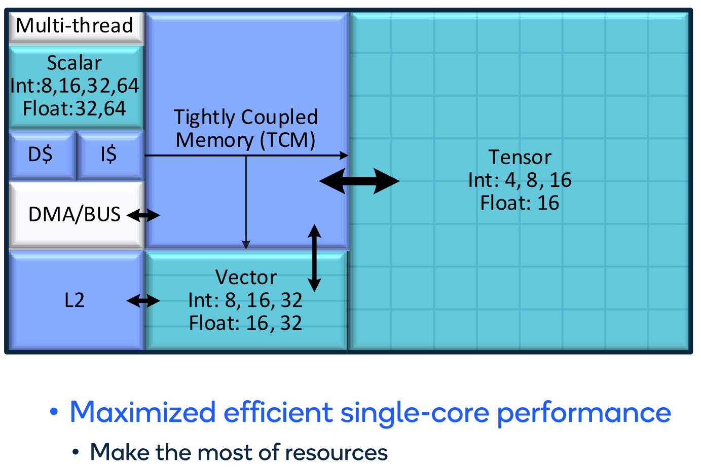

- Maximized efficient single-core performance
  - Make the most of resources

Authorized licensed use limited to: Columbia University Libraries. Downloaded on November 15,2026 at 17:38:22 UTC from IEEE Xplore. Restrictions apply.

4

4

## Vector

- Vector SIMD - like other SIMD extensions, but wider
  - 1 Kb = 128B = 64H = 32W wide
  - 8/16/32 bit fixed-point, 16/32 bit floating-point
- Compute and registers
  - 4 compute, 1 load, and 1 store VLIW resources
  - 32 vector registers and 4 vector predicate registers
- Memory access
  - Load/store with L2/DDR or TCM
  - Fully parallel scatter & gather with TCM to address arbitrary data- parallel workloads
- Target applications
  - Originally for image processing
  - Adapted to additional workloads including DNNs

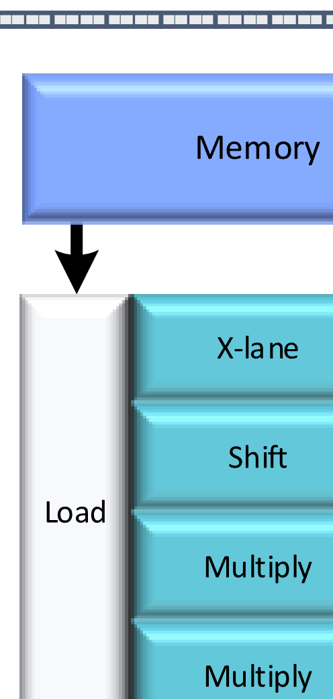

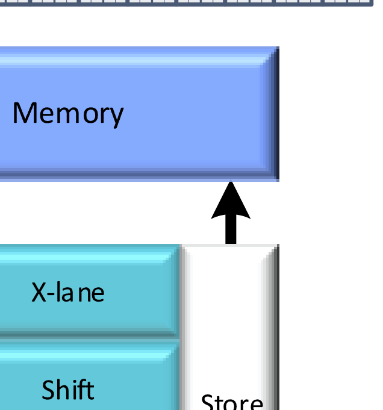

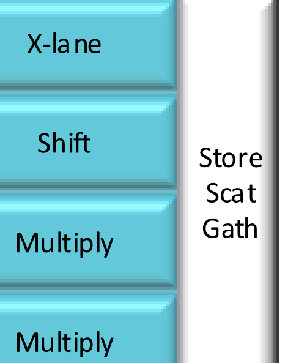

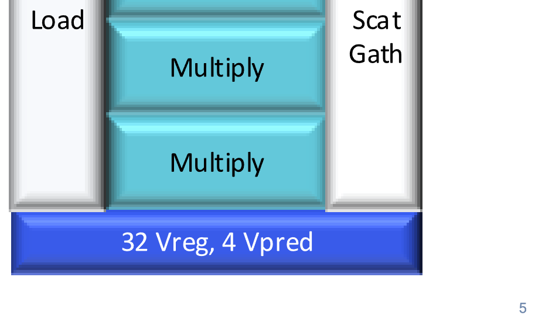

Authorized licensed use limited to: Columbia University Libraries. Downloaded on November 15,2026 at 17:38:22 UTC from IEEE Xplore. Restrictions apply.

5

5

## Tensor

- Tensor SIMD
  - Tensor instead of vector as data-parallel quantum
  - 2D matrices, 3D (X, Y, depth), and 4D (multiple 3D)
- Bit widths (activations * weights):
  - Integer: (8/16) * (4/8/16)
  - Float: FP16 * FP16
- ISA accelerates:
  - Matrix multiply
  - Convolutional layer
  - Depth-wise and other small group sized convolutions
  - Fused activation functions
  - Per output-channel scaling

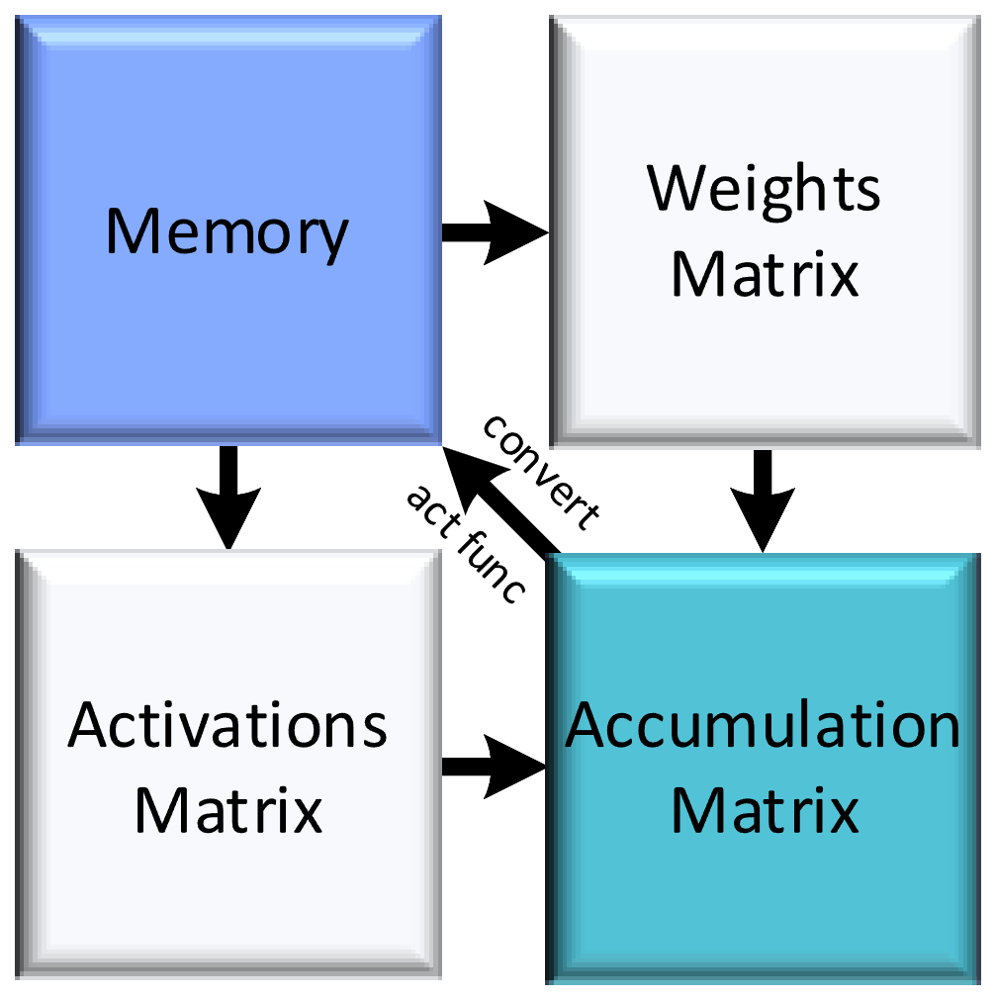

Authorized licensed use limited to: Columbia University Libraries. Downloaded on November 15,2026 at 17:38:22 UTC from IEEE Xplore. Restrictions apply.

6

6

• Processor executing 3 instruction sets:

• Scalar: For control flow and general purpose

• Vector: General purpose data-parallel compute

• Tensor: Matrix multiply and convolutional layer

• Over multiple threads using shared memories (core

local & cached DDR)

# Programming Model

• DSP features:

• Targets DSP and compute-heavy workloads

• Virtual → Physical translation, security, caching

Authorized licensed use limited to: Columbia University Libraries. Downloaded on November 15,2026 at 17:38:22 UTC from IEEE Xplore. Restrictions apply.

## Architecture – Threads

- Each thread has its own program
  - VLIW for predictable Instruction Level Parallelism
  - Scalar ISA for control flow and serial compute
- SIMD extension acquired/released
  - While acquired, a program has extension capabilities
- Scalar, vector, and tensor each have dedicated registers
  - Instructions operate on thread-local registers and [potentially shared] memory

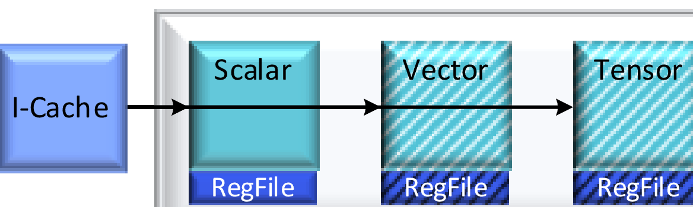

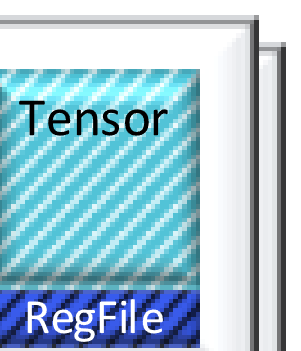

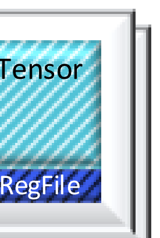

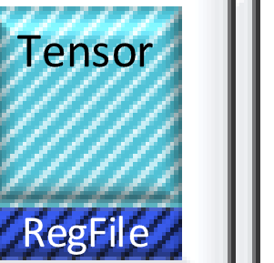

Authorized licensed use limited to: Columbia University Libraries. Downloaded on November 15,2026 at 17:38:22 UTC from IEEE Xplore. Restrictions apply.

8

8

## Architecture – Memory model

- Coherent memory between threads
  - Normal synchronization between threads
- Only scalar instructions uses L1 D-Cache
  - Prevents pollution by vectors & tensors
- Larger L2 acts as an L1 for vectors
  - In addition to backing I-Cache & D-Cache
  - Software prefetch hides DDR latency
- TCM for vectors & tensors:
  - Acts as a software-managed cache
  - More scalable than a hardware cache
  - Much higher bandwidth than a typical cache
  - Enables very high-bandwidth scatter/gather
  - Predictable performance – no misses
  - Virtually addressed DMA for hiding DDR latency

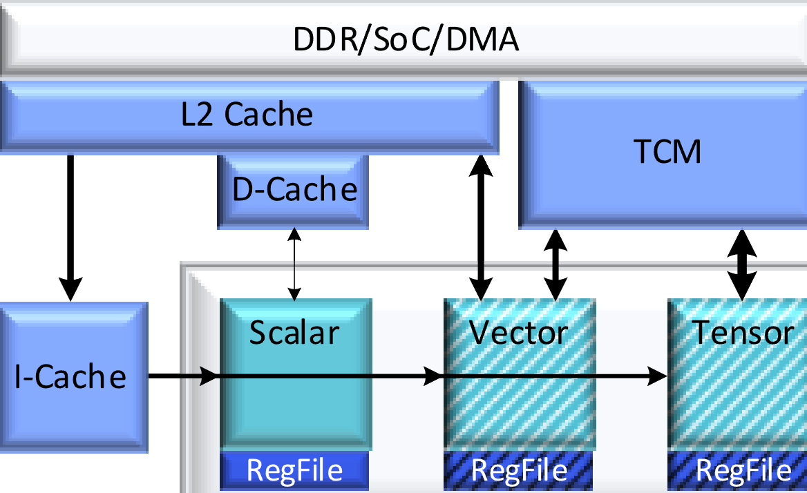

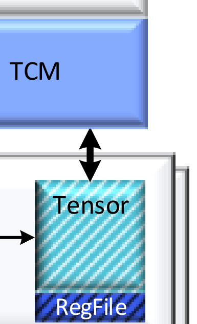

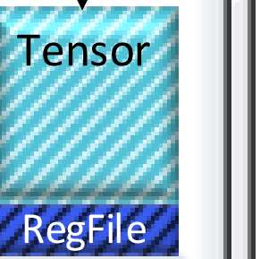

Scalar Vector Tensor

I-Cache

RegFile RegFile RegFile

Authorized licensed use limited to: Columbia University Libraries. Downloaded on November 15,2026 at 17:38:22 UTC from IEEE Xplore. Restrictions apply.

9

9

• Processor executing 3 instruction sets:

• Scalar: For control flow and general purpose

• Vector: General purpose data-parallel compute

• Tensor: Matrix multiply and convolutional layer

• Over multiple threads using shared memories (core

local & cached DDR)

# Efficiency

• VLIW, hardware looping

• Targets DSP and compute-heavy workloads

Authorized licensed use limited to: Columbia University Libraries. Downloaded on November 15,2026 at 17:38:22 UTC from IEEE Xplore. Restrictions apply.

## Tensor Data Locality – Temporal and Spatial

- Data locality is key to tensor compute efficiency
- N:1 compute:memory matrix multiply
  - 2N2 data read and transferred
  - For 2N3 compute
  - Single biggest reason for a dedicated tensor or matrix engine
- Output stationary:
  - Accumulators are wider bit-width than input activations & weights
  - Accumulate across all input channels and filter taps
- Convolution activations reuse:
  - Input activations with halo read once for each hardware output tensor
  - Convolution as a sequence of unaligned matrix multiplies
- Hardware SIMD tensor contiguous in memory
  - Maximized memory bandwidth, just like a SIMD vector is contiguous
  - Responsibility of software to organize data in these chunks

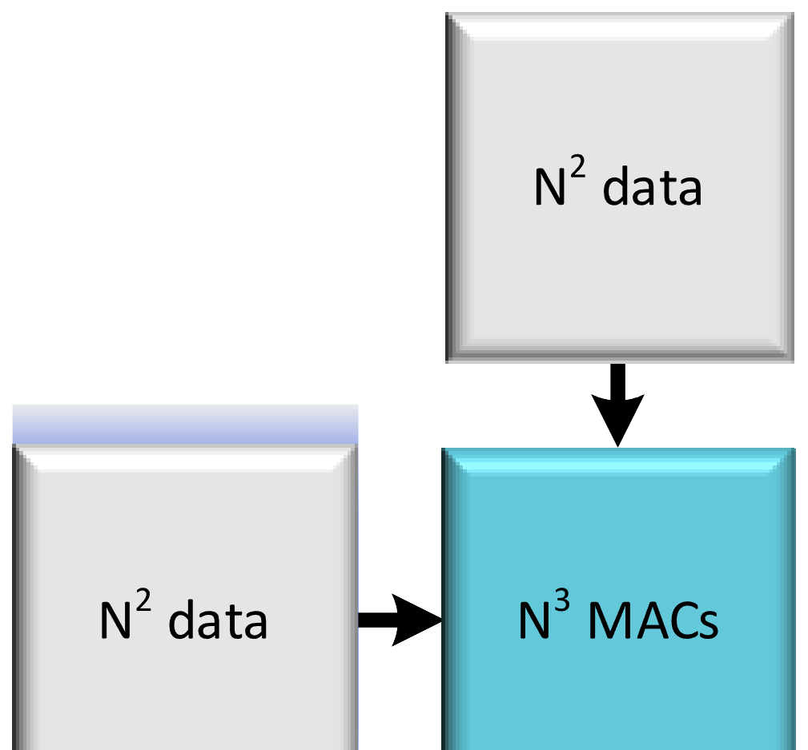

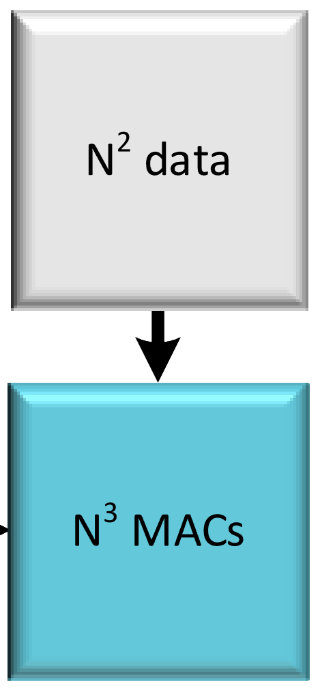

Authorized licensed use limited to: Columbia University Libraries. Downloaded on November 15,2026 at 17:38:22 UTC from IEEE Xplore. Restrictions apply.

11

11

## Floating-Point vs. Fixed-Point

- With tensor hardware, raw computational area & energy dominates, making compute efficiency paramount
- With Normal data, precision yields accuracy, not exponent
  - Beyond 2-bit exponent only harms accuracy with optimal SNR scaling
  - Simple int/fixed-point yields lowest cost for any accuracy
- Floating point vs. fixed point (FXP) accumulation increases overhead
  - Fixed-point or Kulisch accumulation best for small exponents widths: exact and lower cost
- DNNs typically have Normal data, but not always
  - Floating point vs. fixed point studied in (van Baalen et al., 2023)
  - CNNs relatively Normal - INT8 outperforming FP8 with Post Training Quantization (PTQ) and Quantization Aware Training (QAT)
  - Transformers have outliers due to softmax (Bondarenko et al, 2023), but QAT naturally pulls in the outliers
- Large fixed-point capacity + floating-point
  - Fixed-point: A16W16, A16W8, A8W8, A8W4
  - Floating-point: FP16*FP16

| Model | FP32 | INT8 PTQ | FP8E4 PTQ | A8W4 QAT | INT8 QAT | FP8E4 QAT |
| --- | --- | --- | --- | --- | --- | --- |
| ResNet18 | 69.72% | -0.08% | -1.15% | 0.29% | 0.71% | -0.37% |
| MobileNetV2 | 71.70% | -0.76% | -5.65% | -0.53% | 0.12% | -0.81% |
| HRNet | 81.05% | -0.12% | -0.28% |  | 0.22% | 0.01% |
| DeeplabV3 | 72.91% | -1.67% | -34.98% | 0.10% | 1.08% | 0.31% |
| SalsaNext | 55.80% | -1.58% | -0.68% |  | -0.80% | -0.60% |
| BERT(GLUE) | 83.06% | -12.03% | -0.26% | -0.42% | 0.20% | 0.85% |

| Model | FP32 | INT8 PTQ | FP8E4 PTQ | A8W4 QAT | INT8 QAT | FP8E4 QAT |
| --- | --- | --- | --- | --- | --- | --- |
| ResNet18 | 69.72% | -0.08% | -1.15% | 0.29% | 0.71% | -0.37% |
| MobileNetV2 | 71.70% | -0.76% | -5.65% | -0.53% | 0.12% | -0.81% |
| HRNet | 81.05% | -0.12% | -0.28% |  | 0.22% | 0.01% |
| DeeplabV3 | 72.91% | -1.67% | -34.98% | 0.10% | 1.08% | 0.31% |
| SalsaNext | 55.80% | -1.58% | -0.68% |  | -0.80% | -0.60% |
| BERT(GLUE) | 83.06% | -12.03% | -0.26% | -0.42% | 0.20% | 0.85% |

Authorized licensed use limited to: Columbia University Libraries. Downloaded on November 15,2026 at 17:38:22 UTC from IEEE Xplore. Restrictions apply.

12

12

## Performance & Energy vs. Bits

- Lower bit widths affect accuracy, but improve many other dimensions:
  - Memory footprint/bandwidth/energy – TCM & DDR, activations & weights
  - Compute bandwidth/energy
- Can scale quadratically vs. bit width:
  - For matrix/convolution dominated workloads
  - Linear scaling with bit width of each operand
  - Smaller widths fit better into memory (more locality)
- Multiple PTQ & QAT techniques are used to maximize accuracy with reduced bits

Authorized licensed use limited to: Columbia University Libraries. Downloaded on November 15,2026 at 17:38:22 UTC from IEEE Xplore. Restrictions apply.

13

13

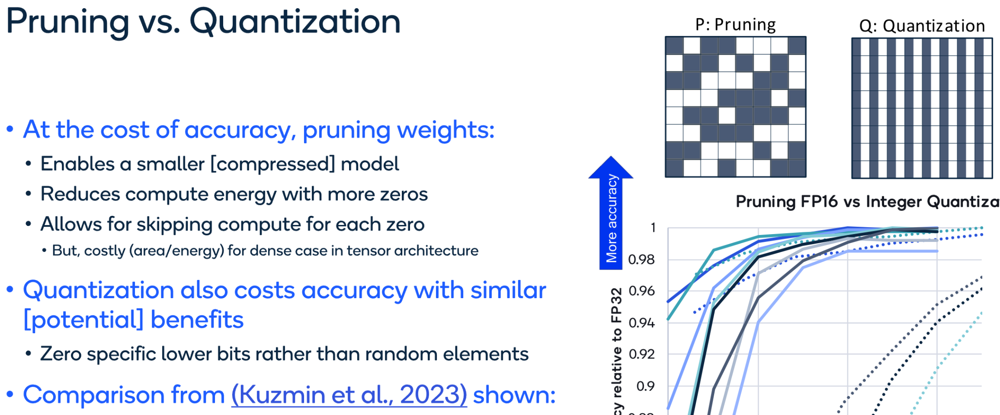

## Pruning vs. Quantization

- At the cost of accuracy, pruning weights:
  - Enables a smaller [compressed] model
  - Reduces compute energy with more zeros
  - Allows for skipping compute for each zero
    - But, costly (area/energy) for dense case in tensor architecture
- Quantization also costs accuracy with similar [potential] benefits
  - Zero specific lower bits rather than random elements
- Comparison from (Kuzmin et al., 2023) shown:
  - Quantization consistently better for given compressed/packed model bits
- Focus on deep quantization rather than deep pruning
  - But pruned/compressed models are supported

Authorized licensed use limited to: Columbia University Libraries. Downloaded on November 15,2026 at 17:38:22 UTC from IEEE Xplore. Restrictions apply.

14

14

• Tensor instead of vector as data-parallel quantum

• 2D matrices, 3D (X, Y, depth), and 4D (multiple 3D)

• Bit widths (activations * weights):

• Integer: (8/16) * (4/8/16)

# Application

• Float: FP16 * FP16

• Depth-wise and other small group sized convolutions

Authorized licensed use limited to: Columbia University Libraries. Downloaded on November 15,2026 at 17:38:22 UTC from IEEE Xplore. Restrictions apply.

## Target Industries

- Single architecture across a wide range of platforms
- Specific implementations with different configurations are used across industries
- Maximized energy-efficient single-core performance and multi-core when needed
- Typically, multiple concurrent uses on any given platform, including with single-core
- Programmability is key to adapting to new demands

IoT

Mobile

AR

PC

Auto

Cloud

Authorized licensed use limited to: Columbia University Libraries. Downloaded on November 15,2026 at 17:38:22 UTC from IEEE Xplore. Restrictions apply.

16

16

16

16

## Performance

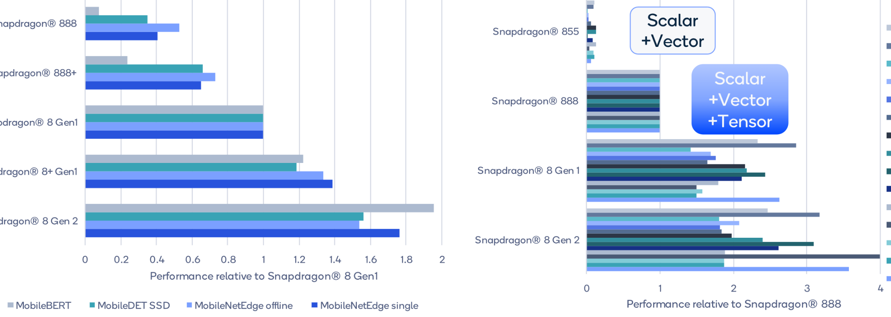

Leading edge performance with 50% to >100% year-over-year gains

Authorized licensed use limited to: Columbia University Libraries. Downloaded on November 15,2026 at 17:38:22 UTC from IEEE Xplore. Restrictions apply.

17

17

17

17

# References

Mart van Baalen, Andrey Kuzmin, Suparna S Nair, Yuwei Ren, Eric Mahurin, Chirag Patel, Sundar , , , J , j “ ”, https://arxiv.org/abs/2303.17951

Yelysei Bondarenko, Markus Nagel, Tijmen Blankevoort. “ : O H H ”, https://arxiv.org/abs/2306.12929

Andrey Kuzmin, Markus Nagel, Mart van Baalen, Arash Behboodi, Tijmen Blankevoort. (2023). “ : ?”, https://arxiv.org/abs/2307.02973

Authorized licensed use limited to: Columbia University Libraries. Downloaded on November 15,2026 at 17:38:22 UTC from IEEE Xplore. Restrictions apply.

18

18

Thank you

Thank you

Nothing in these materials is an offer to sell any of the components or devices referenced herein.

Nothing in these materials is an offer to sell any of the components or devices referenced herein.

©2018-2023 Qualcomm Technologies, Inc. and/or its affiliated companies. All Rights Reserved.

Follow us on:

Follow us on:

©2018-2023 Qualcomm Technologies, Inc. and/or its affiliated companies. All Rights Reserved.

Qualcomm is a trademark or registered trademark of Qualcomm Incorporated. Other products and brand names may be trademarks or registered trademarks of their respective owners.

For more information, visit us at:

For more information, visit us at:

Qualcomm and Snapdragon are trademarks or registered trademarks of Qualcomm Incorporated. Other products and brand names may be trademarks or registered trademarks of their respective owners.

qualcomm.com & qualcomm.com/blog

qualcomm.com & qualcomm.com/blog

References in this presentation to “Qualcomm” may mean Qualcomm Incorporated, Qualcomm Technologies, Inc., and/or other subsidiaries or business units within the Qualcomm corporate structure, as applicable. Qualcomm Incorporated includes our licensing business, QTL, and the vast majority of our patent portfolio. Qualcomm Technologies, Inc., a subsidiary of Qualcomm Incorporated, operates, along with its subsidiaries, substantially all of our engineering, research and development functions, and substantially all of our products and services businesses, including our QCT semiconductor business.

References in this presentation to “Qualcomm” may mean Qualcomm Incorporated, Qualcomm Technologies, Inc., and/or other subsidiaries or business units within the Qualcomm corporate structure, as applicable. Qualcomm Incorporated includes our licensing business, QTL, and the vast majority of our patent portfolio. Qualcomm Technologies, Inc., a subsidiary of Qualcomm Incorporated, operates, along with its subsidiaries, substantially all of our engineering, research and development functions, and substantially all of our products and services businesses, including our QCT semiconductor business. Snapdragon and Qualcomm branded products are products of Qualcomm Technologies, Inc. and/or its subsidiaries. Qualcomm patented technologies are licensed by Qualcomm Incorporated.

Snapdragon and Qualcomm branded products are products of Qualcomm Technologies, Inc. and/or its subsidiaries. Qualcomm patented technologies are licensed by Qualcomm Incorporated.

Authorized licensed use limited to: Columbia University Libraries. Downloaded on November 15,2026 at 17:38:22 UTC from IEEE Xplore. Restrictions apply.
