Read this first This User Guide provides the essential hardware and setup information for your notebook computer. It includes product illustrations, specifications, instructions for basic configuration, and guidance on hardware replacement. Before operating your notebook computer for the first time, read the safety‑related documents listed below to understand important safety and regulatory information. • Safety and Warranty Guide • Generic Safety and Compliance Notices For more supporting documents, go to Lenovo Documentation Center and search by the product name. Seventh Edition (September 2026) © Copyright Lenovo 2024, 2026. LIMITED AND RESTRICTED RIGHTS NOTICE: If data or software is delivered pursuant to a General Services Administration “GSA” contract, use, reproduction, or disclosure is subject to restrictions set forth in Contract No. GS-35F-05925.

i

Contents

[Read this first i](#pdf-dest-1) [Preface: Discover your Lenovo notebookvi](#pdf-dest-2) [Chapter 1 Key features 1](#pdf-dest-3) [AI Camera1](#pdf-dest-4) [Copilot in Windows 1](#pdf-dest-5) [Presence Sensing (for selected models)2](#pdf-dest-6) [Intelligent Cooling3](#pdf-dest-7) [Switch among modes 3](#pdf-dest-8) [Intelligent Cooling Boost (for selected model) 4](#pdf-dest-9) [Cool and Quiet on Lap4](#pdf-dest-10) [Chapter 2 Meet your computer5](#pdf-dest-11) [Front view5](#pdf-dest-12) [Side view7](#pdf-dest-13) [Bottom view 9](#pdf-dest-14) [Features and specifications 10](#pdf-dest-15) [USB specifications 10](#pdf-dest-16) [Chapter 3 Get started with your computer12](#pdf-dest-17) [Set up your computer12](#pdf-dest-18) [Turn on the computer 12](#pdf-dest-19) [Complete the operating system setup12](#pdf-dest-20) [Access networks13](#pdf-dest-21) [Connect to Wi-Fi networks13](#pdf-dest-22) [Turn on Airplane mode 13](#pdf-dest-23) [Connect to the wired Ethernet13](#pdf-dest-24) [Connect to a cellular network (for selected models) 14](#pdf-dest-25) [Interact with your computer15](#pdf-dest-26) [Use the keyboard shortcuts15](#pdf-dest-27) [Use the TrackPoint pointing device 16](#pdf-dest-28) [Use the Trackpad18](#pdf-dest-29) [Use the touch screen (for selected models)21](#pdf-dest-30) [Connect to an external display 23](#pdf-dest-31) [Connect to a Bluetooth device 24](#pdf-dest-32) [Conventional pair 24](#pdf-dest-33) [Swift pair24](#pdf-dest-34) [Lenovo apps25](#pdf-dest-35) [Lenovo Commercial Vantage 25](#pdf-dest-36) [TrackPoint Quick Menu25](#pdf-dest-37) [Color calibration (for selected models) 27](#pdf-dest-38) [Manage power 27](#pdf-dest-39) [Check the battery status 27](#pdf-dest-40) [Charge the computer with ac power 27](#pdf-dest-41) [Maximize the life of the battery28](#pdf-dest-42) [Change the power settings28](#pdf-dest-43) [Purchase accessories or additional services28](#pdf-dest-44) [Secure your computer and information29](#pdf-dest-45) [Lock the computer 29](#pdf-dest-46) [Log in with fingerprint recognition 29](#pdf-dest-47) [Log in with facial recognition 30](#pdf-dest-48) [Protect data against power loss 30](#pdf-dest-49) [UEFI BIOS passwords30](#pdf-dest-50)

ii

[FIDO (Fast Identity Online) authentication 33](#pdf-dest-51) [Chapter 4 UEFI BIOS 35](#pdf-dest-52) [Enter the UEFI BIOS menu35](#pdf-dest-53) [Navigate the UEFI BIOS menu35](#pdf-dest-54) [Customize BIOS Defaults36](#pdf-dest-55) [Save the customized settings configuration 36](#pdf-dest-56) [Load the customized settings configuration36](#pdf-dest-57) [Reset the settings configuration to Setup Defaults 36](#pdf-dest-58) [Detect memory retraining 36](#pdf-dest-59) [Chapter 5 Frequently asked questions 37](#pdf-dest-60) [Camera problems37](#pdf-dest-61) [My camera can’t be launched or found37](#pdf-dest-62) [Keyboard problems 37](#pdf-dest-63) [My keyboard does not work37](#pdf-dest-64) [My keyboard backlight does not work38](#pdf-dest-65) [Mouse problems 39](#pdf-dest-66) [My mouse does not work 39](#pdf-dest-67) [Touchpad or trackpad problems 39](#pdf-dest-68) [My touchpad or trackpad does not respond 39](#pdf-dest-69) [My touchpad or trackpad responds slowly 40](#pdf-dest-70) [Audio problems 40](#pdf-dest-71) [The audio does not work 40](#pdf-dest-72) [Display problems 40](#pdf-dest-73) [Blue screen 41](#pdf-dest-74) [Black screen 41](#pdf-dest-75) [Screen flickering 41](#pdf-dest-76) [The external display does not work 42](#pdf-dest-77) [The display remains dim 42](#pdf-dest-78) [Touch screen problems43](#pdf-dest-79) [My touch screen does not respond43](#pdf-dest-80) [Battery problems 44](#pdf-dest-81) [My computer battery is not recognized 44](#pdf-dest-82) [My computer battery icon disappears 44](#pdf-dest-83) [My computer battery discharges quickly45](#pdf-dest-84) [Hinge problems45](#pdf-dest-85) [My computer hinges lose torque 45](#pdf-dest-86) [My computer cannot be opened or closed 45](#pdf-dest-87) [Fingerprint reader problems46](#pdf-dest-88) [Fingerprint recognition cannot be set up 46](#pdf-dest-89) [Fingerprint recognition error46](#pdf-dest-90) [Fingerprint enrollment error 47](#pdf-dest-91) [Docking station problems 48](#pdf-dest-92) [Poor docking station connection 48](#pdf-dest-93) [My docking station is well connected but does not work 48](#pdf-dest-94) [USB problems 49](#pdf-dest-95) [My USB connector does not work 49](#pdf-dest-96) [Recover data from a USB drive49](#pdf-dest-97) [Create a recovery drive 50](#pdf-dest-98) [Fan problems50](#pdf-dest-99) [Loud fan noise 50](#pdf-dest-100) [My computer fan runs constantly 51](#pdf-dest-101) [Network connection problems 51](#pdf-dest-102) [Wi-Fi connection error 51](#pdf-dest-103) [Bluetooth connection problems 52](#pdf-dest-104) [Bluetooth connection error 52](#pdf-dest-105) [Power charging problems 53](#pdf-dest-106) [My computer is not charged when connected to ac power 53](#pdf-dest-107) [My built-in battery cannot be charged 54](#pdf-dest-108)

iii

[My built-in battery is not fully charged 54](#pdf-dest-109) [Startup problems 55](#pdf-dest-110) [My computer does not start up55](#pdf-dest-111) [Windows login error 55](#pdf-dest-112) [Blue screen during the startup 55](#pdf-dest-113) [Performance problems 56](#pdf-dest-114) [My computer does not work 56](#pdf-dest-115) [My computer responds slowly 56](#pdf-dest-116) [OS problems 57](#pdf-dest-117) [Upgrade my Windows operating system57](#pdf-dest-118) [Windows operating system upgrading error 58](#pdf-dest-119) [Recover Windows operating system 58](#pdf-dest-120) [Windows operating system recovery error 59](#pdf-dest-121) [Password problems 59](#pdf-dest-122) [Change my Windows password 59](#pdf-dest-123) [Reset my Windows password59](#pdf-dest-124) [Retrieve my BitLocker recovery key in Windows 60](#pdf-dest-125) [Driver problems 60](#pdf-dest-126) [Update or install the latest device driver 60](#pdf-dest-127) [Driver installation error 61](#pdf-dest-128) [UEFI BIOS problems 62](#pdf-dest-129) [Update the UEFI BIOS 62](#pdf-dest-130) [UEFI BIOS update error63](#pdf-dest-131) [Recover the UEFI BIOS 63](#pdf-dest-132) [Reset system to factory defaults 63](#pdf-dest-133) [Self-help resource 64](#pdf-dest-134) [Product information64](#pdf-dest-135) [Lenovo Support resource 64](#pdf-dest-136) [Service information 65](#pdf-dest-137) [Product documentation65](#pdf-dest-138) [Operating system support resource65](#pdf-dest-139) [Accessory information 66](#pdf-dest-140) [Legal and compliance information 66](#pdf-dest-141) [Lenovo responsibility 66](#pdf-dest-142) [Chapter 6 Diagnose and troubleshoot your computer67](#pdf-dest-143) [Error messages 67](#pdf-dest-144) [Battery-charge LED indicator diagnosis 68](#pdf-dest-145) [Diagnostics tool70](#pdf-dest-146) [Troubleshoot and diagnose at Lenovo Support Web site 70](#pdf-dest-147) [Hardware scan 71](#pdf-dest-148) [UEFI Diagnostics tool71](#pdf-dest-149) [Windows label 71](#pdf-dest-150) [Call Lenovo72](#pdf-dest-151) [Before you contact Lenovo 72](#pdf-dest-152) [Find your service QR code and serial number72](#pdf-dest-153) [Lenovo Customer Support Center 73](#pdf-dest-154) [Chapter 7 CRU replacement75](#pdf-dest-155) [What are CRUs 75](#pdf-dest-156) [CRU list 75](#pdf-dest-157) [Before you replace any CRU 76](#pdf-dest-158) [Disable Fast Startup 76](#pdf-dest-159) [Disable the built-in battery 76](#pdf-dest-160) [Replace a CRU 76](#pdf-dest-161) [Base cover assembly76](#pdf-dest-162) [Wireless WAN module (for selected models) 77](#pdf-dest-163) [M.2 solid-state drive bracket and M.2 solid-state drive79](#pdf-dest-164) [Speaker assembly80](#pdf-dest-165)

iv

[Appendix A Compliance information82](#pdf-dest-166) [Certification-related information 82](#pdf-dest-167) [Locate the UltraConnect wireless antennas 82](#pdf-dest-168) [Operating environment 83](#pdf-dest-169) [Notice for USB connector name update 84](#pdf-dest-170) [Appendix B Important notice for Quebec consumers 85](#pdf-dest-171) [Appendix C Accessibility features 86](#pdf-dest-172) [Appendix D Notices and trademarks 87](#pdf-dest-173)

v

Discover your Lenovo notebook Thank you for choosing a Lenovo® notebook! We are dedicated to delivering the best solution to you. Before starting your tour, please read the following information: • Illustrations in this documentation might look different from your product. • Depending on the model, some optional accessories, features, software programs, and user interface instructions might not be applicable to your computer. • Documentation content is subject to change without notice. To get the latest documentation, go to https://pcsupport.lenovo.com. HEVC Standard This product may support digital video coding under certain versions of HEVC (High Efficiency Video Coding) standard and, if so, may be covered by patents at https://accessadvance.com/advance- patent-lists/.

Chapter 1 Key features This chapter introduces AI-powered and innovative features of your computer. AI Camera The AI camera delivers improved capture, streaming, and real-time collaboration experiences through a set of high quality effects for video call apps. To access AI camera, do the following: 1. Click the quick settings area on the right side of the taskbar. 2. Click studio effects icon . Key functions • Auto-framing: Automatically keep your face centered in the video call when you move around. • Background effects: Blur the background during a video call to keep the focus on you. • Brightness: Adjust the camera parameter to improve your video call experience. Note: The available features only work when camera shutter is open. Copilot in Windows Copilot in Windows is an AI-powered assistant to help enhance work efficiency and creativity.

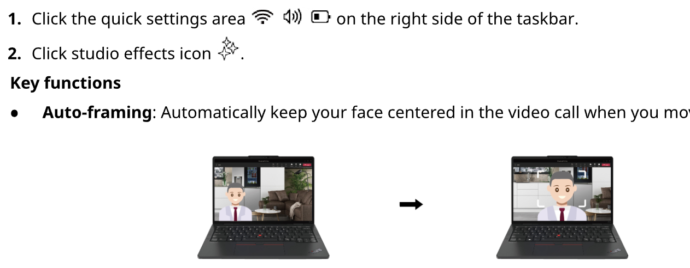

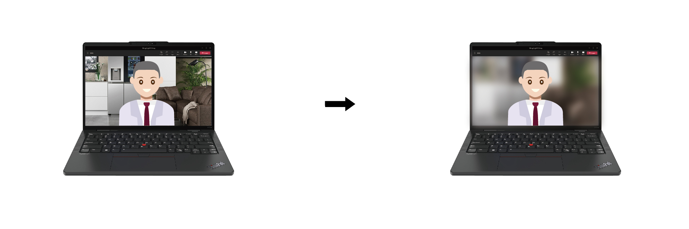

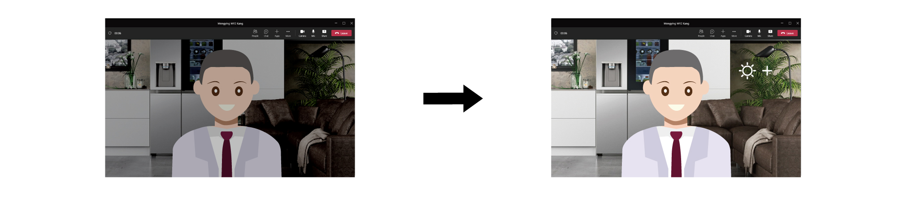

1

To access Copilot in Windows, do one of the following: • Press the Copilot key . • Click the Copilot icon on the task bar. Key functions • Provide answers or suggestions to your questions through live chat. For example, you could ask Copilot how to change your Windows password. • Assist you to analyse image by clicking the image button at the bottom right of the chat box. For example, you could ask Copilot to summarize the image you have uploaded. Note: • This app might not be available in your country or region. • This app makes periodic updates of the features. Explore this app on your actual user interface. Presence Sensing (for selected models) Your device supports Presence Sensing feature. This feature offers smarter privacy protection, simpler login experience, and better energy management for your computer. Note: Before using this feature, ensure that: • You have set up Windows Hello facial recognition in Windows Settings. • The camera is not occupied by another application and in normal use. Key functions • Zero Touch Login: Wake your computer from sleep mode when you approach it. With Windows Hello facial recognition, you can log in without touching your computer. • Zero Touch Lock: Lock the computer automatically when you leave.

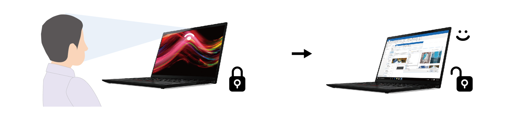

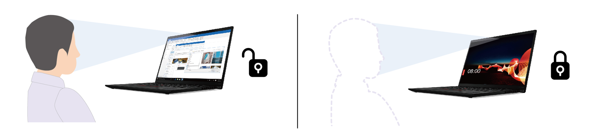

2

• Adaptive Dimming: Track your attention based on head position and eye contact with the display. When your focus is not on your computer screen, the display will dim to save battery power. Note: • The feature uses your camera to detect your presence and recognize your face. Lenovo does not collect or store any personal data from the camera. • For some countries or regions, this feature might be disabled according to local regulations. Customize the feature in Windows Settings 1. Open the Start menu, and then click Settings > System > Power & Battery > Screen, Sleep, & hiberate timouts. 2. Follow the on-screen instructions to customize the feature according to your preference. Intelligent Cooling The Intelligent Cooling feature helps you adjust power consumption, fan speed, computer temperature, and performance. Mode Recommended scenario Best power efficiency • You want the computer to be quieter and cooler. • You want to maximize the battery life. Balanced • You plan to frequently switch between different computer tasks over a period time. • You prefer to balance device performance with temper- ature and fan noise. Best performance • You want the computer to achieve the best perfor- mance. • Louder fan noise and higher temperature are accept- able to you. Switch among modes You can press F8 or do the following to switch among preferred modes: 1. Right-click the battery icon in the quick settings area on the right side of the taskbar. 2. Click Power and sleep settings.

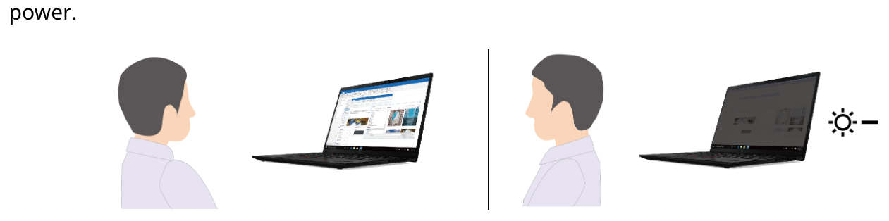

3

3. Locate the Power section and select a preferred mode. Intelligent Cooling Boost (for selected model) The Intelligent Cooling Boost feature dynamically adjusts system performance based on the apps you are running. It is recommended that you enable this function when using unified communication apps (such as Microsoft Teams). Note: Ensure that you use this feature in Balanced mode to have the best user experience. The Intelligent Cooling Boost feature is enabled by default. To disable this feature, do the following: 1. Restart the computer. When the logo screen is displayed, press F1 to enter to the UEFI BIOS menu. 2. Select Config > Power. 3. In the Intelligent Cooling Boost section, turn off the Intelligent Cooling Boost switch. 4. Press F10 to save changes and exit the UEFI BIOS menu. Cool and Quiet on Lap Your computer can detect whether you are using it on your lap and automatically enable the Cool and Quiet on Lap feature. The feature helps cool down your computer to avoid any discomfort caused by extended contact with your body, even through clothing. When you are not using it on your lap, the feature will be disabled automatically.

4

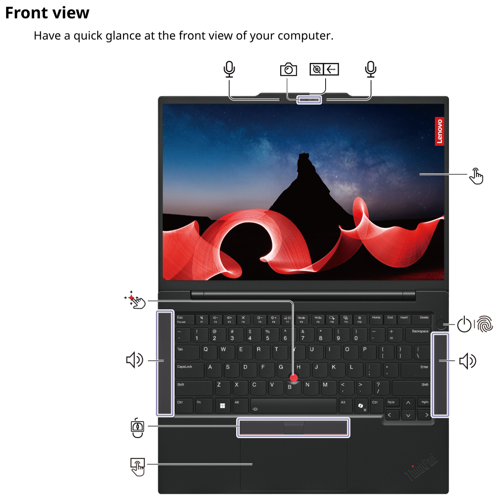

Chapter 2 Meet your computer This chapter introduces the appearance, features and specifications of your computer. Front view Have a quick glance at the front view of your computer. Item Description Item Description Microphone Camera Webcam privacy shutter Touch screen* Power button with fingerprint reader Speaker

5

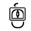

Trackpad TrackPoint Three Buttons TrackPoint® pointing stick * for selected models Webcam privacy shutter Slide the webcam privacy shutter to cover or uncover the camera lens. It is designed to protect your privacy. Important information Your computer contains magnets. Keep a safe distance away from devices and objects that might be affected by magnets, such as credit cards. Related topics • [Lock on leave function](#pdf-dest-174) on page 2 • [Use the TrackPoint pointing device](#pdf-dest-175) on page 16 • [Use the Trackpad](#pdf-dest-176) on page 18 • [Use the touch screen (for selected models](#pdf-dest-177)) on page 21 • [Log in with fingerprint recognition](#pdf-dest-178) on page 29 • [Log in with facial recognition (for selected models](#pdf-dest-179)) on page 30

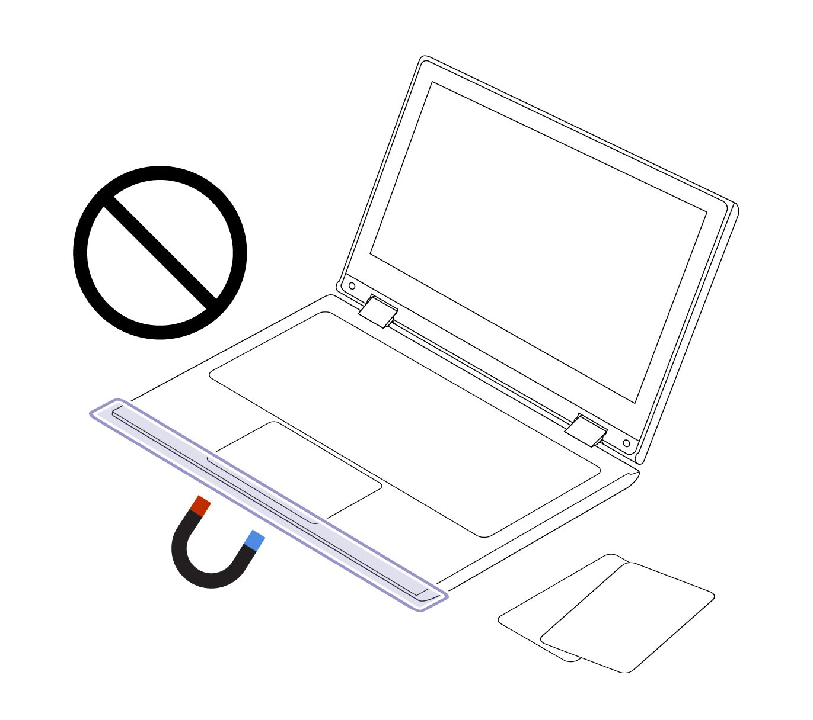

6

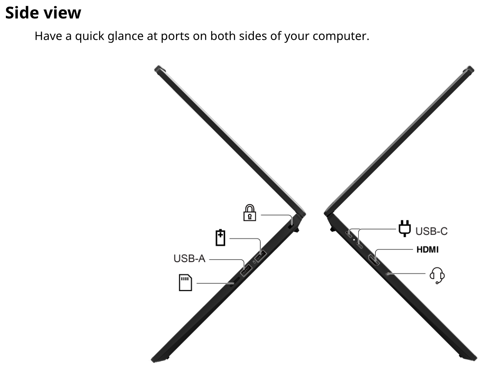

Side view Have a quick glance at ports on both sides of your computer. Item Description Item Description Security-lock slot USB-C® power connector (USB4® 40Gpbs) USB-A connector (USB 5Gbps, Always On USB) HDMI™ connector USB-A connector (USB 5Gbps) Audio connector Nano-SIM-card tray* * for selected models Note: For more information about the USB connector name update, see [Notice for USB connector](#pdf-dest-180) [name update](#pdf-dest-180) on page 84. Related topics • [USB specifications](#pdf-dest-181) on page 10 • [Manage power](#pdf-dest-182) on page 27

7

• [Charge the computer with ac power](#pdf-dest-183) on page 27 • [Lock the computer](#pdf-dest-184) on page 29

8

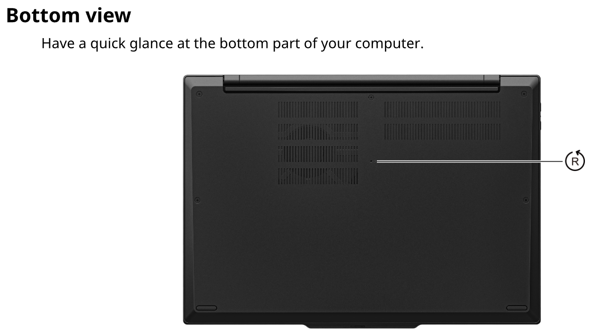

Bottom view Have a quick glance at the bottom part of your computer. Emergency-reset hole Emergency-reset hole can help you to recover computer when the computer stops responding and you cannot turn it off by pressing the power button. Do the following to reset your computer: 1. Disconnect your computer from ac power. 2. Insert a straightened paper clip into the hole to cut off power supply temporarily. 3. Connect your computer to ac power and then turn on your computer. Note: If your computer is still no response, you can call Lenovo Customer Support Center to get further help. CAUTION: When the computer is operating, it should be placed on a hard and flat surface with its bottom area not in contact with user’s bare skin. Under normal operating conditions, the temperature of the bottom surface will remain within an acceptable range as defined in IEC 62368-1, but such temperatures can still be high enough to cause discomfort or harm to the user if directly touched for over one minute at a time. As such, it is recommended that users avoid prolonged direct contact with the bottom of the computer.

9

Features and specifications Get to know more hardware and software details of your computer. Specification Description Memory Low Power Double Data Rate 5X (LPDDR5X), soldered on board, up to 64 GB Storage device One slot, 2242 M.2 solid-state drive, up to 1 TB Audio Dolby Audio™ Premium Display • Organic Light–Emitting Diode (OLED) display* • Color display with In-Plane Switching (IPS) technology* • Display ratio: 16:10 • Display resolution: 1920 x 1200 pixels or 2880 x 1800 pixels • TUV Low Blue Light • TUV Eye Safe* • Multi-touch technology* • Dolby Vision* Security features • Face authentication • Presence Sensing • Fingerprint reader (integrated in power button) • Trusted Platform Module (TPM) Wireless features • Bluetooth • GPS (on wireless WAN model)* • Wireless LAN • Wireless WAN (5G)* Note: The 5G cellular service is provided by authorized mobile service carriers in some countries or regions. You must have a cellular plan from a service carrier to connect to the cellular network. The cellular data plan might vary by location. * for selected models USB specifications Get to know more USB specifications.

10

Note: Depending on the model, some USB connectors might not be available on your computer. Connector name Description • USB-A connector (Hi-Speed USB) • USB-A connector (USB 5Gbps) • USB-A connector (USB 10Gbps) Connect USB-compatible devices, such as a USB keyboard, USB mouse, USB storage device, or USB printer. • USB-C connector (USB 5Gbps) • USB-C connector (USB 10Gbps) • USB-C connector (Thunderbolt 3) • USB-C connector (Thunderbolt 4) • USB-C connector (USB4 40Gbps) • USB-C connector (DP Alt mode DP 2.1) • Charge USB-C compatible devices with the output voltage and current of 5 V and 3 A. • Connect to an external display: - USB-C to VGA: up to 1920 x 1200 pixels, 60 Hz - USB-C to DP: up to 5120 x 2880 pixels, 60 Hz • Connect to USB-C accessories to help expand your computer functionality. To purchase USB-C access- ories, go to https://www.lenovo.com/accessories.

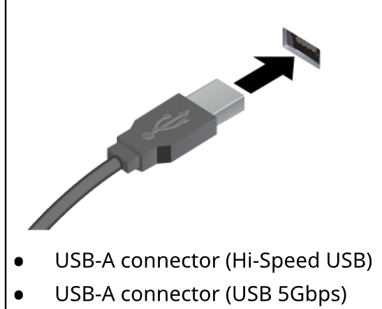

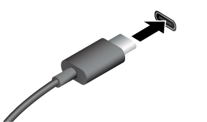

11

Chapter 3 Get started with your computer This chapter introduces the instructions of setting up your computer, various ways to connect to networks, and to interact with your computer. Set up your computer This section helps you to set up your computer and get it ready for use. Turn on the computer Follow the instructions to turn on your computer. 1. Connect the power cord to the ac power adapter. 2. Connect the power adapter to your computer. 3. Plug the power cord into the ac power. 4. Press the power button to turn on your computer. Note: • The appearance varies depending on the computer model. • It is recommended to fully charge the computer when using it for the first time. Click the battery status icon at the bottom right of your desktop to check the battery status. Related topics • [Check the battery status](#pdf-dest-185) on page 27 • [Charge the computer with ac power](#pdf-dest-183) on page 27 Complete the operating system setup Before exploring your computer, you need to complete the operating system setup. The setup includes but is not limited to: • Select the country or region.

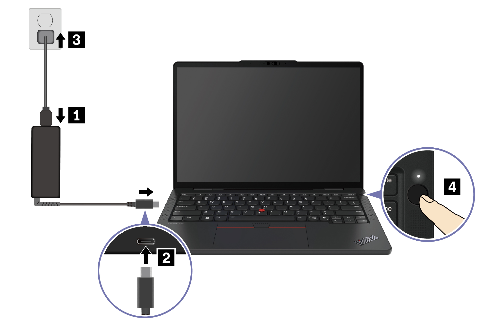

12

• Connect to an available network. • Accept the license agreement. • Create a Microsoft account or log in with your Microsoft account. • Set up your password, fingerprint, or facial recognition as preferred. • Customize your experience. Note: • Depending on the model, some settings might not be available on your computer. • Do not turn off your computer and ensure it is connected to the ac power during the whole process. Follow the instructions to set up the operating system. 1. Connect the computer to the ac power and turn it on. 2. Follow the on-screen instructions to complete the operating system setup. Related topics • [Log in with your fingerprint](#pdf-dest-178) on page 29 • [Log in with facial recognition (for selected models](#pdf-dest-179)) on page 30 • [Set, change, or remove a password](#pdf-dest-186) on page 32 Access networks This section helps you connect to a wireless or wired network. Connect to Wi-Fi networks Click the network icon on the bottom right of your display to connect to an available network. Provide required information, if needed. Note: The wireless LAN module on your computer might support different standards. For some countries or regions, use of 802.11ax/be might be disabled according to local regulations. Turn on Airplane mode You might need to turn on Airplane mode if you board an airplane. When Airplane mode is on, all wireless features are turned off automatically. Click the network icon on the bottom right of your display to turn on Airplane mode. Note: You can enable Wi-Fi networks in this mode according to your actual needs. Connect to the wired Ethernet To connect your computer to a local network, you need a Lenovo USB-C to Ethernet Adapter. Lenovo USB-C to Ethernet Adapter is available as an option and shipped with some computer models. You can purchase one from Lenovo at https://www.lenovo.com/accessories.

13

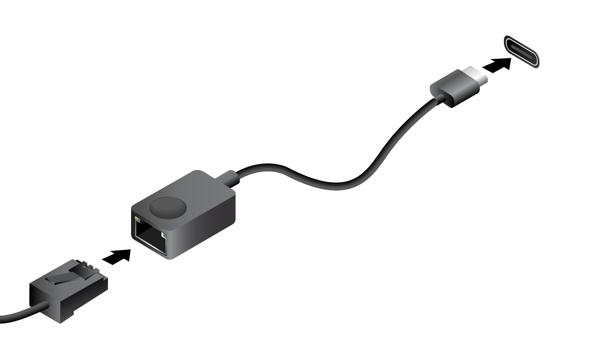

Connect to a cellular network (for selected models) To connect a 5G cellular data network, you must have a wireless wide area network (WWAN) module and a nano-SIM-card installed. The nano-SIM-card might come with your computer by countries or regions. If no nano-SIM-card is shipped, you will need to purchase one from authorized service carriers. Note: • The 5G cellular service is provided by authorized mobile service carriers in some countries or regions. You must have a cellular plan from a service carrier to connect to the cellular network. The cellular data plan might vary by location. • Network connection speeds might also vary by location, environment, network conditions and other factors. Establish a cellular connection This section introduces how to establish a cellular connection. 1. Turn off the computer. 2. Insert a straightened paper clip into the hole in the nano-SIM-card tray. The tray ejects. Install a nano-SIM-card as shown and insert the tray into the nano-SIM-card slot. Note the orientation of the card and ensure that it is seated correctly. 3. Turn on the computer. 4. Click the network icon, and then select the cellular network icon from the list. Provide required information, if needed.

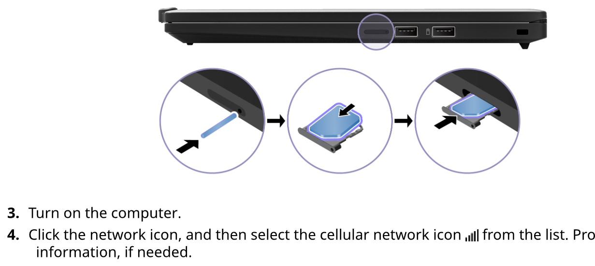

14

Interact with your computer Explore various ways to interact with your computer. Use the keyboard shortcuts Keyboard shortcuts are keys or combinations of keys that provide a quick way to perform particular functions. They help you work more efficiently. The following tables introduce the functions of keyboard shortcuts. FnLock and function keys Key / Key combination Function description Fn + FnLock Switch between the special and standard functions of the function keys (F1–F12). Function keys provide two sets of functions: special function and standard function. Icons on the key denote the special function, such as and . Characters on the key denote the standard function, such as F1 and F2. LED indicator on Esc key indicates which function of the function keys is enabled: • When the indicator is off, the special function is enabled. • When the indicator is on, the standard function is enabled. Mute / Unmute (Speakers). Decrease volume. Increase volume. Enable / Disable the microphone. Decrease screen brightness. Increase screen brightness. Select and set up display devices. Change power mode. For more information about power modes, see [Intelligent Cooling](#pdf-dest-187) on page 3. Print screen. Open Snipping Tool. Open Microsoft® Phone Link. Customize the function of this key on the Vantage app.

15

Other general keyboard shortcuts Key / key combination Function description • Launch Copilot in Windows. • Launch Windows Search. Note: The function varies by countries or regions. Fn+ Open the context menu of the current active app. Fn+ Adjust the keyboard backlight. Fn+ Go to beginning. Fn+ Go to end. Fn+Tab Open Magnifier. Note: Press the Windows logo key + Esc to turn it off. Fn+4 Enter sleep mode. Fn+B Break operation. Fn+K Scroll contents. Fn+P Pause operation. Fn+S Send system request. Fn+N Open system information Window. Fn+G Enable / Disable the tapping gesture to launch TrackPoint Quick Menu. * for selected models You can customize keyboard settings in Vantage app. To customize detailed settings, open the Vantage app, and then click Device > Input & Accessories. For more keyboard shortcuts, go to https://support.lenovo.com/us/en/solutions/windows-support. Use the TrackPoint pointing device The TrackPoint pointing device enables you to perform all the functions of a traditional mouse, such as pointing, clicking, and scrolling.

16

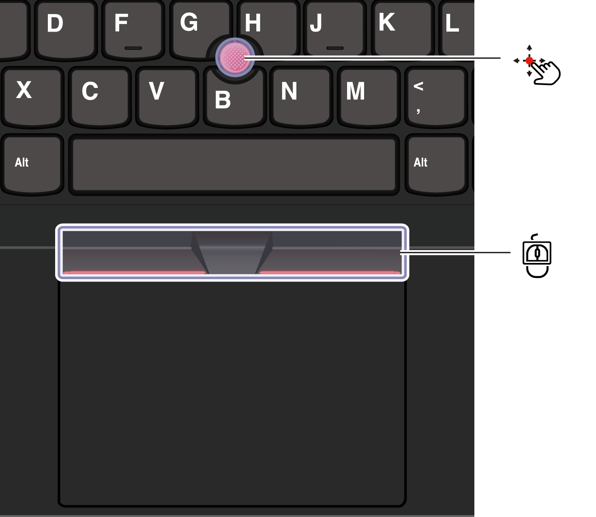

TrackPoint pointing stick Use your finger to apply pressure to the pointing-stick nonslip cap (hereafter referred to as the red cap) in any direction parallel to the keyboard. The pointer on the screen moves accordingly. The higher the pressure applied, the faster the pointer moves. TrackPoint Three Buttons TrackPoint left button and TrackPoint right button correspond to the left and right buttons on a traditional mouse. Press and hold the TrackPoint center button while using your finger to applying pressure to the pointing stick in the vertical or horizontal direction. Then, you can scroll through the document, Web site, or apps. Press Ctrl+TrackPoint center button+TrackPoint pointing stick at the same time to zoom in or zoom out. Disable the TrackPoint pointing device The TrackPoint pointing device is enabled by default. You can disable the device and change settings such as the speed of cursor when using the TrackPoint pointing stick and the TrackPoint center button. To change the settings, do the following: 1. Type Mouse settings in the Windows search box and then press Enter. 2. Click TrackPoint settings and then follow the on-screen instructions to change the settings. Replace the pointing-stick nonslip cap Follow below illustration to replace the pointing-stick nonslip cap. Note: Ensure that the new red cap has grooves a.

17

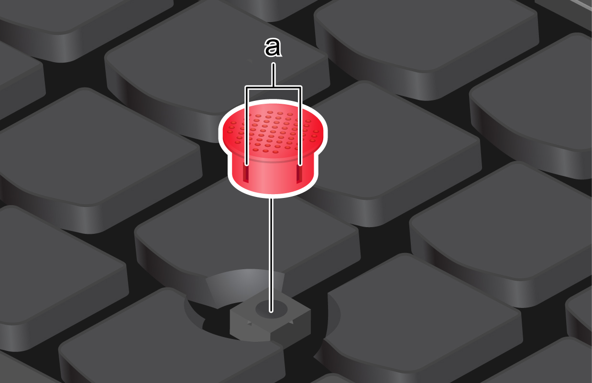

Use the Trackpad You can use the Trackpad to perform all the pointing, clicking, and scrolling functions of a traditional mouse. It is ideal for you to use for occasions with high portability requirements, for example, business trips. Item Description Item Description Left-click zone Right-click zone Note: • Some gestures are not available in the following cases: - if the last action was done from the TrackPoint pointing device. - when you are using certain apps. - when you are using two or more fingers and your fingers are too close. • Trackpad might be insensitive in the following cases: - when you position your fingers too close to the edge of Trackpad. - when you touch the Trackpad with wet fingers. - if the Trackpad surface is stained with water or oil. Turn off the computer first. Then, gently wipe the Trackpad surface with a soft and lint-free cloth that is moistened with lukewarm water or computer cleaner.

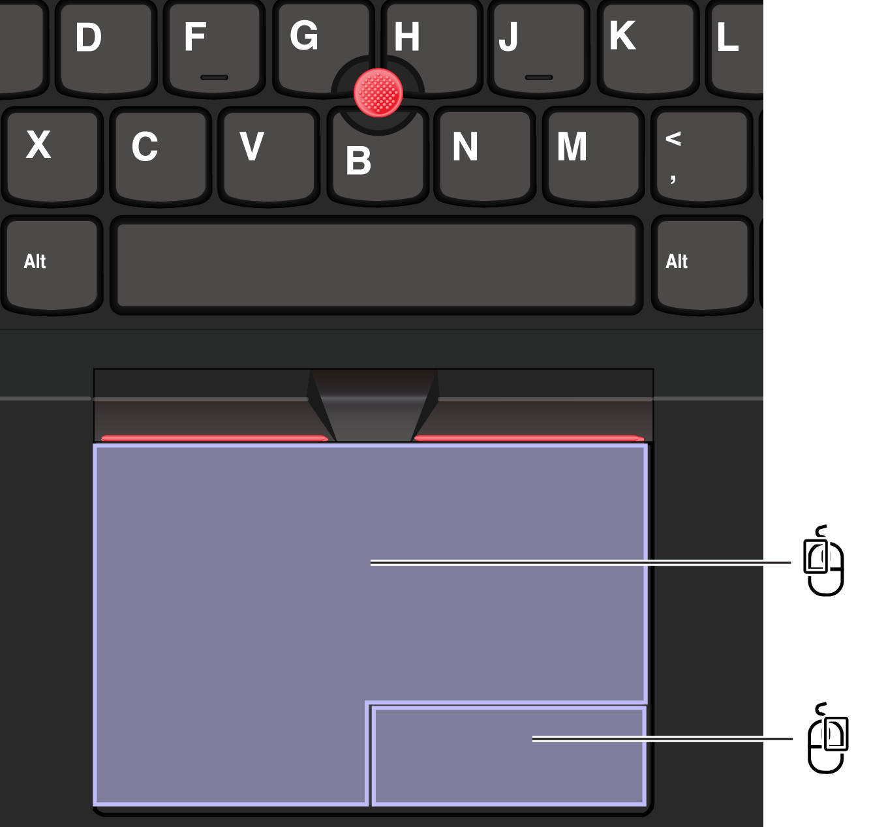

18

Use the touch gestures Note: • When using two or more fingers, ensure that you position your fingers slightly apart. • Some gestures are not available if the last action was done from the TrackPoint pointing device. • Some gestures are only available when you are using certain apps. • If the Trackpad surface is stained with oil, turn off the computer first. Then, gently wipe the Trackpad surface with a soft and lint-free cloth moistened with lukewarm water or computer cleaner. For more gestures, see the help information of the pointing device. One-and-two-finger touch gestures To do this Gesture Select an item. One finger taps once. Open an item. One finger taps twice. Display a shortcut menu. Two fingers tap twice quickly. Zoom in. Two fingers stretch out. Zoom out. Two fingers pinch in.

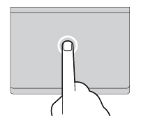

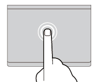

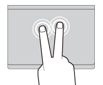

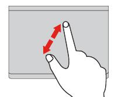

19

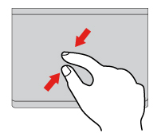

Scroll through items. Two fingers slide horizontally or vertically. Three-and-four-finger touch gestures To do this Gesture Open search window. Three fingers tap once. Open notification center. Four fingers tap once. Show all windows. Three- or four-finger swipes up. Show the desktop. Three- or four-finger swipes down.

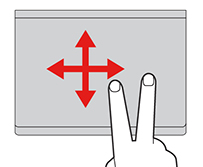

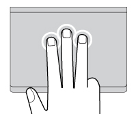

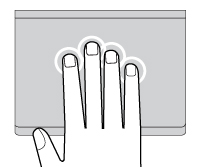

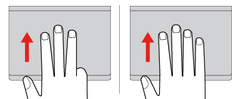

20

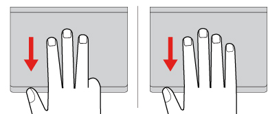

Switch between open apps or windows. Three- or four-finger swipes left or right. Disable the Trackpad The Trackpad is enabled by default. To disable the device: 1. Open the Start menu, and then click Settings > Bluetooth & devices > Touchpad. 2. In the Touchpad section, turn off the Touchpad control. Use the touch screen (for selected models) For computers with a touch-enabled screen, you can touch the screen directly with your fingers and interact with computer in a simple way. The following sections introduce frequently used touch gestures. Note: • Some gestures might not be available when you are using certain apps. • Do not use gloved fingers or incompatible pens for input on the screen. Otherwise, the touch screen might be not sensitive or does not respond. • The touch screen is delicate. Do not apply pressure on the screen or touch the screen with anything hard or sharp. Otherwise, the touch panel might malfunction or get damaged. One-finger touch gesture To do this Gesture Open a shortcut menu. Tap and hold. Open the widget panel. Swipe from the left.

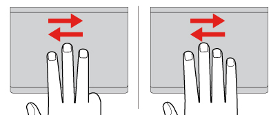

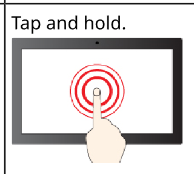

21

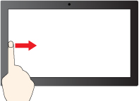

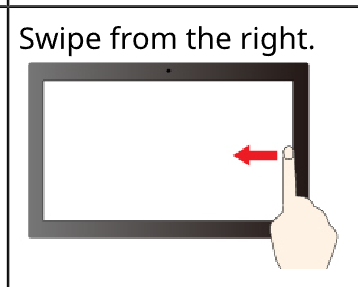

Open notification center. Swipe from the right. Two-finger touch gesture To do this Gesture Zoom out. Move two fingers towards. Zoom in. Spread two fingers apart. Three-and-four-finger touch gesture To do this Gesture Show all open windows. Swipe with three fingers up. Show the desktop. Swipe with three fingers down.

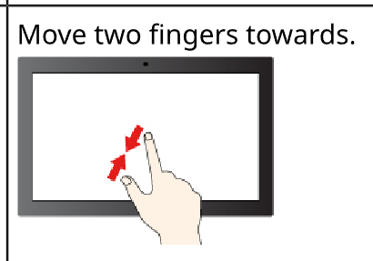

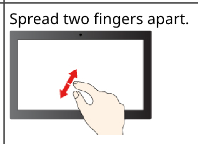

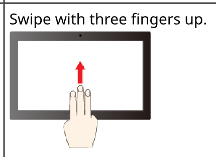

22

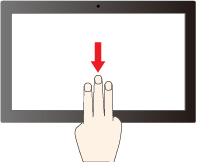

Switch apps. Swipe with three fingers to the left or right. Switch desktops. Swipe with four fingers to the left or right. Enable three-and-four-finger touch gestures (for selected models) 1. Type touch gesture in the Windows search box and then press Enter. 2. Turn on the Three- and four-finger touch gestures switch. Connect to an external display Connect your computer to a projector or a monitor to give presentations or expand your workspace. Connect to a wired display You can connect a wired display with your computer through the USB-C connector or HDMI connector. If your computer cannot detect the external display, right-click a blank area on the desktop and select Display settings. Then follow the on-screen instructions to detect the external display.

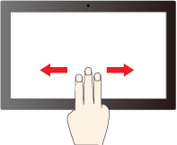

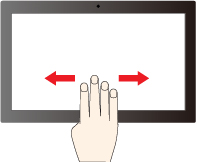

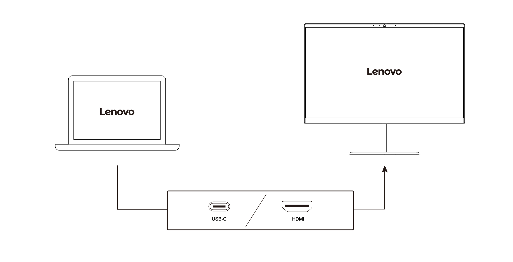

23

Supported resolution The following table lists the supported maximum resolution of the external display. Connect the external display to Supported resolution USB-C connector Up to 5K / 60 Hz HDMI™ connector Up to 4K / 60 Hz Note: The refresh rate higher than 60 Hz can also be supported. If you set the refresh rate higher than 60 Hz, the maximum resolution might be limited. Connect to a wireless display To use a wireless display, ensure that both your computer and the external display support the Miracast® feature. Press Windows logo key+K and then select a wireless display to connect with. Set the display mode Press or Fn key+ and then select a display mode of your preference. Change display settings You can change the settings for both the computer display and the external display, such as the main or the secondary display, brightness, resolution, and orientation. To change the settings, do the following: 1. Right-click a blank area on the desktop and select Display settings. 2. Select the display that you want to configure and change display settings of your preference. Connect to a Bluetooth device You can connect all types of Bluetooth-enabled devices to your computer, such as a keyboard, a mouse, a smartphone, or speakers. To ensure successful connection, place the devices at most 10 meters (33 feet) from the computer. Conventional pair This topic helps you connect to a Bluetooth device by conventional pair. 1. Type Bluetooth in the Windows search box and then press Enter. 2. Turn on both the Bluetooth on your computer and the Bluetooth device. Make sure the device is discoverable. 3. Select the device when it is displayed on the Add device list, and then follow the on-screen instructions. Swift pair This topic helps you connect to a Bluetooth device by swift pair. If your Bluetooth device supports swift pair, do the following:

24

1. Enable swift pair notification on Bluetooth settings page. 2. Turn on both the Bluetooth on your computer and the Bluetooth device. Make sure the device is discoverable. 3. Click Connect when a swift pair notification appears on your computer. Lenovo apps This section introduces Lenovo apps that can enrich your computing experience and improve productivity. Lenovo Commercial Vantage The Lenovo Commercial Vantage app (hereafter referred to as Vantage app) is a customized one-stop solution to help you maintain your computer with automated updates and fixes, configure hardware settings, and get personalized support. To access the Vantage app, type Lenovo Commercial Vantage in the Windows search box. Note: • The available features vary depending on the computer model. • The Vantage app makes periodic updates of the features to keep improving your experience with your computer. The description of features might be different from that on your actual user interface. Ensure that you use the latest version of Vantage app, and apply Windows Update to get the latest updates. The Vantage app enables you to: • Know the device status easily and customize device settings. • Download and install UEFI BIOS, firmware, and driver updates to keep your computer up-to-date. • Monitor your computer health, and secure your computer against outside threats. • Scan your computer hardware and diagnose hardware problems. • Look up warranty status (online). • Access User Guide and helpful articles. • Temporarily disable the keyboard, screen, Trackpad, and TrackPoint pointing device for cleaning. TrackPoint Quick Menu TrackPoint Quick Menu is a clickable app. It offers rapid access to functions, such as camera and microphone. You can adjust the function settings in this app. Launch the TrackPoint Quick Menu Double-tap the TrackPoint pointing stick to launch the TrackPoint Quick Menu. You can also set single-tapping as the launch gesture. Note: If the TrackPoint Quick Menu does not pop up after you use the launch gesture, this case might be caused by the displacement of the TrackPoint pointing stick due to too much force applied on it. Wait 15 to 30 seconds and try again. To change the settings, do the following: 1. Click the flyout and click ADVANCED SETTINGS.

25

2. Select Single-tapping under TrackPoint Quick Menu Launch. The TrackPoint Quick Menu is enabled by default. Press Fn+G to disable or enable the tapping gesture. When disabled, it cannot be launched by tapping the TrackPoint pointing stick. Use the TrackPoint Quick Menu You can click the edit button to rearrange the features in the preview panel, or drag and drop the features on the right to the preview panel to customize your quick menu. • Camera You can adjust the brightness and contrast of the camera, and restore the settings to default by tapping the reset button . • Microphone You can mute your computer, and adjust the sound effect of your microphone by selecting the following modes: - Center mode: Capture the speaker’s voice. - Spatial mode: Capture the speaker’s voice and the ambience. Note: When internal microphone is not supported by Dolby or the Dolby driver is disabled, an input device list will be displayed instead. The list provides options and one volume bar to test your microphone. • Voice typing You can convert the speech to text in the text box. Click START VOICE TYPING to invoke the text box. • Battery You can extend the battery lifespan and health by setting the charging threshold below 100%. To set the threshold, enable the feature and click ADJUST THRESHOLD. Then set the charge threshold in the Vantage app. • Audio playback You can select the output device of your preference and set the volume of your selected channel or mute it. • Noise suppression You can suppress your own background noise and the noise from other meeting participants.

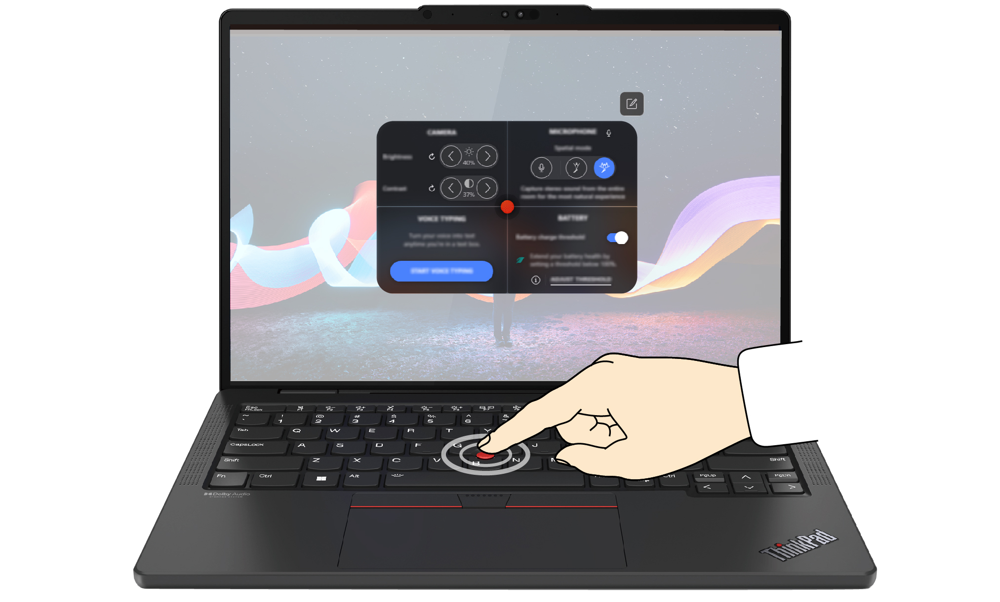

26

- Off: Disable noise suppression. - Low: Suppress low-level background noise. - High: Suppress all non-speech background noise. • Quick Clean You can temporarily disable the keyboard, screen, Trackpad, and TrackPoint pointing device to clean your computer. Note: The features might vary due to periodic updates. For details of the version installed on your computer, click the flyout at the top-right corner of the page and click LEARN MORE. Color calibration (for selected models) The factory color calibration feature is available on computer models with the embedded display. This feature enables you to render color images or graphics on your display close to the original intent as much as possible. For computer with the factory color calibration feature, the AICCP color profiles are preinstalled. You can switch between calibrated color profiles and non-calibrated color profiles as desired: 1. Open the Start menu, and then click Settings > Display. 2. Follow the on-screen instructions to select a color profile as desired. Note: The calibration data is stored in the embedded display nonvolatile memory. It can be restored after you reset the computer. Manage power Use the information in this section to achieve the best balance between performance and power efficiency. Check the battery status Check the battery status to help use computer properly. Go to Settings > System to check the battery status. For more details about your battery, refer to the Vantage app. Charge the computer with ac power Power source of the ac power adapter: • Power: 65 W • Sine-wave input at 50 Hz to 60 Hz • Input rating of the ac power adapter: 100 V to 240 V ac, 50 Hz to 60 Hz • Output rating of the ac power adapter: 20 V dc, 3.25 A When the battery power is low, charge your battery by connecting your computer to ac power with the supplied power adapter. The 65 W ac power adapter supports the rapid charge function, the battery is 80% charged in about one hour when the computer is turned off. The actual charging time depends on the battery size, the physical environment, and whether you are using the computer.

27

Battery charging is also affected by its temperature. The recommended temperature range for charging the battery is between 10°C (50°F) and 35°C (95°F). Note: Some models might not ship with ac adapters or power cords. Use only the certified adapters and power cords that comply with the requirements of relevant national standards (such as UL/EN/IEC 62368-1) to charge the product. It is recommended to use the Lenovo qualified adapters. Unqualified adapters may cause hazards. You can refer to https://www.lenovo.com/ us/en/compliance/eu-doc. Maximize the life of the battery Follow the instructions to maximize the life of the battery. • Use the battery until the charge is depleted and recharge the battery completely before using it. Once the battery is fully charged, it must discharge to 94% or lower before it will be allowed to recharge again. • Keep the battery from full charge when it is not in heavy use. For more information, refer to the Battery settings tab in the Power section of the Vantage app. • The battery might optimize its full charge capacity based on your usage. After prolonged periods of limited use, full battery capacity might not be available until you discharge to as low as 20% and recharge completely. For more information, refer to the Battery settings tab in the Power section of the Vantage app. Change the power settings Follow the instructions to change the power settings of your preference. For ENERGY STAR® compliant computers, the following power plan takes effect by default when your computer is on ac power and has been idle for a specified duration: • Turn off the display: After 5 minutes • Put the computer to sleep: After 5 minutes To change the power plan, the power button function and other settings, do the following: 1. Go to Control Panel and view by Large icons or Small icons. 2. Click Power Options. 3. Change the settings as you prefer. Purchase accessories or additional services This topic provides instructions on how to purchase accessories or additional services.

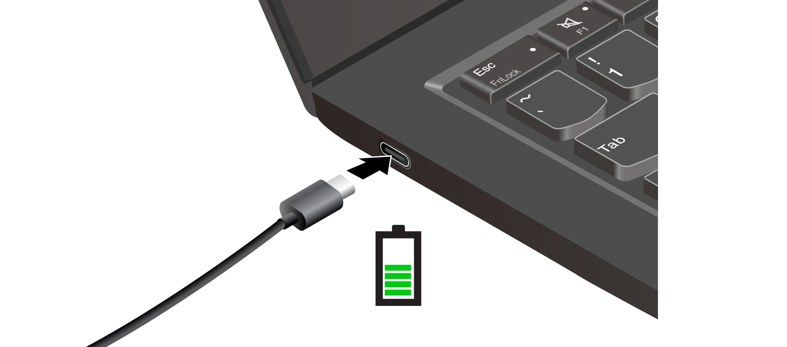

28

Accessories Lenovo has a number of hardware accessories and upgrades to help expand the functionality of your computer. Accessories include memory modules, storage devices, network cards, power adapters, keyboards, mice, and so on. You can purchase Lenovo accessories at https://www.lenovo.com/ accessories. Additional services During and after the warranty period, you can purchase additional services from Lenovo at https:// pcsupport.lenovo.com/warrantyupgrade. Service availability and service names might vary by country or region. Secure your computer and information Your computer can safeguard your privacy and information through some privacy protection functions. Lock the computer Lock your computer to a desk, table, or other fixtures through a compatible security cable lock. Note: You are responsible for evaluating, selecting, and implementing the locking device and security feature. Lenovo is not responsible for the locking device and security feature. You can purchase the cable locks at https://smartfind.lenovo.com. Log in with fingerprint recognition The fingerprint reader is integrated with the power button. You can power on and log in to the computer with your fingerprint. It eliminates the need to enter complex passwords, saving your time and boosting your productivity. To enroll your fingerprints, do the following: 1. Type Sign-in options in the Windows search box and then press Enter. 2. Select Fingerprint recognition (Windows Hello) and then follow the on-screen instruction to enroll your fingerprint. Note: It is recommended that you put your finger at the center of the power button during enrollment and enroll more than one fingerprint in case of any injuries to your fingers.

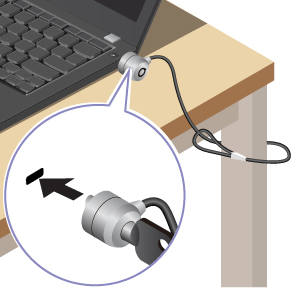

29

After the enrollment, the fingerprints are associated with the Windows password automatically. 3. Log in with your fingerprint. When the fingerprint reader indicator is solid green, tap your finger on the fingerprint reader for authentication. Note: You can associate your fingerprints with your power-on password and NVMe password. See [Associate your fingerprints with passwords (for selected models](#pdf-dest-188)) on page 33. Maintenance tips: • Do not scratch the surface of the reader with anything hard or sharp. • Do not use or touch the reader with a wet, dirty, wrinkled, or injured finger. Log in with facial recognition You can log in to the computer with your facial recognition. It provides precise and secure authentication. For models come with a webcam privacy shutter, slide the webcam privacy shutter to uncover the camera lens before using the Windows Hello face recognition. Set up facial recognition and unlock your computer by scanning your face: 1. Type Sign-in options in the Windows search box and then press Enter. 2. Select Facial recognition (Windows Hello) and then follow the on-screen instruction to enroll your facial ID. Protect data against power loss NVMe (Non-Volatile Memory express) M.2 solid-state drive features the Lenovo-unique PLP (Power Loss Protection) function to avoid data loss or damage. If your computer is not responding and you might have to shut down your computer by pressing and holding the power button for several seconds. In this case, the PLP function enables your computer data to be saved timely. However, there is no guarantee that all data is saved in any situation. To check the type of your M.2 solid-state drive: 1. Restart the computer. When the logo screen is displayed, press F10 to enter the Lenovo diagnostics window. 2. On the TOOLS tab, select SYSTEM INFORMATION > STORAGE using the arrow keys. 3. Locate the Device Type section to check the information. UEFI BIOS passwords You can set passwords in UEFI (Unified Extensible Firmware Interface) BIOS (Basic Input/Output System) to strengthen the security of your computer.

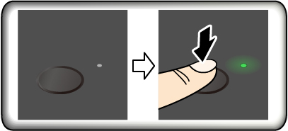

30

Password types You can set a power-on password, supervisor password, system management password, or NVMe password in UEFI BIOS to prevent unauthorized access to your computer. However, you are not prompted to enter any UEFI BIOS password when your computer resumes from sleep mode. Power-on password If you set a power-on password, a window is displayed on the screen when you turn on the computer. Enter the correct password to use the computer. Supervisor password The supervisor password protects the system information stored in UEFI BIOS. When entering the UEFI BIOS menu, enter the correct supervisor password in the window prompted. You also can press Enter to skip the password prompt. However, you cannot change most of the system configuration options in UEFI BIOS. If you have set both the supervisor password and power-on password, you can use the supervisor password to access your computer when you turn it on. The supervisor password overrides the power-on password. NVMe passwords The NVMe password prevents unauthorized access to the data on the storage drive. When an NVMe password is set, you are prompted to type a correct password each time you try to access the storage drive. • Single Password When a Single NVMe password is set, the user must enter the user NVMe password to access files and applications on the storage drive. • Dual Password (User+Admin) The admin NVMe password is set and used by a system administrator. It enables the administrator to access any storage drive in a system or any computer connected in the same network. The administrator can also assign a user NVMe password for each computer in the network. The user of the computer can change the user NVMe password as desired, but only the administrator can remove the user NVMe password. When prompted to enter an NVMe password, press F1 to switch between the admin NVMe password and user NVMe password. Note: The NVMe password is not available in the following situations: • A Trusted Computing Group (TCG) Opal-compliant storage drive and a TCG Opal management software program are installed in the computer, and the TCG Opal management software program is activated. • An eDrive storage drive is installed in the computer preinstalled with the Windows operating system. System management password The system management password can also protect the system information stored in UEFI BIOS like a supervisor password, but it has lower authority by default. The system management password can be set through the UEFI BIOS menu or through Windows Management Instrumentation (WMI) with the Lenovo client-management interface.

31

You can enable the system management password to have the same authority as the supervisor password to control security-related features. To customize the authority of the system management password through the UEFI BIOS menu: 1. Restart the computer. When the logo screen is displayed, press F1 to enter the UEFI BIOS menu. 2. Select Security > Password > System Management Password Access Control. 3. Follow the on-screen instructions. If you have set both the supervisor password and the system management password, the supervisor password overrides the system management password. If you have set both the system management password and the power-on password, the system management password overrides the power-on password. Set, change, or remove a password Follow the instructions to set, change or remove a password. Before you start, print these instructions. 1. Restart the computer. When the logo screen is displayed, press F1 to enter the UEFI BIOS menu. 2. Select Security > Password by using the arrow keys. 3. Select the password type. Then, follow the on-screen instructions to set, change, or remove a password. You should record all your passwords and store them in a safe place. If you forget any of your passwords, any potential repair actions required are not covered under warranty. What to do if you forget your power-on password Follow the instructions to remove the power-on password if you forget your power-on password. If you have set a supervisor password or a system management password and remember it: 1. Restart the computer. When the logo screen is displayed, immediately press F1. 2. Type the supervisor password or the system management password to enter the UEFI BIOS menu. 3. Select Security > Password > Power-On Password by using the arrow keys. 4. Type the current supervisor password or the system management password in the Enter Current Password field. Then, leave the Enter New Password field blank, and press Enter twice. 5. In the Changes have been saved window, press Enter. 6. Press F10 to save changes and exit the UEFI BIOS menu. If you have not set a supervisor password or a system management password, contact a Lenovo-authorized service provider to have the power-on password removed. What to do if you forget your system management password Follow the instructions to remove the system management password if you forget your system management password. If you have set a supervisor password and remember it: 1. Restart the computer. When the logo screen is displayed, immediately press F1. 2. Type the supervisor password to enter the UEFI BIOS menu. 3. Select Security > Password > System Management Password by using the arrow keys. 4. Type the current supervisor password in the Enter Current Password field. Then, leave the Enter New Password field blank, and press Enter twice. 5. In the Changes have been saved window, press Enter. 6. Press F10 to save changes and exit the UEFI BIOS menu.

32

If you have not set a supervisor password, contact a Lenovo-authorized service provider to have the system management password removed. What to do if you forget your NVMe password Follow the instructions to remove the NVMe password if you forget your NVMe password. If you forget your NVMe password (Single password) or both user and admin NVMe passwords (Dual password), Lenovo cannot reset your passwords or recover data from the storage drive. You can contact a Lenovo-authorized service provider to have the storage drive replaced. A fee will be charged for parts and service. If the storage drive is a CRU (Customer Replaceable Unit), you can also contact Lenovo to purchase a new storage drive to replace the old one by yourself. To check whether the storage drive is a CRU and the relevant replacement procedure, see [CRU list](#pdf-dest-189) on page 75. What to do if you forget your supervisor password There is no service procedure to remove the password. You can contact a Lenovo-authorized service provider to have the system board replaced. A fee will be charged for parts and service. Associate your fingerprints with passwords (for selected models) You can associate the fingerprints with passwords to get quick access to the computer and the data on the storage drive without entering the power-on password or NVMe password. Do the following to associate your fingerprints with the power-on password and NVMe password: 1. Turn off and then turn on the computer. 2. When prompted, scan your finger on the fingerprint reader. 3. Enter your power-on password, NVMe password, or both as required. The association is established. When you start the computer again, you can use your fingerprints to log in to the computer without entering your Windows password, power-on password, or NVMe password. To change settings, press F1 to enter the UEFI BIOS menu, and then select Security > Fingerprint. Attention: If you always use your fingerprint to log in to the computer, you might forget your passwords. Write down your passwords, and keep them in a safe place. FIDO (Fast Identity Online) authentication Your computer supports FIDO (Fast Identity Online) authentication feature. This feature works as an alternative to password-based authentication to achieve passwordless authentication. This feature only works when a power-on password is set in UEFI BIOS and the FIDO2 USB device is registered in ThinkShield™ Passwordless Power-On Device Manager. With this feature, you can input the power-on password or use the registered FIDO2 USB device to power on your computer. Register FIDO2 USB device in ThinkShield Passwordless Power-On Device Manager Follow the instructions to register FIDO2 USB device in ThinkShield Passwordless Power-On Device Manager. 1. Turn on the computer. 2. Press F12 during the power-on process. 3. If you set a power-on password, you are prompted to enter the correct password. 4. Select App Menu > ThinkShield Passwordless Power-On Device Manager and press Enter 5. Insert the FIDO2 USB device to register the device by following steps: a. Select the available FIDO2 USB device that you want to register in the Discovered Devices field.

33

b. Click Yes in the displayed window to confirm the device you selected c. If you set a power-on password, you are prompted to enter the correct password. d. The User operation request window is displayed. You are prompted to press the button on the connected FIDO2 USB device, and then follow the on-screen instructions to close the window. e. Press Esc to exit and restart your computer. Note: • If you want to unregister your devices, click the available FIDO2 USB device that you want to unregister in the My Device field and enter the correct power-on password for verification. • If you use more than one FIDO2 USB device with a common identifier for registration, only one device is available. Log in to the System with Passwordless Power-On Authentication Follow the instructions to log in to the System with Passwordless Power-On Authentication. 1. Restart the computer. 2. ThinkShield Passwordless Power-On Authentication window is displayed. 3. Insert your registered FIDO2 USB device for detection. 4. Then follow the on-screen instructions to press the button on your FIDO2 USB device for verification. 5. After your device is verified, the power-on process continues. Note: You should insert the FIDO2 USB device or enter the power-on password within 60 seconds. Otherwise, your computer will shut down automatically.

34

Chapter 4 UEFI BIOS UEFI BIOS is the first program that the computer runs. When the computer turns on, the UEFI BIOS performs a self test to make sure that various devices in the computer are functioning properly. Enter the UEFI BIOS menu Turn on or restart the computer. When the logo screen is displayed, press F1 repeatedly to enter the UEFI BIOS menu. Navigate the UEFI BIOS menu Follow the on-screen instructions to navigate in the UEFI BIOS menu. The table below introduces some available settings of the UEFI BIOS menu. To know more about the UEFI BIOS, for example, BIOS Event log, you can go to https://pcsupport.lenovo.com and then type UEFI BIOS in search box. Note: The UEFI BIOS menu might vary depending on system configurations. Menu Introduction Main This category displays the general product-related information, such as UEFI BIOS version, machine type, system serial number, preinstalled OS license, and BIOS Event log. Config This category enables you to update configurations relating to system settings such as network, USB, keyboard, display, CPU, and power. Date/Time This category enables you to set computer date and time in this category. Security This category enables you to configure security settings related to such as password, fingerprint, and I/O accessibility. Startup This category enables you to manage settings relevant to booting up. Restart This category enables you to save or discard changes before exiting. You can go to Lenovo BIOS Simulator Center https://download.lenovo.com/bsco/index.html to explore the detailed settings by your product name. Note: The Lenovo BIOS Simulator Center makes periodic updates of the settings. The UEFI BIOS simulator interface and description of settings might be different from that on your actual user interface.

35

Customize BIOS Defaults The feature provides a solution to backup your preferred BIOS Setup settings. It helps you to save the BIOS Setup settings as customized BIOS default settings, load them to current BIOS settings when needed, and reset the settings to Setup Defaults. Save the customized settings configuration Follow the instructions to save the customized settings configuration. 1. Restart the computer. When the logo screen is displayed, press F1 to enter the UEFI BIOS menu. 2. Select Restart > Save Custom Defaults. 3. Click Yes to save the settings configuration you customized. Load the customized settings configuration Follow the instructions to load the customized settings configuration. 1. Restart the computer. When the logo screen is displayed, press F1 to enter the UEFI BIOS menu. 2. Select Restart > Load Custom Defaults. 3. Click Yes to load the customized settings configuration you saved. You can also press F9 and click Custom Defaults to load the customized settings configuration. Note: Load Custom Defaults is unavailable if no customized BIOS default settings are saved. Reset the settings configuration to Setup Defaults Follow the instructions to reset the settings configuration to Setup Defaults. 1. Restart the computer. When the logo screen is displayed, press F1 to enter the UEFI BIOS menu. 2. Select Restart > Load Factory Defaults. 3. Click Yes to reset the settings configuration to Setup Defaults. You can also press F9 and click Factory Defaults to reset the settings configuration to Setup Defaults. Detect memory retraining Memory retraining is a process to initialize the memory module and run diagnostic tests for the memory module in your computer. The memory retraining might occur during POST if any of the following situations is detected: • Memory module replacement • Total Memory Encryption setting change in the UEFI BIOS • Memory Reference Code (MRC) change when the UEFI BIOS updates When memory retraining occurs, the screen might be blank. You might see the LED indicators on Esc, F1, and F4 blinking sequentially to indicate the progress. Do not press the power button to interrupt the process. Wait a few minutes until the logo screen is displayed.

36

Chapter 5 Frequently asked questions This chapter provides solutions to some hardware and software issues. Camera problems My camera can’t be launched or found Problem: What should I do if my camera can’t be launched or found? Solution: If your camera can’t be launched or found, try the following solutions one by one to troubleshoot and fix the issue: 1. If you are using an external camera, ensure that it is connected to a working USB connector on your computer. 2. If you are using an integrated camera, ensure that it is uncovered and enabled. Take the following steps: a. Open the camera shutter. b. Open the Start menu, click Settings > Bluetooth & devices > Cameras, and enable the camera. 3. Authorize apps to have access to the camera. Take the following steps: a. Open the Start menu, and select Settings > Privacy & security > Camera. b. Turn on Camera access switch and Let apps access your camera switch. 4. Unblock access to the camera in your antivirus software settings. 5. Update the camera driver. Take the following steps: a. Type device manager in the Windows search box and then press Enter. b. Click Device Manager from the list of results. The Device Manager window opens. c. Click arrow icon > next to Camera to expand the section. d. Right-click the camera that you would like to update. e. Select Update driver and follow the on-screen instructions. 6. Run the automated camera troubleshooter in the Get Help app. Take the following steps: a. Open the Start menu and click Settings > Privacy & security > Camera. b. Scroll down to the bottom. Click Get help and follow the on-screen instructions. If the problem persists, do not hesitate to contact Lenovo. For details, go to https://pcsupport. lenovo.com/contact-us. Keyboard problems My keyboard does not work Problem: What should I do if my keyboard does not work? Solution: If your keyboard does not work or types wrong characters, try the following solutions one by one to troubleshoot and fix the issue: 1. Ensure that the keyboard is well connected. • If you are using a wired keyboard, check if it is connected to your computer correctly or try to connect the keyboard to another compatible connector on your computer.

37

• If you are using a wireless keyboard, ensure that your keyboard is powered on. Check if the dongle is connected to your computer correctly or the Bluetooth connection with your computer is established. 2. Ensure that the keyboard layout settings are correct. Take the following steps: a. Go to Settings > Time & language > Language & region. b. Under Preferred languages, click on the three horizontal dots next to your primary language preference and select Language options. c. Under Installed keyboards, check the keyboard layout and add the corresponding keyboard if you’re not using the right one. 3. Ensure that the keyboard is in good status. Take the following steps: a. Type device manager in the Windows search box and then press Enter. b. Click Device Manager from the list of results. The Device Manager window opens. c. Click arrow icon > next to Keyboard to expand the section. d. Double-click the keyboard that is not working and check the status. e. If it is not working properly, select Driver from the tabs on the top and click Uninstall device to uninstall the device. f. Apply Windows Update to install the latest driver automatically. 4. Ensure that the sticky keys and filter keys are disabled. Take the following steps: a. Open the Start menu, and click Settings > Accessibility > Keyboard. b. Disable Sticky keys switch and Filter keys switch. 5. Clean the keyboard. • For external keyboard, take the following steps: a. Disconnect your keyboard. b. Turn the keyboard upside down and gently shake it. c. Use compressed air to blow out the dirt and debris from underneath the keys. d. Use a cotton swab dipped in rubbing alcohol to remove stickiness around and underneath stuck keys. • For integrated keyboard, take the following steps: a. Turn off your computer. b. Use compressed air to blow out the dirt and debris from underneath the keys. c. Use a cotton swab dipped in rubbing alcohol to remove stickiness around and underneath stuck keys. 6. Restart your computer. If the problem persists, do not hesitate to contact Lenovo. For details, go to https://pcsupport. lenovo.com/contact-us. My keyboard backlight does not work Problem: What should I do if my keyboard backlight does not work? Solution: If your keyboard backlight does not work, try the following solutions one by one to troubleshoot and fix the issue: 1. Turn on or adjust the keyboard backlight by pressing the key combination Fn+space. 2. Update the keyboard driver. Take the following steps: a. Type device manager in the Windows search box and then press Enter. b. Click Device Manager from the list of results. The Device Manager window opens. c. Click arrow icon > next to Keyboard to expand the section. d. Right-click the keyboard you would like to update. e. Select Update driver and follow the on-screen instructions.

38

If the problem persists, do not hesitate to contact Lenovo. For details, go to https://pcsupport. lenovo.com/contact-us. Mouse problems My mouse does not work Problem: What should I do if my mouse does not work? Solution: If you encounter mouse problems such as mouse not responding or mouse cursor disappearing, try the following solutions one by one to troubleshoot and fix the issue: 1. Ensure the power switch on your mouse in turned on. 2. If you are using a wireless mouse, try the following solutions one by one: • Ensure that the battery power is enough for working. • If it is connected through a USB dongle, ensure that the USB dongle is connected to a working USB connector of your computer. The USB dongle is usually stored within the battery compartment of the mouse. • If it is a Bluetooth mouse, ensure that the Bluetooth connection with your computer is correct. If there is a Bluetooth connection problem, refer to “Bluetooth connection problems” in this User Guide . 3. If you are using a wired mouse, try the following solutions one by one: • Connect it to a working USB connector on your computer correctly. • Connect another wired mouse to the same USB connector. If it is connected correctly and works well, there may be something wrong with the original mouse. 4. Update the mouse driver. Take the following steps: a. Type device manager in the Windows search box. b. Click Device Manager from the list of results. The Device Manager window opens. c. Click arrow icon > next to Mice and other pointing devices to expand the section. d. Right-click the mouse driver, click Update driver, and then follow the on-screen instructions to update the driver. If the problem persists, do not hesitate to contact Lenovo. For details, go to https://pcsupport. lenovo.com/contact-us. Touchpad or trackpad problems My touchpad or trackpad does not respond Problem: What should I do if my touchpad or trackpad does not respond? Solution: If your touchpad or trackpad is not responding, try the following solutions one by one to troubleshoot and fix the issue: 1. Enable the touchpad. Take the following steps: a. Go to Start > Settings > Bluetooth & devices > Touchpad. b. Turn on the Touchpad toggle. Note: For some Lenovo computers, you can also press the touchpad hotkey or the key combination Fn+M to enable or disable the touchpad.

39

2. Update the touchpad driver. Take the following steps: a. Type device Manager in the Windows search box and then press Enter. b. Click the arrow next to Human Interface Devices to expand the section. c. Right-click the touchpad, select Update driver, and follow the on-screen instructions. 3. Roll back the touchpad driver. Take the following steps: a. Type device Manager in the Windows search box and then press Enter. b. Click the arrow icon > next to Human Interface Devices to expand the section. c. Right-click the touchpad, and select Properties. d. Under Driver, select Roll Back Driver and follow the on-screen instructions. If the problem persists, do not hesitate to contact Lenovo. For details, go to https://pcsupport. lenovo.com/contact-us. My touchpad or trackpad responds slowly Problem: What should I do if my touchpad or trackpad responds slowly? Solution: If your touchpad or trackpad response is very slow, take the following steps to troubleshoot and fix the issue: 1. Go to Start > Settings > Bluetooth & devices > Touchpad. 2. Adjust the cursor speed. 3. Under Taps, adjust the touchpad or trackpad sensitivity. If the problem persists, do not hesitate to contact Lenovo. For details, go to https://pcsupport. lenovo.com/contact-us. Audio problems The audio does not work Problem: What should I do if the audio does not work? Solution: If you encounter any audio problems, such as no audio or malfunctioning audio, try the following solutions one by one to troubleshoot and fix the issue: 1. If you are using an external audio device, ensure that the device is properly connected to your computer. 2. Verify your audio settings. Take the following steps: a. Go to Start > Settings > System > Sound. b. Verify that the sound output and input devices are selected correctly. c. Verify that the volume is properly set and your computer is not muted. 3. Run the audio troubleshooter. Take the following steps: a. Go to Start > Settings > System > Sound. b. Under Advanced, find Troubleshoot common sound problems, and click Output devices or Input devices to troubleshoot and fix the problem. For more solutions to audio problems, go to https://support.lenovo.com/solutions/ht501860. If the problem persists, do not hesitate to contact Lenovo. For details, go to https://pcsupport. lenovo.com/contact-us. Display problems

40

Blue screen Problem: How to troubleshoot blue screen errors? Solution: To troubleshoot blue screen errors, take the following steps: 1. Type get help in the Windows search box and then press Enter. 2. In the search box of the Get Help app, type troubleshoot BSOD error. 3. Follow the guided walkthrough. If the problem persists, do not hesitate to contact Lenovo. For details, go to https://pcsupport. lenovo.com/contact-us. Black screen Problem: How to troubleshoot black screen issues? Solution: To troubleshoot black screen errors, try the following solutions one by one: 1. Update the Windows operating system. Take the following steps: a. Press the Windows logo key+Ctrl+Shift+B to wake your computer from the black screen. b. Select the Start menu on the taskbar and then select Settings. c. Select Windows Updates and then select Check for updates. If updates are available, download and install them. 2. Update the mouse and keyboard drivers. Take the following steps: a. Press the Windows logo key+Ctrl+Shift+B to wake your computer from the black screen. b. Type device manager in the Windows search box and then press Enter. c. Under Keyboards, select HID Keyboard Device. d. Select the Power Management tab and then check Allow this device to wake the computer. e. Under Keyboards, select HID Keyboard Device, and then select Update driver. f. Select Search automatically for drivers and then follow the on-screen instructions to confirm the best available driver is installed. Note: If there is more than one HID keyboard device listed, perform steps c˗f for each device. g. Repeat steps c˗f for Mice and other pointing devices. Note: If there is more than one HID-compliant mouse device listed, perform steps c–f for each device. If the problem persists, do not hesitate to contact Lenovo. For details, go to https://pcsupport. lenovo.com/contact-us. Screen flickering Problem: What should I do if my screen flickers? Solution: If your screen flickers, take the following steps: 1. Check whether Task Manager also flickers. To open Task Manager, press Ctrl+Alt+Delete or Ctrl+Shift+Esc. 2. If Task Manager also flickers, roll back your display driver. Take the following steps: a. Type device manager in the Windows search box and then press Enter. b. Under Display adapters, select a display adapter. c. Click the Driver tab and then select Roll Back Driver.

41

d. Click Yes to roll back your display driver and restart your computer. Note: If the Roll Back Driver option is unavailable, Windows does not have a previous driver to roll back to. In this scenario, you can try updating or uninstalling your display driver in the Driver tab. 3. If Task Manager does not flicker, update or uninstall incompatible apps that are probably causing the problem. Take the following steps: a. Keep all apps updated from the Microsoft Store or the manufacturer's site. b. Check whether screen flickers in a specific app. If yes, uninstall the app. Take the following steps: 1) Click the Start menu on the taskbar and then select Settings. 2) Click Apps > Installed apps. 3) Scroll down the list, find the app you want to uninstall, and then click Uninstall. 4) In the popup window, select Uninstall. 5) If you're asked to confirm your choice, select Yes. If the problem persists, do not hesitate to contact Lenovo. For details, go to https://pcsupport. lenovo.com/contact-us. The external display does not work Problem: What should I do if the external display does not work? Solution: If the external display does not work, try the following solutions one by one to troubleshoot and fix the issue: 1. Ensure that the external display is well connected to your computer 2. Reconnect the external display to your computer. 3. Update the display driver. Take the following steps: a. Type device manager in the Windows search box and then press Enter. b. Click the arrow icon > next to Display adapters to expand the section. c. Right-click your display adapter, select Update driver, and follow the on-screen instructions. 4. Roll back to the previous installed driver if the display problem occurs after a recent driver update. Take the following steps: a. Type device manager in the Windows search box and then press Enter. b. Click the arrow icon > next to Display adapters to expand the section. c. Right-click the display driver and select Properties. d. Under Driver, select Roll Back Driver and follow the on-screen instructions. If the problem persists, do not hesitate to contact Lenovo. For details, go to https://pcsupport. lenovo.com/contact-us. The display remains dim Problem: What should I do if the display remains dim? Solution: If the display remains dim, try the following solutions one by one to troubleshoot and fix the issue: 1. Adjust the display brightness. Choose one of the following ways: • Press the function key F6 to increase the display brightness. • Go to Start > Settings > System > Display, and move the Brightness slider to the right. • Click the quick settings area on the right side of the taskbar to open the quick settings panel, and then move the Brightness slider to the right.

42

2. Update the display driver. Take the following steps: a. Type device manager in the Windows search box and then press Enter. b. Click the arrow icon > next to Display adapters to expand the section. c. Right-click your display adapter, select Update driver, and follow the on-screen instructions. 3. Roll back to the previous installed driver if the problem occurs after a recent driver update. Take the following steps: a. Type device manager in the Windows search box and then press Enter. b. Click the arrow icon > next to Display adapters to expand the section. c. Right-click the display driver and select Properties. d. Under Driver, select Roll Back Driver and follow the on-screen instructions. If the problem persists, do not hesitate to contact Lenovo. For details, go to https://pcsupport. lenovo.com/contact-us. Touch screen problems My touch screen does not respond Problem: What should I do if my touch screen does not respond? Solution: If your touch screen does not respond, try the following solutions one by one to troubleshoot and fix the issue: 1. Clean your touch screen. Take the following steps: a. Turn off the computer. b. Use a dry, soft, and lint-free cloth or a piece of absorbent cotton to remove fingerprints or dust from the touch screen. Do not apply solvents to the cloth. c. Restart the computer. 2. Enable your touch screen. Take the following steps: a. Type device manager in the Windows search box and then press Enter. b. Under Human Interface Devices, right-click HID-compliant touch screen. c. Select the Driver tab, select Enable device, and then confirm. Note: If there’s more than one HID-compliant touch screen device listed, perform steps b-c for each device. d. If Intel(R) Quick I2C Host Controller is listed under Human Interface Devices, right-click Intel(R) Quick I2C Host Controller, select Driver > Enable device, and then confirm. Note: If there is more than one Intel(R) Quick I2C Host Controller device listed, perform step d for each device. 3. Update your touch screen driver. Take the following steps: a. Type device manager in the Windows search box and then press Enter. b. Under Human Interface Devices, right-click HID-compliant touch screen. c. Select the Driver tab and then select Update Driver. d. Select Search automatically for drivers and then follow the on-screen instructions to confirm the best available driver is installed.

43

Note: If there is more than one HID-compliant touch screen device listed, perform steps b-d for each device. e. If Intel(R) Quick I2C Host Controller is listed under Human Interface Devices, right-click Intel(R) Quick I2C Host Controller, select Driver > Update Driver > Search automatically for drivers, and then follow the on-screen instructions to confirm the best available driver is installed. Note: If there is more than one Intel(R) Quick I2C Host Controller device listed, perform step e for each device. 4. Upgrade the Windows operating system. Take the following steps: a. Type windows update in the Windows search box and press Enter. b. Click Check for updates. If an operating system update package is available, it will be automatically downloaded and installed. c. Follow the on-screen instructions to install the device drivers and necessary programs. If the problem persists, do not hesitate to contact Lenovo. For details, go to https://pcsupport. lenovo.com/contact-us. Battery problems My computer battery is not recognized Problem: What should I do if my computer battery is not recognized? Solution: If your computer battery is not recognized, try the following solutions one by one to troubleshoot and fix the issue: 1. Ensure that the ac power adapter, power cord, power connector, and the power outlet are working correctly. 2. Restart the computer. 3. Reset the computer. Remove the ac power adapter and take the following steps: • For models with an emergency reset hole, insert a straightened paper clip into the emergency reset hole. Then, restart the computer with ac power connected. • For models without an emergence reset hole, press and hold the power button for about seven seconds. Then, restart the computer with ac power connected. 4. Update the battery driver to the latest version. For details, refer to “Driver problems” in this User Guide . 5. Update UEFI BIOS to the latest version. For details, refer to “UEFI BIOS problems” in this User Guide . If the problem persists, do not hesitate to contact Lenovo. For details, go to https://pcsupport. lenovo.com/contact-us. My computer battery icon disappears Problem: What should if the battery icon in the quick settings area disappears? Solution: If the battery icon in the quick settings area disappears, try the following solutions one by one to troubleshoot and fix the issue: 1. Ensure that the ac power adapter, power cord, power connector, and the power outlet are working correctly.

44

2. Restart the computer. 3. Reset the computer. Remove the ac power adapter and take the following steps: • For models with an emergency reset hole, insert a straightened paper clip into the emergency reset hole. Then, restart the computer with ac power connected. • For models without an emergence reset hole, press and hold the power button for about seven seconds. Then, restart the computer with ac power connected. 4. Update the battery driver to the latest version. For details, refer to “Driver problems” in this User Guide . 5. Update UEFI BIOS to the latest version. For details, refer to “UEFI BIOS problems” in this User Guide . If the problem persists, do not hesitate to contact Lenovo. For details, go to https://pcsupport. lenovo.com/contact-us. My computer battery discharges quickly Problem: What should I do if my computer battery discharges quickly? Solution: If your computer battery discharges quickly, try the following solutions one by one to troubleshoot and fix the issue: 1. Terminate any power-consuming settings, operations, or running apps, such as: • Decrease the screen brightness. • Turn off the keyboard backlight. • Disconnect unnecessary peripheral devices. 2. Ensure your computer is not set to high performance mode, which can consume more power. Take the following steps: a. Click the quick settings area on the right side of the taskbar. b. Click the battery icon to change the settings. 3. Reset the battery gauge, which can help estimate the full charge capacity more accurately. Take the following steps: a. Open the Vantage app, and then click Device > Power. b. Follow the on-screen instructions to reset the battery gauge. 4. Update the battery driver to the latest version. For details, refer to “Driver problems” in this User Guide . 5. If your computer battery is old or drained, consider replacing the battery. If the problem persists, do not hesitate to contact Lenovo. For details, go to https://pcsupport. lenovo.com/contact-us. Hinge problems My computer hinges lose torque Problem: What should I do if my computer hinges lose torque? Solution: If your computer hinges lose torque, take the following steps: 1. Go to https://support.lenovo.com/partnerlocator to locate the nearest service center. 2. Go to a service center in your area for professional support. If the problem persists, do not hesitate to contact Lenovo. For details, go to https://pcsupport. lenovo.com/contact-us. My computer cannot be opened or closed Problem: What should I do if I cannot open or close the computer?

45

Solution: If you cannot open or close the computer, take the following steps: 1. Go to https://support.lenovo.com/partnerlocator to locate the nearest service center. 2. Go to a service center in your area for professional support. If the problem persists, do not hesitate to contact Lenovo. For details, go to https://pcsupport. lenovo.com/contact-us. Fingerprint reader problems Fingerprint recognition cannot be set up Problem: What should I do if I cannot set up fingerprint recognition? Solution: If you cannot set up fingerprint recognition, try the following solutions one by one to troubleshoot and fix the issue: 1. Restart the computer. 2. Cut off power supply to the fingerprint reader temporarily. Remove the ac power adapter and take the following steps: • For models with an emergency reset hole, insert a straightened paper clip into the emergency reset hole. Then, restart the computer with ac power connected. • For models without an emergence reset hole, press and hold the power button for about seven seconds. Then, restart the computer with ac power connected. 3. Check the fingerprint device driver. Take the following steps: a. Type device manager in the Windows search box. b. Click Device Manager from the list of results. The Device Manager window opens. c. Click the arrow icon > next to Biometric devices to expand the section. • If there is no fingerprint device, it might be a fingerprint reader failing problem, and you might need to have the fingerprint reader serviced. • If there is a yellow exclamation mark next to the fingerprint device, update the fingerprint reader driver. Take the following steps: 1) Download the latest driver from Lenovo support website. For how to download the driver, refer to “Driver problems” in this User Guide . 2) In the Biometric devices section of the Device manager, right-click the fingerprint device, and then click Update driver. 3) In the Update Drivers window, click Browse my computer for drivers. 4) Browse to the folder where the latest fingerprint driver is stored. Double-click to run the driver and then follow the on-screen instructions to update the driver. 5) Restart your computer. If the problem persists, do not hesitate to contact Lenovo. For details, go to https://pcsupport. lenovo.com/contact-us. Fingerprint recognition error Problem: What to do if fingerprint recognition always fails? Solution: If fingerprint recognition always fails, choose one of the following solutions to troubleshoot and fix the issue: • Remove the fingerprint, and enroll again. Take the following steps: 1. Click Start > Settings > Accounts > Sign-in options > Fingerprint recognition (Windows Hello).

46

2. Click Remove to remove the fingerprint. No matter how many fingers have been set, you only need to remove once. 3. Enroll the fingerprint again. For how to enroll the fingerprint, refer to fingerprint recognition topic in this User Guide . Note: During the enrollment, it is recommended that you follow the on-screen instructions to enroll the full image of your fingerprint. • Update the fingerprint driver and enroll again. Take the following steps: 1. Download the latest driver from Lenovo support website. For how to download the driver, refer to “Driver problems” in this User Guide . 2. Remove the fingerprint. Take the following steps: a. Click Start > Settings > Accounts > Sign-in options > Fingerprint recognition (Windows Hello). b. Click Remove to remove the fingerprint. No matter how many fingers have been set, you only need to remove once. 3. Update the fingerprint driver. Take the following steps: a. Type device manager in the Windows search box. b. Click Device Manager from the list of results. The Device Manager window opens. c. Click the arrow icon > next to Biometric devices to expand the section. d. Right-click the fingerprint driver, and then click Update driver. e. Browse to the folder where the latest fingerprint driver is stored. Double-click to run the driver and then follow the on-screen instructions to update the driver. f. Restart your computer. 4. Enroll the fingerprint again. For how to enroll the fingerprint, refer to fingerprint recognition topic in this User Guide . Note: During the enrollment, it is recommended that you follow the on-screen instructions to enroll the full image of your fingerprint. If the problem persists, do not hesitate to contact Lenovo. For details, go to https://pcsupport. lenovo.com/contact-us. Fingerprint enrollment error Problem: What should I do if there is an error during fingerprint enrollment? Solution: If there is an error during fingerprint enrollment, try the following solutions one by one to troubleshoot and fix the issue: 1. Download the latest driver from Lenovo support website. For how to download the driver, refer to “Driver problems” in this User Guide . 2. Update the fingerprint reader driver. Take the following steps: a. Type device manager in the Windows search box. b. Click Device Manager from the list of results. The Device Manager window opens. c. Click the arrow icon > next to Biometric devices to expand the section. d. Right-click the fingerprint driver, and then click Update driver. e. In the Update Drivers window, click Browse my computer for drivers. f. Browse to the folder where the latest fingerprint driver is stored. Double-click to run the driver and then follow the on-screen instructions to update the driver.

47

3. Restart your computer, and then enroll again. If the problem persists, do not hesitate to contact Lenovo. For details, go to https://pcsupport. lenovo.com/contact-us. Docking station problems Poor docking station connection Problem: What should I do if my docking station has a poor connection? Solution: If your docking station has a poor connection, try the following solutions one by one to troubleshoot and fix the issue: 1. Ensure that your computer is compatible with the docking station. To check the compatibility, go to https://www.lenovo.com/accessoriesguide. 2. Use a dry, soft, and lint-free cloth or a piece of absorbent cotton to remove dust from the connectors on the docking station. 3. Use the cable that comes with your computer or the docking station, and ensure it is completely and firmly connected to both devices. If there are any visible signs of damage, you can purchase a new cable at https://www.lenovo.com/accessories. Note: If your docking station has a LED indicator, ensure that it turns to solid white. If not, disconnect the cable and wait 15 seconds. Then, reconnect it to the docking station. 4. Restart your computer to establish a new connection to the docking station. If the problem persists, do not hesitate to contact Lenovo. For details, go to https://pcsupport. lenovo.com/contact-us. My docking station is well connected but does not work Problem: What should I do if my docking station is well connected but does not work? Solution: If your docking station is well connected but does not work, try the following solutions one by one to troubleshoot and fix the issue: 1. Update the driver to the latest version. For details, refer to “Driver problems” in this User Guide . 2. Update the firmware. Take the following steps: a. Go to https://pcsupport.lenovo.com and search by your docking station name. b. Select and download the update package you want under Drivers and Software or Drivers and Firmware tab. c. Follow the on-screen instructions to manually install the firmware. Note: The firmware packages might not be available depending on the docking station. 3. If the issue is still not fixed, update the UEFI BIOS to the latest version. For details, refer to “UEFI BIOS problems” in this User Guide . If the problem persists, do not hesitate to contact Lenovo. For details, go to https://pcsupport. lenovo.com/contact-us.

48

USB problems My USB connector does not work Problem: What should I do if my USB connector does not work? Solution: If your USB connector does not work, try the following solutions one by one to troubleshoot and fix the issue: 1. Ensure that the cable is connected properly to your computer or there are no debris in your USB connector. 2. Use a different USB connector on your computer. 3. Ensure that your USB connector supports charging function if you are using a USB connector for charging. 4. Disable USB selective suspend setting. Take the following steps: a. Type power plan in the Windows search box and press Enter. b. Click Edit power plan > Change advanced power settings. c. Double-click USB settings > USB selective suspend setting to expand the menu. d. Disable On battery and Plugged in and click Apply. e. Restart your computer. 5. Restart your computer. 6. Update the driver. Take the following steps: a. Type device manager in the Windows search box and then press Enter. b. Click Device Manager from the list of results. The Device Manager window opens. c. Click the arrow icon > next to Universal Serial Bus controllers to expand the section. d. Right-click the USB device you would like to update. e. Select Update driver and follow the on-screen instructions. If the problem persists, do not hesitate to contact Lenovo. For details, go to https://pcsupport. lenovo.com/contact-us. Recover data from a USB drive Problem: How to recover data from a USB drive? Solution: To recover data from a USB drive, choose one of the following solutions to troubleshoot and fix the issue: • Recover data by using command lines. Take the following steps: 1. Connect the USB drive to your computer. 2. Press Windows key+R to launch Windows Explorer. 3. Type CMD in the search box and press Enter. 4. Type chkdsk E: /f and press Enter. Note: Replace E with your actual USB drive letter. 5. Type ATTRIB -H -R -S /S /D E:*.* and press Enter. Note: Replace E with your actual USB drive letter. 6. Wait for the process to finish. All the recovered files will be in a new folder on your USB drive after the process is complete.

49

Note: These files names might be with the extension “.chk”. You can change it into the original extension, for example, “.jpg” , and save the files to another location. • If you have created a recovery USB drive as a backup for the Windows recovery programs, recover data by restoring to a previous version. Take the following steps: 1. Connect the USB drive to your computer and enter This PC. 2. Right-click your USB drive and select Properties. 3. Click Previous Versions and select an available previous version. 4. Click Restore to and choose a new location to save the files. • Recover data by using a reliable USB data recovery tool. If the problem persists, do not hesitate to contact Lenovo. For details, go to https://pcsupport. lenovo.com/contact-us. Create a recovery drive Problem: How to create a recovery drive? Solution: To create a recovery drive, take the following steps: Attention: The process of creating a recovery drive deletes all the data stored on the USB drive, including the data stored in a hidden folder. 1. Prepare a USB drive (at least 32 GB of storage). 2. Type Create a recovery drive in the Windows search box and then select it. 3. Ensure that Back up system files to the recovery drive is selected and then click Next. 4. Connect the USB drive to your computer, select it and then click Next. 5. Click Create to start the recovery drive creation process. If the problem persists, do not hesitate to contact Lenovo. For details, go to https://pcsupport. lenovo.com/contact-us. Fan problems Loud fan noise Problem: What should I do if my fan makes loud noise? Solution: If your fan makes loud noise, try the following solutions one by one to troubleshoot and fix the issue: 1. Terminate power-consuming applications or processes that are not in use to reduce fan noises. Take the following steps: a. Type task manager in the Windows search box and press Enter. b. Terminate power-consuming applications or processes that are not in use. 2. Adjust your computer operation mode to the proper one. Choose one of the following solutions: • For computer models with the intelligent cooling feature, power efficiency mode or balanced mode is preferred. For details, see “Intelligent cooling” in this User Guide . • For computer models with the system operation modes feature, power saving (quiet) mode or auto (balanced) mode is preferred. For details, see “System operation modes” in this User Guide .

50

3. Update the operating system or device drivers to the latest version. For details, see “OS problems” or “Driver problems” in this User Guide . If the problem persists, do not hesitate to contact Lenovo. For details, go to https://pcsupport. lenovo.com/contact-us. My computer fan runs constantly Problem: What should I do if my computer fan runs constantly? Solution: If your fan runs constantly, try the following solutions one by one to troubleshoot and fix the issue: 1. Terminate power-consuming applications or processes that are not in use to reduce heat. Take the following steps: a. Type task manager in the Windows search box and press Enter. b. Terminate power-consuming applications or processes that are not in use. 2. Adjust your computer operation mode to the proper one. Choose one of the following solutions: • For computer models with the intelligent cooling feature, power efficiency mode or balanced mode is preferred. For details, see “Intelligent cooling” in this User Guide . • For computer models with the system operation modes feature, power saving (quiet) mode or auto (balanced) mode is preferred. For details, see “System operation modes” in this User Guide . 3. Improve airflow. Ensure that the vents of your computer are not covered and there is enough airflow to keep the computer cool. Avoid using the computer on a soft surface, such as a bed or couch. It is recommended to use the computer on a table or lap desk in a cool room. 4. Clean the air vents or dust filters. Take the following steps: a. Turn off the computer and disconnect the computer from ac power and all connected cables. b. Use compressed air to blow out the dirt and debris from the air vent or dust filter. 5. Update the UEFI BIOS or device drivers to the latest version. For details, see “UEFI BIOS problems” or “Driver problems” in this User Guide . If the problem persists, do not hesitate to contact Lenovo. For details, go to https://pcsupport. lenovo.com/contact-us. Network connection problems Wi-Fi connection error Problem: What should I do if I cannot connect to Wi-Fi? Solution: If you cannot connect to Wi-Fi, try the following solutions one by one to troubleshoot and fix the issue: 1. Ensure that Wi-Fi is turned on and Airplane mode is turned off. Take the following steps: a. Click the quick settings area on the right side of the taskbar. b. Check if Wi-Fi is turned on. If not, click the Wi-Fi icon to turn it on. c. Check if Airplane mode is turned off. If not, click the Airplane mode icon to turn it off. 2. Reconnect to Wi-Fi. Take the following steps: a. Click the quick settings area on the right side of the taskbar. b. Click Manage Wi-Fi connections (>) on the Wi-Fi quick setting to expand the section. c. Select the network you want to connect, and click Connect. 3. Connect to the network with a different frequency band. Most Wi-Fi routers support both 2.4 GHz and 5 GHz network frequency bands. They appear as two different networks in the list of Wi-Fi

51

networks. If your list of Wi-Fi networks includes these two networks, connect to the one with different frequency band. 4. Run the network troubleshooter on your computer to diagnose and solve common network connecting problems. Take the following steps: a. Right-click the network icon in the quick settings area on the right side of the taskbar. b. Click Diagnose network problems and follow on-screen instructions. 5. Restart your modem and wireless router. Take the following steps: a. Disconnect your modem and wireless router from power source. b. If your modem has a backup battery, remove the battery. c. Wait for at least 30 seconds. d. If your had removed the backup battery from the modem, install it. e. Connect your modem and wireless router to the power source. f. Connect to Wi-Fi network on your computer again. 6. Disable your wireless network adapter driver and enable it again. Take the following steps: a. Type device manager in the Windows search box. b. Click Device Manager from the list of results. The Device Manager window opens. c. Click the arrow icon > next to Network adapters to expand the section. d. Right-click the wireless network adapter driver, and then click Disable device. e. Click Yes in the window prompted. The wireless network adapter driver is disabled. f. Right-click the wireless network adapter driver again, and then click Enable device to enable the driver. 7. Uninstall your wireless network adapter driver and restart your computer. Take the following steps: a. Before uninstalling, download the available driver on a different computer from Lenovo support website and save it to a USB flash drive. For how to download the driver, see “Driver problems” in this User Guide . b. Type device manager in the Windows search box. c. Click Device Manager from the list of results. The Device Manager window opens. d. Click the arrow icon > next to Network adapters to expand the section. e. Right-click the wireless network adapter driver, and then click Uninstall device. f. In the Uninstall Device window, confirm that you want to uninstall this device from your system, and then click Uninstall. g. After the driver is uninstalled, restart your computer. h. Install the driver you have downloaded. 8. Contact your Internet service provider to check if there are any issues with your internet plan or connection. If the problem persists, do not hesitate to contact Lenovo. For details, go to https://pcsupport. lenovo.com/contact-us. Bluetooth connection problems Bluetooth connection error Problem: What should I do if I cannot connect to Bluetooth? Solution: If you cannot connect to Bluetooth, try the following solutions one by one to troubleshoot and fix the issue: 1. Ensure Bluetooth is supported and enabled on both your computer and your Bluetooth device. To turn on Bluetooth on your computer, take the following steps: a. Click the quick settings area on the right side of the taskbar.

52

b. In the Bluetooth quick setting, ensure that Bluetooth is turned on. If not, click the Bluetooth icon to turn it on. 2. Restart your Bluetooth device. 3. Ensure that your Bluetooth device is charged or has enough power. 4. Ensure that your Bluetooth device is placed within the required Bluetooth connection distance range of your computer. 5. Ensure that airplane mode is turned off on your computer. Take the following steps: a. Click the quick settings area on the right side of the taskbar. b. In the Airplane mode quick setting, ensure that Airplane mode is turned off. If not, click the Airplane mode icon to turn it off. 6. Ensure that your Bluetooth device is not too close to other USB devices that are connected to your computer. Unshielded USB devices might interfere with Bluetooth connections. 7. Remove your Bluetooth device, and then add it again. Take the following steps: a. Remove your Bluetooth device. Take the following steps: 1) Click Start > Settings > Bluetooth & devices > Devices. 2) Click More options of the Bluetooth device you are having problem with. 3) Click Remove device to remove the Bluetooth device. 4) Ensure that the Bluetooth on both your computer and the Bluetooth device are turned on. Ensure that the device is discoverable. b. Add your Bluetooth device. Take the following steps: 1) Click the quick settings area on the right side of the taskbar. 2) Click Manage Bluetooth devices (>) on the Bluetooth quick setting to expand the section. 3) Click the device when it is displayed on the New devices list, and then follow the on-screen instructions. 8. Run the Bluetooth troubleshooter. Take the following steps: a. Click Start > Settings > System > Troubleshoot > Other troubleshooters. b. Locate the Bluetooth section, click Run and then follow the on-screen instructions. 9. Uninstall the driver of the Bluetooth adapter. Windows will automatically install the latest driver. Take the following steps: a. Type device manager in the Windows search box. b. Click Device Manager from the list of results. The Device Manager window opens. c. Click the arrow icon > next to Bluetooth to expand the section. d. Right-click the Bluetooth device you are having problem with, and then click Uninstall device. e. Confirm that you want to uninstall this device from your system in the Uninstall Device window, and then click Uninstall. f. After the driver is uninstalled, restart your computer. Windows will automatically install the latest driver. g. If Windows does not reinstall the driver automatically, open device manager and click Action > Scan for hardware changes. If the problem persists, do not hesitate to contact Lenovo. For details, go to https://pcsupport. lenovo.com/contact-us. Power charging problems My computer is not charged when connected to ac power Problem: What should I do if my computer is connected to ac power but not charged?

53

Solution: If your computer is connected to ac power but not charged, try the following solutions one by one to troubleshoot and fix the issue: 1. Ensure that you use Lenovo-certified ac power adapter and power cord that are designed for charging with proper wattage. If there are any visible signs of damage, you can purchase a new ac power adapter or power cord at https://www.lenovo.com/accessories. 2. Ensure that the power connector is clean and well-conditioned. 3. Ensure that the power adapter and power cord are completely and firmly connected to both your computer and a working power outlet. 4. Turn off the computer and disconnect the computer from ac power and all connected cables. Wait a few minutes. Then, reconnect to ac power and turn on the computer. If the problem persists, do not hesitate to contact Lenovo. For details, go to https://pcsupport. lenovo.com/contact-us. My built-in battery cannot be charged Problem: What should I do if my built-in battery cannot be charged? Solution: If your built-in battery cannot be charged, try the following solutions one by one to troubleshoot and fix the issue: 1. Ensure that you use the power adapter with proper wattage. Low-wattage power adapters might cause battery charging problem. 2. Exit any heavy-loading programs and charge the computer again. To check the load of programs in process: Press Ctrl+Alt+Delete, and then click Task Manager > Processes. 3. Move your computer to a cool and well-ventilated spot. Battery charging is also affected by its temperature. 4. Reset the battery gauge. Take the following steps: a. Open the Vantage app, and then click the menu icon at the top-right corner. b. Select Power > BATTERY SETTINGS, and then click RESET in Battery gauge reset section. 5. Update the UEFI BIOS to the latest version. For details, refer to “UEFI BIOS problems” in this User Guide . If the problem persists, do not hesitate to contact Lenovo. For details, go to https://pcsupport. lenovo.com/contact-us. My built-in battery is not fully charged Problem: What should I do if my built-in battery is not fully charged? Solution: Keeping the battery from full charge when battery power is not in heavy use can help extend its lifespan. If you want to fully charge the battery, try the following solutions one by one: 1. Disable the Smart Charge. Take the following steps: a. Open the Vantage app, and then click the menu icon at the top-right corner. b. Select Power > BATTERY SETTINGS, and then slide the Smart charge switch to disable the function. 2. Reset the battery gauge. Take the following steps: a. Open the Vantage app, and then click the menu icon at the top-right corner. b. Select Power > BATTERY SETTINGS, and then click RESET in Battery gauge reset section. 3. Update the UEFI BIOS to the latest version. For details, refer to “UEFI BIOS problems” in this User Guide . If the problem persists, do not hesitate to contact Lenovo. For details, go to https://pcsupport. lenovo.com/contact-us.

54

Startup problems My computer does not start up Problem: What should I do if my computer does not start up? Solution: If your computer does not start up, take the following steps: 1. Check if the power indicator is on, to ensure that the power adapter is connected to your computer and the power cord of your computer is plugged into a working electrical outlet. 2. If you are using a power strip or surge protector, ensure it is turned on and working. 3. Press the power button to turn on your computer again. If the problem persists, do not hesitate to contact Lenovo. For details, go to https://pcsupport. lenovo.com/contact-us. Windows login error Problem: What should I do if I cannot log in to Windows? Solution: If you cannot log in to Windows, try the following solutions one by one to troubleshoot and fix the issue: 1. Restart your computer. The startup process might be interrupted abnormally. Restart to see if your computer can start up normally: a. Shut down your computer by pressing the power button for 10 seconds until the screen turns off. b. Wait about 1 minute. Then, press the power button to turn on your computer again. 2. Set the drive that the operating system has been installed on as the first boot device. Then, restart your computer. For details, refer to the BIOS related information in this User Guide . 3. Recover your Windows operating system. Depending on your specific situation, you can choose from different Windows recovery options. For details, go to https://support.microsoft.com/ windows_recovery. 4. Recover and restore the UEFI BIOS from the last uncorrupted and secure backup. Then, restart your computer. For details, refer to “UEFI BIOS problems” in this User Guide . 5. Reset the UEFI BIOS to factory default settings. Then, restart your computer. For details, refer to “BIOS problems” in this User Guide . If the problem persists, do not hesitate to contact Lenovo. For details, go to https://pcsupport. lenovo.com/contact-us. Blue screen during the startup Problem: What should I do if I encounter a blue screen during the startup? Solution: If you encounter a blue screen during the startup, try the following solutions one by one to troubleshoot and fix the issue: 1. Fix STOP code errors: For details, go to https://support.microsoft.com/stop_code_error. 2. Update the Windows operating system. Take the following steps: a. Restart your computer in safe mode. For details, go to https://support.microsoft.com/safe_ mode. b. Get the latest updates from the Windows Update. For details, go to https://support.microsoft. com/windows_update. c. Restart your computer.

55

If the problem persists, do not hesitate to contact Lenovo. For details, go to https://pcsupport. lenovo.com/contact-us. Performance problems My computer does not work Problem: What should I do if my computer does not work? Solution: If your computer does not work, try the following solutions one by one to troubleshoot and fix the issue: 1. Wait several seconds to see if your computer responds properly later. 2. Terminate tasks that are not responding. 3. Restart your computer. • Restart in Windows a. Press Ctrl+Alt+Delete at the same time. b. Click power icon , then select Restart. • Shut down and turn on the computer again a. Shut down your computer by pressing the power button for 10 seconds until the screen turns off. b. Wait about 1 minute. Then, press the power button to turn on your computer again. If the problem persists, do not hesitate to contact Lenovo. For details, go to https://pcsupport. lenovo.com/contact-us. My computer responds slowly Problem: What should I do if my computer responds slowly? Solution: If your computer responds slowly, try the following solutions one by one to troubleshoot and fix the issue: 1. Restart your computer. 2. Cool down your computer. Turn off your computer, move it to a cooler place, and let it cool down for at least five minutes. 3. Clean up disks in Windows. Delete temporary files and free up more drive space on your computer using Disk Cleanup. For details, go to https://support.microsoft.com/disk_cleanup. 4. Remove unnecessary programs from the startup programs. a. Open the Start menu, and then click Settings > Apps > Startup. b. In the Startup section, turn off the switch of programs that are not necessary to start automatically when you log in to Windows. 5. Uninstall unnecessary software. 6. Scan for viruses and Malware using the anti-virus software that is installed on your computer. 7. Change to another power mode with higher performance. For details, go to https://support.microsoft.com/change_the power_mode_for_your_windows_pc. 8. Repair missing or corrupted system files using the System File Checker tool. For details, go to https: //support.microsoft.com/system_file_checker. 9. Update the Windows operating system. Get the latest updates from the Windows Update. For details, go to https://support.microsoft. com/windows_update. 10. Update drivers.

56

You can update drivers manually. For details, refer to “Driver problems” in this User Guide . 11. Recover your Windows operating system. Depending on your specific situation, you can choose from different recovery options. For details, go to https://support.microsoft.com/windows_recovery. 12. Use memory module(s) with higher speed. If the problem persists, do not hesitate to contact Lenovo. For details, go to https://pcsupport. lenovo.com/contact-us. OS problems Upgrade my Windows operating system Problem: How to upgrade my Windows operating system? Solution: To upgrade your Windows operating system, take the following steps: Attention: • It is recommended that you upgrade your operating system through official channels. Any unofficial update might cause security risks. • Before upgrading a particular Windows version, make a backup copy of all the data that you want to keep. • Ensure that your computer is connected to the network and ac power during the whole process. 1. Get your computer ready for updating the Window operating system. Take the following steps: a. Microsoft constantly makes updates to the Windows operating system. Before upgrading a particular Windows version, check the compatibility list and the minimum system requirements for the Windows version. For details, go to https://support.lenovo.com/ solutions/ht512575. b. For models with a Trusted Platform Module, if you are using the Windows BitLocker® Drive Encryption feature, ensure that you have disabled the feature. You can re-enable the feature after the operating system installation is complete. c. Enable the security-related features (Security Chip, Virtualization, and Secure Boot). Take the following steps: 1) Restart the computer. When the logo screen is displayed, choose one of the following ways to enter the UEFI BIOS menu depending on your computer model: • For ThinkPad and ThinkBook computers: Press F1. • For Yoga and IdeaPad computers: Press F2. 2) Select Security and select the security-related features. Then, press Enter. Ensure that the security-related features are enabled. 3) Press F10 to save the settings and exit. 2. Type Windows Update in the Windows search box and press Enter. 3. Click Check for updates. If an operating system update package is available, it will be automatically downloaded and installed. 4. Follow the on-screen instructions to install the device drivers and necessary programs. If the problem persists, do not hesitate to contact Lenovo. For details, go to https://pcsupport. lenovo.com/contact-us.

57

Windows operating system upgrading error

**Problem:** What should I do if the upgrading of Windows operating system fails? **Solution:** If the upgrading of Windows operating

1. Read the error message to figure out the specific

system fails, take the following steps: cause.

Ensure that the UEFI BIOS version on your device is up-to-date.

Ensure that the available disk space of your computer meets the requirement of the new Windows operating system.

4. Upgrade the system again.

If the problem persists, do not hesitate to contact [lenovo.com/contact-us](https://pcsupport.lenovo.com/contact-us).

Recover Windows operating system

**Problem:** How to recover my Windows operating

Lenovo. For details, go to [https://pcsupport.](https://pcsupport.lenovo.com/contact-us)

system?

**Solution:** To recover your Windows operating system, choose one of the following recovery options:

Reset system to factory default:

Reset your computer from Settings. Take

the following steps:

Open the Start menu, and then click Settings > System > Recovery.

2. Select Reset PC under Recovery options.

Select Keep my files or Remove everything as desired to reset the system.

Reset your computer from Windows Recovery Environment. Take the following steps:

1. Restart your computer. When the logo

Recovery Environment.

2. Click Troubleshoot > Reset this PC >

screen is displayed, press F11 to enter the Windows

**System Restore.**

Select Keep my files or Remove everything as desired to reset the system.

**-** Refer to the instructions in [https://support.lenovo.com/HowToCreateLenovoRecovery](https://support.lenovo.com/HowToCreateLenovoRecovery).

Other recovery options such as recovering Refer to the instructions in Popular Topics:

**system to a previous system point:**

[https://support.lenovo.com/solutions/ht118590](https://support.lenovo.com/solutions/ht118590). Here are some frequently-asked cases and solutions for your reference:

| Cases | Solutions |
| --- | --- |
| Your computer does not work well and you recently installed a device from Windows Update. | Remove the installed update device. |
| Your computer does not work well and it has been a while since you installed an app or changed system settings. | Reset your system. |
| Your computer cannot start or is still loading. | Use the Startup Repair function. |
| Your computer cannot start, you have not created a recovery drive, and resetting your computer does not work. | Use installation media to reinstall Windows operating system. |
| Your computer cannot start and you have not created a recovery drive. | Use installation media to restore your comput- er. |
| Your computer cannot start and you have created a recovery drive. | Use a recovery drive to restore or recover your computer. |

You want to reinstall your previous operating system. Go back to your previous version of Windows operating system. Your computer does not work well and you recently installed an app. Restore from a system restore point. You suspect your device has been infected. Use installation media to reinstall Windows operating system. If the problem persists, do not hesitate to contact Lenovo. For details, go to https://pcsupport. lenovo.com/contact-us. Windows operating system recovery error Problem: What should I do if the recovery of Windows operating system fails? Solution: If the recovery of Windows operating system fails, take the following steps: 1. Read the error message to figure out the specific cause. 2. Ensure that the computer is connected to the network and ac power source. 3. Ensure that the UEFI BIOS version on your device is up-to-date. 4. Ensure that the available disk space of your computer meets the requirement of the new Windows operating system. 5. Reinstall the Windows operating system. If the problem persists, do not hesitate to contact Lenovo. For details, go to https://pcsupport. lenovo.com/contact-us. Password problems Change my Windows password Problem: How to change my Windows password? Solution: To change your Windows password, take the following steps: 1. Type Sign-in options in the Windows search box and press Enter. 2. Select Password > Change and follow on-screen instructions to change the password. If the problem persists, do not hesitate to contact Lenovo. For details, go to https://pcsupport. lenovo.com/contact-us. Reset my Windows password Problem: How to reset my Windows password? Solution: To reset your Windows password, choose one of the following solutions: • If you have set security questions, take the following steps: 1. Click Reset password on the sign-in screen after you have entered an incorrect password. Note: Contact your administrator if you do not see an option to reset your password. 2. Follow on-screen instructions to reset a new password. • If you have created a password reset disk, take the following steps:

59

1. Connect a password reset disk to a USB-compatible connector on your computer. 2. Follow on-screen instructions to reset your password. • If you have an administrator account take the following steps: 1. Sign in to your computer with the local administrator account. 2. Follow on-screen instructions to reset your password. If the problem persists, do not hesitate to contact Lenovo. For details, go to https://pcsupport. lenovo.com/contact-us. Retrieve my BitLocker recovery key in Windows Problem: How to retrieve my BitLocker recovery key in Windows? Solution: To retrieve your BitLocker recovery key in Windows, choose one of the following solutions: • In your Microsoft account: 1. Open a web browser on any device such as mobile phone with internet access. 2. Sign into your Microsoft account at https://account.microsoft.com/devices/recoverykey. 3. Follow on-screen instructions to find the recovery key. • On a printed paper: Find out the paper with the record of BitLocker recovery information if you have printed or recorded the recovery key on the paper. • On a USB flash drive: 1. Connect the USB flash drive into a USB-compatible connector on your computer. 2. Follow the on-screen instructions to find the recovery key. • By your administrator: Contact your administrator to have the recovery key if your computer is connected to a domain or signed into an organization using a work or school e-mail account. For more details, go to https://support.microsoft.com/windows/finding-your-bitlocker-recovery-key- in-windows. If the problem persists, do not hesitate to contact Lenovo. For details, go to https://pcsupport. lenovo.com/contact-us. Driver problems Update or install the latest device driver Problem: How to update or install the latest device driver? Solution: Download the latest driver for a component when you notice poor performance from that component or when you install a new component. Attention: • Before updating or installing a driver: - Check if it is compatible with your computer. Ensure that the driver you download matches your computer and system version to avoid compatibility issues. - Make a backup copy of all the essential data to avoid data loss, especially for drivers like graphic card, sound card, network card, and so on. These drivers might affect the stability and the performance of your computer.

60

• During the process of updating or installing a driver, ensure that your computer is connected to the network. • After completing the process of updating or installing a driver, restart your computer to enable the new driver. • Among the following solutions, it is recommended to download Lenovo-qualified drivers from Lenovo Support Web site. To update and install the latest driver, try one of the following solutions: • From the Lenovo Support Web site: 1. Go to https://pcsupport.lenovo.com and type the product name or the serial number of your computer into the search box and select your product from the dropdown list. 2. Click Drivers & Software. Click Select Drivers under the Manual Update tab. Select and download the update package as desired. 3. Follow the instruction at https://support.lenovo.com/solutions/HT074189 to manually install the driver. • From the Windows Update: 1. Type Windows Update in the Windows search box and press Enter. 2. Click Check for Updates. If an update package is available, it will be automatically downloaded and installed. • From the Vantage app: Note: Ensure that the Vantage app is up to date for the best features and performance. 1. Open the Vantage app and then click Device > System Update > CHECK FOR UPDATES. 2. If an update package is available, follow the on-screen instructions to download and install the package. If the problem persists, do not hesitate to contact Lenovo. For details, go to https://pcsupport. lenovo.com/contact-us. Driver installation error Problem: What should I do if I encounter driver installation errors? Solution: If you encounter driver installation errors, try the following solutions to troubleshoot and fix the issue according to your case: Cases Solutions The device cannot be recognized by the system. Try the following solutions one by one: 1. Ensure that the driver you just installed matches your computer and system version in Lenovo Support Web site. 2. Restart your computer. 3. Reinstall the driver. Take the following steps: a. Type device manager in the Windows search box. b. Click Device Manager from the list of results. The Device Manager window opens.

61

c. Right-click the device that cannot be recognized. Then, select Uninstall device. d. After the driver is uninstalled, restart your computer. Windows will automatically install the latest driver. An error message is displayed. Take the following steps: 1. Read the error message to figure out the specific cause. 2. Download the appropriate driver version from Lenovo support Web site according to the error message. 3. Reinstall the driver. There is an exception in Device Manager. Try the following solutions one by one: 1. Reinstall the driver. 2. Roll back to the previously installed driver. There are some system stability issues, for example: • The system frequently crashes. • Blue Screen of Death occurs. For detailed operations, refer to the “Display problems” in this User Guide . Performance degradation For detailed operations, refer to the “Perfo rmance problems” in this User Guide . The installation progress is stuck. Try the following solutions one by one: 1. Restart your computer. 2. Reinstall the driver. Find general solutions, go to https://support.lenovo.com/solutions/HT105331 If the problem persists, do not hesitate to contact Lenovo. For details, go to https://pcsupport. lenovo.com/contact-us. UEFI BIOS problems Update the UEFI BIOS Problem: How to update the UEFI BIOS? Solution: To update the UEFI BIOS, choose one of the following solutions:

62

Note: During the UEFI BIOS update process, MRC change might cause memory retraining. Memory retraining is a process to initialize the memory module and run diagnostic tests for the memory module in your computer. When memory retraining occurs, the screen might be blank. For some computer models, you might see the LED indicators on Esc, F1, and F4 blinking sequentially to indicate the progress. Do not press the power button to interrupt the process. Wait a few minutes until the logo screen is displayed. • From the Lenovo Support Web site: 1. Go to https://pcsupport.lenovo.com and search by your product name. 2. Click Drivers & Software. Click Select Drivers under the Manual Update tab. Select BIOS/UEFI. 3. Follow the on-screen instructions to download and install the latest UEFI BIOS update package. • From the Windows Update: 1. Type Windows update in the Windows search box and press Enter. 2. Click Check for updates. 3. If a UEFI BIOS update package is available, it will be automatically downloaded and installed. • From the Vantage app (for some computer models): 1. Open the Vantage app, and then click Device > System Update > CHECK FOR UPDATES. 2. If the latest UEFI BIOS update package is available, follow the on-screen instructions to download and install the package. If the problem persists, do not hesitate to contact Lenovo. For details, go to https://pcsupport. lenovo.com/contact-us. UEFI BIOS update error Problem: What should I do if the update of UEFI BIOS update fails? Solution: If the update of UEFI BIOS update fails, take the following steps: 1. Check if any error messages to figure out the specific cause. 2. Ensure that the downloaded package is from Lenovo Support website. 3. Ensure that your computer is connected to a working power outlet. If the problem persists, do not hesitate to contact Lenovo. For details, go to https://pcsupport. lenovo.com/contact-us. Recover the UEFI BIOS Problem: How to recover the UEFI BIOS? Solution: If the UEFI BIOS is corrupted or maliciously attacked, the UEFI BIOS will automatically recover from the last uncorrupted and secure backup to protect your computer data. During the UEFI BIOS auto-recovery, do not press the power button or unplug the power to interrupt the progress. If the problem persists, do not hesitate to call Lenovo Customer Center. For the latest Lenovo Support phone numbers for your country or region, go tohttps://pcsupport.lenovo.com/ supportphonelist. Reset system to factory defaults Problem: How to reset system to factory defaults?

63

Solution: For some computer models, you can reset the UEFI BIOS to the factory default settings, including all UEFI BIOS settings and internal system data. It helps you wipe user data in case that you want to dispose of or reuse your computer. User data erasure is performed on the following components: • UEFI BIOS • Security Engine • Embedded Controller • Fingerprint Reader • TPM To reset system to factory defaults, take the following steps: 1. Restart the computer. When the logo screen is displayed, press F1 to enter the UEFI BIOS menu. 2. Select Security > Reset System to Factory Defaults and press Enter. 3. Several warning windows might be displayed. Follow the instructions to prepare for the reset. 4. Select Reset System to Factory Defaults again and select Yes to reset. If the problem persists, do not hesitate to contact Lenovo. For details, go to https://pcsupport. lenovo.com/contact-us. Self-help resource Find more information about your device through the following self-help resources. Product information • Product specifications: https://psref.lenovo.com • Technical specifications for Lenovo workstations: https://thinkstation-specs.com Lenovo Support resource • Lenovo PC Technical Support web site: https://pcsupport.lenovo.com. You can obtain the following information and resources: - Drivers and software - Documentation Center - Troubleshoot and diagnose - How to’s - Guides and manuals - Warranty lookup - Parts lookup - Accessories - Contact us - Repair status check - Imaging and security resources - Glossary • Vantage app: Type vantage in the Windows search box. You can use the app to: - Configure device settings - Download and install UEFI BIOS, drivers, and firmware updates - Secure your device from outside threats - Diagnose hardware problems - Check the warranty status of your device

64

- Access User Guide and helpful articles • Troubleshooting tips: https://www.lenovo.com/tips Service information • Warranty lookup: https://support.lenovo.com/warranty-lookup. You can check the warranty status of your device. • Repair status check: https://support.lenovo.com/track-repair-status. You can check the repair status of your device by repair ticket, serial number, or IMEI number. • Parts lookup and purchase: https://support.lenovo.com/parts-lookup . You can find service parts by serial number or machine type. • Lenovo BIOS Simulation Center: https://download.lenovo.com/bsco/index.html. You can explore the BIOS settings of your device. • Additional services purchase: https://pcsupport.lenovo.com/warrantyupgrade. You can protect your device with extended warranty, Accidental Damage Protection, Premium Care & Support, and Vantage Smart Performance. Product documentation Documentation title Information included How to Access Setup Guide Initial setup and overvi- ew information • Access the printed version from the product package. • Go to https://support.lenovo.com/ documentation and search by the product name. Then, select the Setup Guide of the product. User Guide Instructions, guidance, resources, and contact information • Scan the QR code in Setup Guide . • In Windows Start menu, click User Guide . • Type vantage in the Windows search box and press Enter. Then, find the User Guide in the app. • Go to https://support.lenovo.com/ documentation and search by the product name. Then, select the User Guide of the product. Hardware Maintenance Manual Hardware diagno- stic and replacement information for techni- cians Go to https://support.lenovo.com/documentation and search by the product name. Then, select the Hardware Maintenance Manual of the product. Operating system support resource • Windows help information - Type get help in the Windows search box - Use Windows Search - Microsoft Support Web site: https://support.microsoft.com • Reset or restore Windows

65

- Use Lenovo recovery options: https://support.lenovo.com/HowToCreateLenovoRecovery - Use Windows recovery options: Go to https://pcsupport.lenovo.com and search by the product name or serial number. Then, navigate to the troubleshooting menu to diagnose the operating system for recovery instructions. Accessory information • Purchase accessories: https://www.lenovo.com/accessories • Service recommendation and accessory configurator: https://smartfind.lenovo.com • Accessories and option compatibility matrix: https://www.lenovo.com/accessoriesguide Legal and compliance information • Product compliance: https://www.lenovo.com/compliance • Legal information: https://www.lenovo.com/us/en/legal • Regulatory documentation: Go to https://support.lenovo.com/documentation and search by the product name. Then, select the User Guide of the product and select the manual you want in More resources section in Contents. - Safety and Warranty Guide : Safety, warranty, recycling, and other information - Generic Safety and Compliance Notices : Compliance, accessibility, RoHS, and other information - Regulatory Notice : Regulatory notices for wireless modules Lenovo responsibility • Accessibility information: https://www.lenovo.com/accessibility • Environment information: https://www.lenovo.com/us/en/sustainability-operational-impact • Product security: https://www.lenovo.com/us/en/product-security/landing/

66

Chapter 6 Diagnose and troubleshoot your computer This section provides instructions on how to diagnose and trouble shoot your computer. Error messages An error message is displayed for each error detected in POST or system operation. Refer to the error messages in the table below to solve your computer problems. If you see a message that is not included in the following table, record the error message first, then shut down the computer and call Lenovo for help. See [Lenovo Customer Support Center](#pdf-dest-190) on page 73. Message Solution 0190: Critical low-battery error The computer turned off because the battery power is low. Connect the ac power adapter to the computer and charge the batteries. 0191: System Security - Invalid remote change requested The system configuration change has failed. Confirm the operation and try again. 0199: System Security - Security password retry count exceeded. This message is displayed when you enter a wrong supervisor password more than three times. Confirm the supervisor password and try again. 0271: Check Date and Time settings. The date or the time is not set in the computer. Enter the UEFI BIOS menu and set the date and time. 210x/211x: Detection/Read error on HDDx/SSDx The storage drive is not working. Reinstall the storage drive. If the problem still exists, replace the storage drive. Error: The non-volati- le system UEFI variable storage is nearly full. Note: This error indicates that the operating system or progra- ms cannot create, modify, or delete data in the non-volatile system UEFI variable storage due to insufficient storage space after POST. The non-volatile system UEFI variable storage is used by the UEFI BIOS and by the operating system or programs. This error occurs when the operating system or programs store large amounts of data in the variable storage. All data needed for POST, such as UEFI BIOS setup settings, chipset, or platfo- rm configuration data, are stored in a separate UEFI variable storage.

67

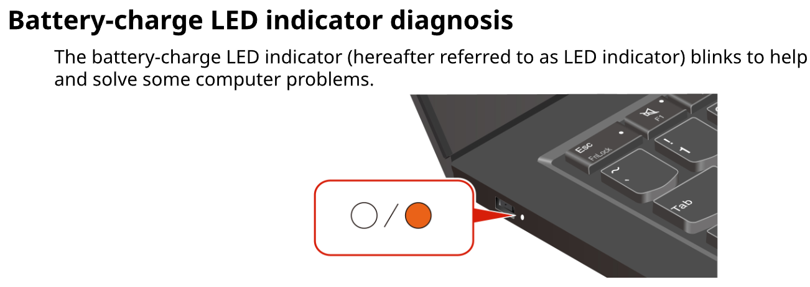

Press F1 after the error message is displayed to enter the UEFI BIOS menu. A dialog asks for confirmation to clean up the storage. If you select “Yes”, all data that were created by the operating system or programs will be deleted except global variables defined by the Unified Extensible Firmware Interface Specification. If you select “No”, all data will be kept, but the operating system or programs will not be able to create, modify, or delete data in the storage. If this error happens at a service center, Lenovo-authorized service personnel will clean up the non-volatile system UEFI variable storage using the preceding solution. Battery-charge LED indicator diagnosis The battery-charge LED indicator (hereafter referred to as LED indicator) blinks to help you diagnose and solve some computer problems. Indicator blinking patterns The LED indicator blinks amber first and then white continually, consisting of different blinking patterns. Each blinking pattern corresponds to an error code. For example, when the LED indicator blinks amber once and then blinks white twice , the blinking pattern corresponds to error code 0001. Note: • The LED indicator blinks automatically only when the error in the following table occurs. • The LED indicator blinks continually until the computer turns off. If you need to interrupt the process, press power button for a few seconds. • We recommend that you speak to our Customer Support Center before attempting to service the computer yourself so that you can be directed to the correct documentation and repair information. It might be recommended to have a Lenovo-authorized service provider repair your computer depending on the complexity of the error or fault. Refer to the blinking patterns and error codes in the table below to solve your computer problems. Blinking patterns Error codes Solutions 0001: Reset error (platform reset not de-asserted) 1. Remove the ac power adapter and the removable battery if your computer has one. Then, reset

68

the computer by doing one of the following: • For models with the emerge- ncy-reset hole, insert a straig- htened paper clip into the emergency reset hole to cut off power supply temporarily. Then, restart the computer with ac power connected. • For models without the emergency-reset hole, press and hold the power button for about seven seconds. Then, reconnect to all power resour- ces and restart the computer. 2. If step 1 does not work, replace the system board (service provider only). 0002: Internal bus error Replace the system board (service provider only). 0283: PCI resource error 1. Remove PCIe devices (the M.2 card, PCIe card, and so on) (service provider only). 2. If step 1 does not work, replace the system board (service provider only). 0284: TCG-compliant functionality- related error (might be the BIOS code validation failure) Replace the system board (service provider only). 0285: TCG-compliant functionality- related error (might be the TPM initia- lization failure) Replace the system board (service provider only). 0286: Integrated graphics error Replace the system board (service provider only). 0288: Computer display error 1. Reconnect the display cable on both the system board side and the computer display side (service provider only) and check the LCD panel. 2. If step 1 does not work, connect an external display to your computer and check the status (customer or service provider).

69

• If the external display works, replace the LCD panel (service provider only). • If the external display does not work, replace the system board (service provider only). Diagnostics tool This section provides introduction to a set of diagnostics and troubleshooting tools at Lenovo Support Web site, the Vantage app, and in your computer. They can help you diagnose common software and hardware issues. The following table lists these diagnostics tools and the recommended conditions for each tool. Diagnostics tool Recommended scenario Troubleshoot and diagnose at Lenovo Support Web site You want to have an online troubleshooting or scan of hardware and drivers on your computer. Hardware scan • Your computer is installed with the Vantage app. • You want to perform basic examinations of the hardware components. UEFI Diagnostics tool • You cannot log in to the operating system. • Your computer cannot connect to the network. Troubleshoot and diagnose at Lenovo Support Web site Lenovo provides two different diagnosing options to help you identify and resolve problems on your computer. 1. Go to https://www.pcsupport.lenovo.com/ and enter your product name in the search box. 2. Click Troubleshoot & Diagnose and select from the following two options depending on your needs. • If you are unsure of the problem with your computer, it is recommended that you select Easy and follow on-screen instructions to get your firmware updated and obtain the hardware status. • If you have identified the problem on your computer, you can select Custom and follow on-screen instructions to resolve the problem. Note: • Before launching any automatic diagnosing process, a pop-up window will prompt you to install Lenovo Service Bridge. Lenovo Service Bridge helps to connect your computer with Lenovo diagnosing tools.

70

• Lenovo Support Web site makes periodic updates of the sections to keep improving your experience with your computer. The Web site interface and descriptions of sections might be different from that on your actual interface. If solutions cannot resolve problems on your computer, you can follow on-screen instructions to submit an e-ticket or contact Lenovo for professional assistance. Hardware scan Hardware scan is an effective hardware testing tool to help you identify existing hardware issues. To run the Hardware scan: 1. Type Vantage in the Windows search box and then press Enter. 2. Click Hardware scan or Support > Hardware scan. 3. Select QUICK SCAN or CUSTOMIZE and then follow the on-screen instructions to run the hardware scan. Note: • The Quick Scan tool contains a pre-selected suite of tests that performs basic examinations of the hardware components found in the system. The Customize tool enables you to select one or several hardware components to perform the examinations. • Before selecting QUICK SCAN, click Refresh Modules to ensure that the list of hardware components is the components currently available for the computer. 4. If any hardware failure is detected, the result varies depending on the warranty status and varies by country or region. Follow the on-screen instructions to resolve the issue. UEFI Diagnostics tool UEFI Diagnostics tool enables you to view system information and identify hardware issues when you cannot log in to the operating system, or the computer cannot connect to the network. To use the UEFI Diagnostics tool: 1. Connect your computer to ac power. 2. Turn on your computer, and press F10 immediately to enter the UEFI Diagnostics tool. 3. Follow the on-screen instructions to run the test. 4. Press Esc to exit the tool. Your computer will restart immediately. 5. If any hardware failure is detected and you are unable to locate and resolve the problem, you can call Lenovo Customer Support Center. See [Call Lenovo](#pdf-dest-191) on page 72. Windows label Windows Genuine Microsoft label indicates the edition of Windows preinstalled on your computer and whether the device is preinstalled with or licensed for genuine Windows. Your computer might have a Windows Genuine Microsoft label affixed to its cover depending on the following factors: • Your geographic location • Edition of Windows that is preinstalled Go to https://www.microsoft.com/howtotell/Hardware.aspx for illustrations of the various types of Genuine Microsoft labels.

71

• In the People’s Republic of China, the Genuine Microsoft label is required on all computer models preinstalled with any edition of the Windows operating system. • In other countries and regions, the Genuine Microsoft label is required only on computer models licensed for Windows Pro editions. The absence of a Genuine Microsoft label does not indicate that the preinstalled Windows version is not genuine. For details on how to tell whether your preinstalled Windows product is genuine, refer to the information provided by Microsoft at https://www.microsoft.com/howtotell/default.aspx. There are no external, visual indicators of the Product ID or Windows version for which the computer is licensed. Instead, the Product ID is recorded in the computer firmware. Whenever a Windows product is installed, the installation program checks the computer firmware for a valid, matching Product ID to complete the activation. In some cases, an earlier Windows version might be preinstalled under the terms of the Windows Pro edition license downgrade rights. Call Lenovo If you have tried to correct the problem yourself and still need help, you can call Lenovo Customer Support Center. Before you contact Lenovo Prepare the needed information before you contact Lenovo. 1. Record the problem symptoms and details: • What is the problem? Is it continuous or intermittent? • Any error message or error code? • What operating system are you using? Which version? • Which software applications were running at the time of the problem? • Can the problem be reproduced? If so, how? 2. Record the system information: • Product name. • Machine type and [serial number](#pdf-dest-192) on page 72. Find your service QR code and serial number This topic helps you find service QR code and serial number. Scan the QR code on the base cover assembly to view the following information: • Your product information and warranty status • The latest Lenovo-verified drivers and software • Troubleshooting and diagnosing solutions when hardware or software issue is encountered • Customer support center and e-ticket entry for professional support You can find your serial number via: • Dashboard or Device in the Vantage app • Serial-number label of your computer (shown as below illustration)

72

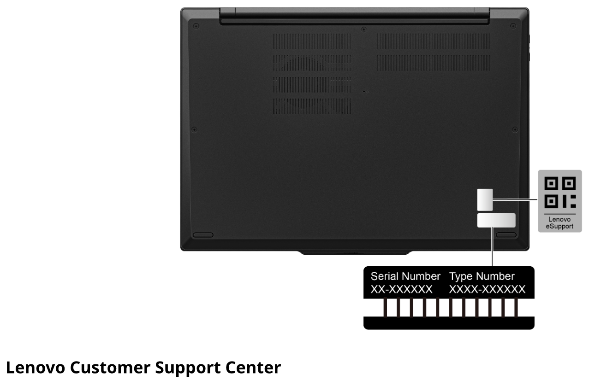

Lenovo Customer Support Center During the warranty period, you can call Lenovo Customer Support Center for help. Telephone numbers For a list of the Lenovo Support phone numbers for your country or region, go to https://pcsupport. lenovo.com/supportphonelist for the latest phone numbers. Note: Phone numbers are subject to change without notice. If the number for your country or region is not provided, contact your Lenovo reseller or Lenovo marketing representative. Services available during the warranty period • Problem determination - Trained personnel are available to assist you with determining if you have a hardware problem and deciding what action is necessary to fix the problem. • Lenovo hardware repair - If the problem is determined to be caused by Lenovo hardware under warranty, trained service personnel are available to provide the applicable level of service. • Engineering change management - Occasionally, there might be changes that are required after a product has been sold. Lenovo or your reseller, if authorized by Lenovo, will make selected Engineering Changes (ECs) that apply to your hardware available. Services not covered • Replacement or use of parts not manufactured for or by Lenovo or nonwarranted parts • Identification of software problem sources • Configuration of UEFI BIOS as part of an installation or upgrade • Changes, modifications, or upgrades to device drivers • Installation and maintenance of network operating systems (NOS) • Installation and maintenance of programs

73

For the terms and conditions of the Lenovo Limited Warranty that apply to your Lenovo hardware product, go to: • https://www.lenovo.com/warranty/llw_02 • https://pcsupport.lenovo.com/warrantylookup

74

Chapter 7 CRU replacement This section provides instructions on how to replace Customer Replaceable Units (CRUs). What are CRUs Customer Replaceable Units (CRUs) are parts that can be replaced by the customer. The computers contain the following types of CRUs: • Self-service CRUs: Refer to parts that can be replaced easily by customer themselves or by trained service technicians at an additional cost. • Optional-service CRUs: Refer to parts that can be replaced by customers with a greater skill level. Trained service technicians can also provide service to replace the parts under the type of warranty designated for the customer’s machine. If you intend on installing a CRU, Lenovo will ship the CRU to you. CRU information and replacement instructions are shipped with your product and are available from Lenovo at any time upon request. You might be required to return the defective part that is replaced by the CRU. When return is required: (1) return instructions, a prepaid shipping label, and a container will be included with the replacement CRU; and (2) you might be charged for the replacement CRU if Lenovo does not receive the defective CRU within thirty (30) days of your receipt of the replacement CRU. For full details, see the Lenovo Limited Warranty documentation at https://www.lenovo.com/warranty/llw_02. CRU list This topic provides the CRU list of your computer. Self-service CRUs • ac power adapter* • Power cord* • Nano-SIM-card tray* • Base cover assembly • M.2 solid-state drive • M.2 solid-state drive bracket Optional-service CRUs • Wireless WAN module* • Speaker assembly * for selected models Note: Replacement of any parts not listed above, including the built-in rechargeable battery, should be done by a qualified repair technician or by ensuring that you carefully follow all instructions provided by Lenovo. You can also find Lenovo-authorized repair facilities by going to https://support.lenovo.com/partnerlocator for more information.

75

Before you replace any CRU Before replacing any CRU, ensure that you disable Fast Startup first and then disable the built-in battery. Disable Fast Startup Follow the instructions to disable Fast Startup. 1. Go to Control Panel and view by Large icons or Small icons. 2. Click Power Options, and then click Choose what the power buttons do on the left pane. 3. Click Change settings that are currently unavailable at the top. 4. If prompted by User Account Control (UAC), click Yes. 5. Clear the Turn on fast startup check box, and then click Save changes. Disable the built-in battery Follow the instructions to disable the built-in battery. 1. Restart your computer. When the logo screen is displayed, immediately press F1 to enter the UEFI BIOS menu. 2. Select Config > Power. The Power submenu is displayed. 3. Select Disable Built-in Battery and press Enter. 4. Select Yes in the Setup Confirmation window. The built-in battery is disabled and the computer turns off automatically. Wait three to five minutes to let the computer cool. Note: If your computer cannot enter the UEFI BIOS menu, you cannot disable the built-in battery. It is recommended to disconnect the battery cable. Replace a CRU Follow the instructions to replace a CRU. Base cover assembly Follow the instructions to replace the base cover assembly. Prerequisite Before you start, read Generic Safety and Compliance Notices and print the following instructions. Note: Do not remove the base cover assembly when your computer is connected to ac power. Otherwise, there might be a risk of short circuits. For access, do the following: 1. Disable the built-in battery. See [Disable the built-in battery](#pdf-dest-193) on page 76. 2. Turn off the computer and disconnect the computer from ac power and all connected cables. 3. Close the computer display and turn over the computer. 1. Remove the base cover assembly as shown below.

76

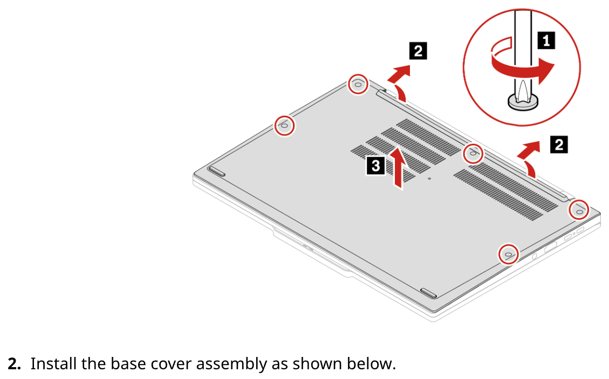

2. Install the base cover assembly as shown below. If the computer does not start up after you reinstall the base cover assembly, disconnect the ac power adapter and then reconnect it to the computer. Wireless WAN module (for selected models) Follow the instructions to replace the Wireless WAN module. The following information is only for the computer with user-installable modules. Ensure that you use only a Lenovo-authorized wireless module specifically tested for this computer model. Otherwise, the computer will generate an error-code beep sequence when you turn on the computer. Note: Only wireless WAN model is allowed to install the optional Lenovo wireless WAN module. Before you start, read Generic Safety and Compliance Notices and print the following instructions.

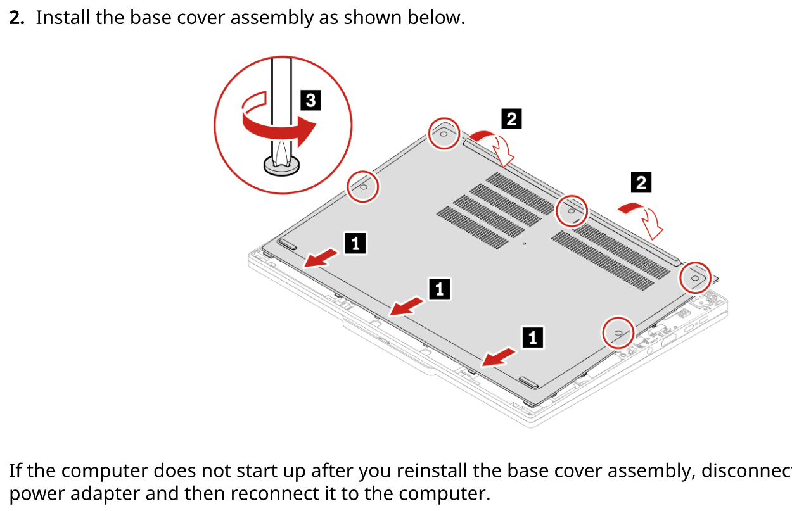

77

Attention: Do not touch the contact edge of the wireless WAN module. Otherwise, the wireless WAN module might get damaged. For access, do the following: 1. Disable the built-in battery. See [Disable the built-in battery](#pdf-dest-193) on page 76. 2. Turn off the computer and disconnect the computer from ac power and all connected cables. 3. Close the computer display and turn over the computer. 4. Remove the base cover assembly. See [Base cover assembly](#pdf-dest-194) on page 76. 1. Remove the wireless WAN module as shown below. 2. Install the wireless WAN module in reverse order. Note: • Before installing, remove the plastic tape with conductive tape from the failing wireless WAN module and apply the tape to the same position on the wireless WAN module as below.

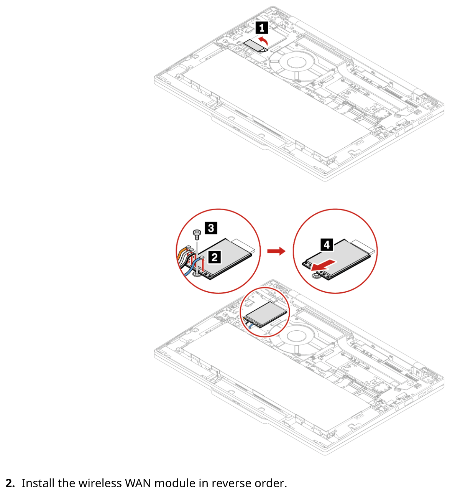

78

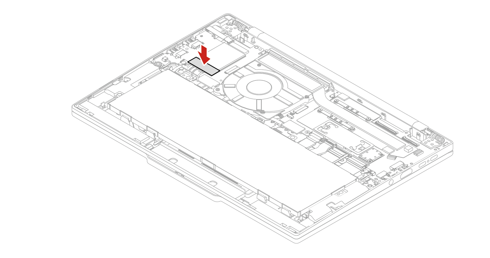

• During installation, ensure that you connect the cables with different colors to the corresponding connectors on the module according to the illustrations above: the orange cable to the connector labeled ORANGE, the blue cable to the connector labeled BLUE, the white and grey cable to the connector labeled WHITE GREY, and the black and grey cable to the connector labeled BLACK GREY. M.2 solid-state drive bracket and M.2 solid-state drive Follow the instructions to replace the M.2 solid-state drive. Before you start, read Generic Safety and Compliance Notices and print the following instructions. Attention: The M.2 solid-state drive is sensitive. Inappropriate handling might cause damage and permanent loss of data. When handling the M.2 solid-state drive, observe the following guidelines: • Replace the M.2 solid-state drive only for repair. The M.2 solid-state drive is not designed for frequent changes or replacement. • Before replacing the M.2 solid-state drive, make a backup copy of all the data that you want to keep. • Do not apply pressure to the M.2 solid-state drive. • Do not touch the contact edge or circuit board of the M.2 solid-state drive. Otherwise, the M.2 solid-state drive might get damaged. • Do not subject the M.2 solid-state drive to physical shocks or vibration. Put the M.2 solid-state drive on a soft material, such as cloth, to absorb physical shocks. 1. Disable the built-in battery. See [Disable the built-in battery](#pdf-dest-193) on page 76. 2. Turn off the computer and disconnect the computer from ac power and all connected cables. 3. Close the computer display and turn over the computer. 4. Remove the base cover assembly. See [Base cover assembly](#pdf-dest-194) on page 76. 1. Remove the M.2 solid-state drive bracket and M.2 solid-state drive as shown below.

79

2. Install the M.2 solid-state drive bracket and M.2 solid-state drive in reverse order. Speaker assembly Follow the instructions to replace the speaker assembly. Before you start, read Generic Safety and Compliance Notices and print the following instructions. For access, do the following: 1. Disable the built-in battery. See [Disable the built-in battery](#pdf-dest-193) on page 76. 2. Turn off the computer and disconnect the computer from ac power and all connected cables. 3. Close the computer display and turn over the computer. 4. Remove the base cover assembly. See [Base cover assembly](#pdf-dest-194) on page 76. 1. Remove the speaker assembly as shown below.

80

2. Install the speaker assembly in reverse order.

81

Appendix A Compliance information This chapter provides the compliance information of your computer. For compliance information, refer to Regulatory Notice at https://pcsupport.lenovo.com and Generic Safety and Compliance Notices at https://pcsupport.lenovo.com/docs/generic_notices. Certification-related information This section provides certification-related information, such as product name and machine type. Table 1: Product information Product name Compliance ID Machine type(s) • ThinkPad T14s Gen 6 Snapdragon • ThinkPad T14s Gen 6 SD 5G1 TP00161A 21N1 and 21N2 1 for mainland China only Further compliance information related to your product is available at https://www.lenovo.com/ compliance. Table 2: Korean Minimum Energy Performance Standard (MEPS) value Energy efficiency labeling Energy efficiency inform- ation Computer type A Annual power consumption (kWh) 20.8 Power consumption in sleep mode (W) 0.7 Power consumption in off mode (W) 0.8 Locate the UltraConnect wireless antennas Your computer has an UltraConnect™ wireless antenna system. You can enable wireless communication wherever you are. The following illustration shows the antenna locations on your computer:

82

1 Wireless LAN antenna (main and auxiliary) 2 Wireless WAN antenna (MIMO2)* 3 Wireless WAN antenna (auxiliary)* 4 Wireless WAN antenna (main)* 5 Wireless WAN antenna (MIMO1)* * for selected models Operating environment This section provides information about the operating environment of your computer. Maximum altitude (without pressurization) 3048 m (10 000 ft) Temperature • Operating: 5°C to 35°C (41°F to 95°F) • Storage and transportation in original shipping packaging: -20°C to 60°C (-4°F to 140°F)

83

• Storage without packaging: 5°C to 43°C (41°F to 109°F) Note: When you charge the battery, its temperature must be no lower than 10°C (50°F). Relative humidity • Operating: 8% to 95% at wet-bulb temperature 23°C (73°F) • Storage and transportation: 5% to 95% at wet-bulb temperature 27°C (81°F) Notice for USB connector name update The USB Implementers Forum published a revision of the guideline for USB connector names in September, 2022. Lenovo follows the revised guideline and updates USB connector names accordingly. You can refer to the table below for naming update details. Current name Previous name USB-A connector (Hi-Speed USB) USB-A 2.0 connector USB-A connector (USB 5Gbps) USB-A 3.2 Gen 1 connector USB-A connector (USB 10Gbps) USB-A 3.2 Gen 2 connector USB-A connector (USB 5Gbps, Always On USB) Always on USB-A 3.2 Gen 1 connector USB-A connector (USB 10Gbps, Always On USB) Always on USB-A 3.2 Gen 2 connector USB-C connector (USB 5Gbps) USB-C (3.2 Gen 1) connector USB-C connector (USB 10Gbps) USB-C (3.2 Gen 2) connector USB-C connector (USB 20Gbps) USB 3.2 Gen 2x2 USB-C connector (USB4 20Gbps) USB 4 Gen 2x2 USB-C connector (USB4 40Gbps) USB-C (USB 4) connector USB-C connector (Thunderbolt 3) USB-C (Thunderbolt 3) connector USB-C connector (Thunderbolt 4) USB-C (Thunderbolt 4) connector

84

Appendix B Important notice for Quebec consumers In regard to section 79.18 of Quebec’s Regulation respecting the application of the Consumer Protection Act, Lenovo in no way guarantees the availability of (a) replacement parts; (b) repair services; and (c) information necessary to maintain or repair the goods. For up-to-date information on the technical support and parts available for your purchase, please consult https://support. lenovo.com/ca/en. En ce qui concerne l’article 79.18 du Règlement d’application de la Loi sur la protection du consommateur du Québec, Lenovo ne garantit en aucune façon la disponibilité des éléments suivants:(a) les pièces de rechange; (b) les services de réparation; et (c) les renseignements nécessaires à l’entretien à la réparation du bien. Pour obtenir des renseignements à jour sur le soutien technique et les pièces disponibles pour votre achat, veuillez consulter https://support. lenovo.com/ca/fr.

85

Appendix C Accessibility features Lenovo is committed to making information technology accessible to everyone, including individuals with hearing, vision, mobility, cognitive, or speech disabilities. To get the most up-to-date and detailed accessibility features information for the product, go to https://support.lenovo.com/docs/ product_accessibility_features.

86

Appendix D Notices and trademarks Notices Lenovo may not offer the products, services, or features discussed in this document in all countries. Consult your local Lenovo representative for information on the products and services currently available in your area. Any reference to a Lenovo product, program, or service is not intended to state or imply that only that Lenovo product, program, or service may be used. Any functionally equivalent product, program, or service that does not infringe any Lenovo intellectual property right may be used instead. However, it is the user's responsibility to evaluate and verify the operation of any other product, program, or service. Lenovo may have patents or pending patent programs covering subject matter described in this document. The furnishing of this document does not give you any license to these patents. You can send license inquiries, in writing, to: Lenovo (United States), Inc. 8001 Development Drive Morrisville, NC 27560 U.S.A. Attention: Lenovo Director of Licensing LENOVO PROVIDES THIS PUBLICATION "AS IS" WITHOUT WARRANTY OF ANY KIND, EITHER EXPRESS OR IMPLIED, INCLUDING, BUT NOT LIMITED TO, THE IMPLIED WARRANTIES OF NON-INFRINGEMENT, MERCHANTABILITY OR FITNESS FOR A PARTICULAR PURPOSE. Some jurisdictions do not allow disclaimer of express or implied warranties in certain transactions, therefore, this statement may not apply to you. Changes are made periodically to the information herein; these changes will be incorporated in new editions of the publication. To provide better service, Lenovo reserves the right to improve and/or modify the products and software programs described in the manuals included with your computer, and the content of the manual, at any time without additional notice. The software interface and function and hardware configuration described in the manuals included with your computer might not match exactly the actual configuration of the computer that you purchase. For the configuration of the product, refer to the related contract (if any) or product packing list, or consult the distributor for the product sales. Lenovo may use or distribute any of the information you supply in any way it believes appropriate without incurring any obligation to you. The products described in this document are not intended for use in implantation or other life support applications where malfunction may result in injury or death to persons. The information contained in this document does not affect or change Lenovo product specifications or warranties. Nothing in this document shall operate as an express or implied license or indemnity under the intellectual property rights of Lenovo or third parties. All information contained in this document was obtained in specific environments and is presented as an illustration. The result obtained in other operating environments may vary. Lenovo may use or distribute any of the information you supply in any way it believes appropriate without incurring any obligation to you. Any references in this publication to non-Lenovo Web sites are provided for convenience only and do not in any manner serve as an endorsement of those Web sites. The materials at those Web sites are not part of the materials for this Lenovo product, and use of those Web sites is at your own risk. Any performance data contained herein was determined in a controlled environment. Therefore, the result obtained in other operating environments may vary significantly. Some measurements may have been made on development-level systems and there is no guarantee that these measurements will be the same on generally available systems. Furthermore, some measurements may have been

87

estimated through extrapolation. Actual results may vary. Users of this document should verify the applicable data for their specific environment. This document is copyrighted by Lenovo and is not covered by any open source license, including any Linux® agreement(s) which may accompany software included with this product. Lenovo may update this document at any time without notice. For the latest information or any questions or comments, contact or visit the Lenovo Web site: https://pcsupport.lenovo.com New Mexico PFAS notice Trademarks Lenovo, Lenovo logo, ThinkPad, ThinkPad logo, and TrackPoint are trademarks of Lenovo. Linux is the registered trademark of Linus Torvalds in the U.S. and other countries. Microsoft, Microsoft Teams, Windows, Windows Hello, One Drive, Outlook, Skype, Office 365, Direct3D, BitLocker, , and Cortana are trademarks of the Microsoft group of companies. Dolbyand Dolby Audio are trademarks of Dolby Laboratories Licensing Corporation. The terms HDMI and HDMI High-Definition Multimedia Interface are trademarks or registered trademarks of HDMI Licensing LLC in the United States and other countries. USB4® and USB-C® are registered trademarks of USB Implementers Forum. Wi-Fi and Miracast are registered trademarks of Wi-Fi Alliance. All other trademarks are the property of their respective owners.

88

---

## Repeated content (headers / footers / watermarks)

> Page-edge and repeated content was moved out of the body to keep reading order clean — kept here, not deleted.

- .........................................................................................................................  *(pp.3–4)*
- .........................................................................  *(p.3)*
- .................................................................................................  *(pp.3–4)*
- ...................................................................................................................................................................  *(p.3)*
- ...................................................................................................................................................  *(pp.3, 5)*
- ................................................................................................................  *(pp.3–5)*
- .....................................................................................................................................................  *(pp.3–4)*
- ..................................................................................................................................  *(pp.3, 5)*
- ........................................................................................  *(p.3)*
- .............................................................................................................................................  *(p.3)*
- ...................................................................................  *(pp.3, 5)*
- .....................................................................................................................................................................  *(pp.3, 5)*
- ...............................................................................................................................................................  *(pp.3, 5)*
- ...................................................................................................................................  *(pp.3, 5)*
- ......................................................................................................................................  *(p.3)*
- .............................................................  *(p.3)*
- ............................................................................................................................................  *(pp.3–5)*
- ...............................................................................................................................  *(pp.3–5)*
- ....................................................................................................  *(pp.3–4)*
- ......................................................................................................................................................  *(pp.3, 5)*
- ........................................................................................................................  *(p.3)*
- .............................................................................................................................  *(pp.3–5)*
- .................................................................................................................  *(pp.3, 5)*
- ............................................................................  *(p.3)*
- .................................................................................................................................  *(pp.3–5)*
- ......................................................................................................................  *(pp.3–4)*
- .........................................................................................................  *(pp.3–4)*
- ........................................................................................................................................  *(p.3)*
- ...........................................................................................  *(p.3)*
- .......................................................................................................................................  *(pp.3–5)*
- .............................................................................................................................................................  *(p.3)*
- ....................................................................................................................  *(pp.3–5)*
- ..............................................................................................................................  *(pp.3–5)*
- ...............................................................................................................  *(pp.3, 5)*
- ........................................................................................................................................................  *(pp.3, 5)*
- ...........................................................................................................................  *(pp.3–4)*
- ......................................................................................................  *(p.3)*
- .......................................................................................................................  *(pp.3, 5)*
- .......................................................................................................  *(pp.3, 5, 6)*
- ..............................................................................................................  *(pp.3, 5)*
- .....................................................................................................................................  *(pp.3–4)*
- ...................................................................................................................  *(pp.3, 5)*
- .............................................................................................  *(p.4)*
- ....................................................................................................................................  *(pp.4–5)*
- ..........................................................................................  *(p.4)*
- ..............................................................................  *(p.4)*
- ....................................................................  *(pp.4–5)*
- ....................................................................................................................................................  *(pp.4–5)*
- ..................................................................................................  *(pp.4–5)*
- ................................................................................................................................................  *(pp.4–5)*
- .....................................................................................................................  *(p.4)*
- ..........................................................................................................................  *(pp.4–6)*
- .........................................................................................  *(pp.4–5)*
- ............................................................................................  *(pp.4–5)*
- .......................................................................................................................................................  *(pp.4–5)*
- ..................................................................................................................................................  *(p.4)*
- .........................................................................................................................................  *(pp.4, 6)*
- ........................................................................................................  *(pp.4–5)*
- ..........................................................................................................................................  *(pp.4–5)*
- ................................................................................................  *(pp.4–5)*
- ............................................................................................................  *(p.4)*
- ..............................................................................................  *(p.4)*
- .............................................................................................................  *(pp.4–6)*
- ..........................................................................................................................................................  *(p.4)*
- ...........................................................................................................  *(pp.4–5)*
- ...........................................................................................................................................................  *(p.4)*
- ................................................................  *(p.4)*
- ...................................................................................................  *(p.4)*
- ............................................................................................................................................................  *(p.5)*
- ...............................................................................................  *(p.5)*
- ...............................................................................................................................................  *(p.5)*
- ..........................................................................................................  *(p.5)*
- ..........................................  *(p.5)*
- .........................................................................................................................................................  *(p.5)*
- .......................................................................................  *(p.5)*
- ........................................................................  *(pp.5–6)*
- ...........................................  *(p.6)*
- .............................................................................  *(p.6)*
- .......................................................................  *(p.6)*
- Item Description Item Description  *(p.13)*
- To do this Gesture  *(pp.27–30)*
- Cases Solutions  *(pp.66, 69)*
- Message Solution  *(p.75)*
- Blinking patterns Error codes Solutions  *(pp.76–77)*
