# Make It Sense

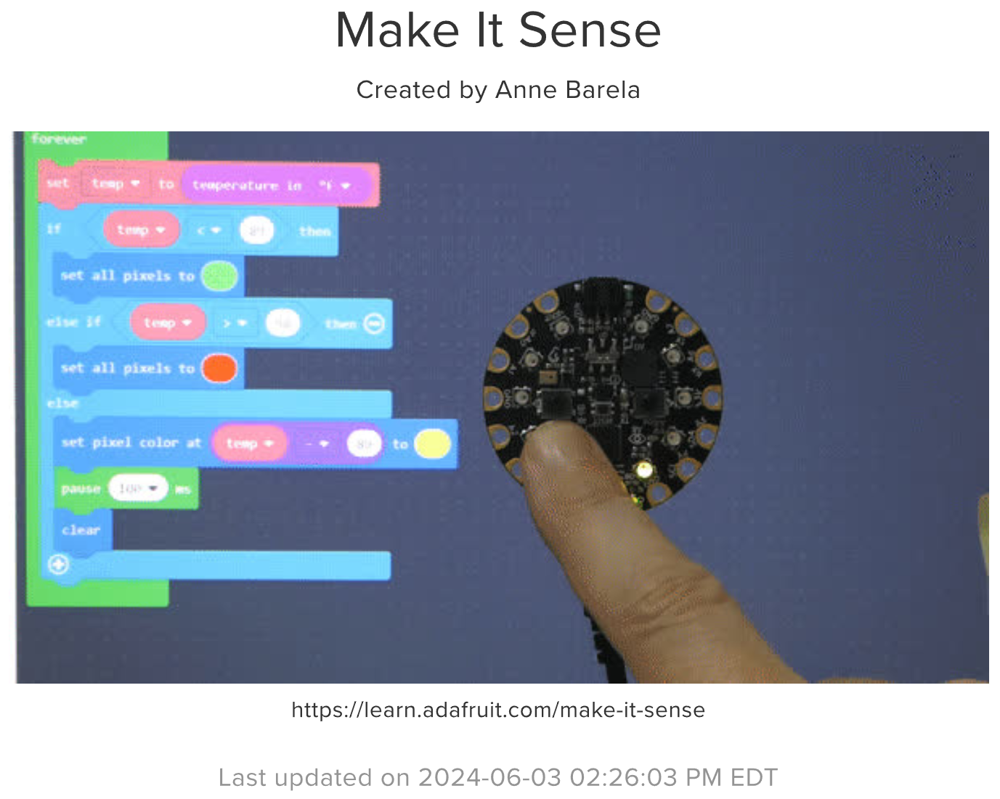

## Table of Contents

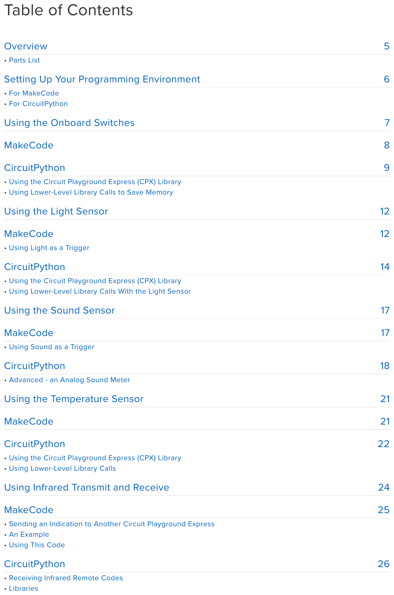

[Overview](#pdf-dest-1) [5](#pdf-dest-1)

- Parts List

[Setting Up Your Programming Environment](#pdf-dest-2) [6](#pdf-dest-2)

- For MakeCode

- For CircuitPython

[Using the Onboard Switches](#pdf-dest-3) [7](#pdf-dest-3) [MakeCode](#pdf-dest-4) [8](#pdf-dest-4) [CircuitPython](#pdf-dest-5) [9](#pdf-dest-5)

- Using the Circuit Playground Express (CPX) Library

- Using Lower-Level Library Calls to Save Memory

[Using the Light Sensor](#pdf-dest-6) [12](#pdf-dest-6)

[MakeCode](#pdf-dest-7) [12](#pdf-dest-7)

- Using Light as a Trigger

[CircuitPython](#pdf-dest-8) [14](#pdf-dest-8)

- Using the Circuit Playground Express (CPX) Library

- Using Lower-Level Library Calls With the Light Sensor

[Using the Sound Sensor](#pdf-dest-9) [17](#pdf-dest-9)

[MakeCode](#pdf-dest-10) [17](#pdf-dest-10)

- Using Sound as a Trigger

[CircuitPython](#pdf-dest-11) [18](#pdf-dest-11)

- Advanced - an Analog Sound Meter

[Using the Temperature Sensor](#pdf-dest-12) [21](#pdf-dest-12)

[MakeCode](#pdf-dest-13) [21](#pdf-dest-13)

[CircuitPython](#pdf-dest-14) [22](#pdf-dest-14)

- Using the Circuit Playground Express (CPX) Library

- Using Lower-Level Library Calls

[Using Infrared Transmit and Receive](#pdf-dest-15) [24](#pdf-dest-15)

[MakeCode](#pdf-dest-16) [25](#pdf-dest-16)

- Sending an Indication to Another Circuit Playground Express

- An Example

- Using This Code

[CircuitPython](#pdf-dest-17) [26](#pdf-dest-17)

- Receiving Infrared Remote Codes

- Libraries

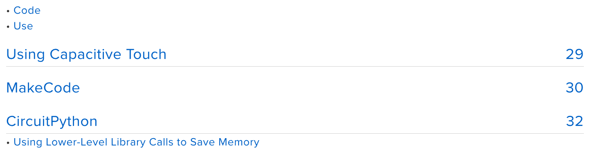

- Use

[Using Capacitive Touch](#pdf-dest-18) [29](#pdf-dest-18)

[MakeCode](#pdf-dest-19) [30](#pdf-dest-19)

[CircuitPython](#pdf-dest-20) [32](#pdf-dest-20)

- Using Lower-Level Library Calls to Save Memory

# <a id="pdf-dest-1"></a>Overview

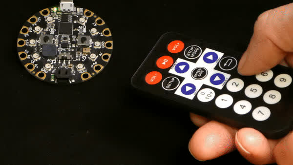

Sensing the world around us is central to what we do and what we'd like electronics projects to do for us. Be it the weather or detecting specific things like light, sound, etc., we always want to know.

The Circuit Playground Express board is specifically designed to have the sensors you might wish to use built-in.

This guide will help you use the Circuit Playground Express sensors quickly, with code examples, so you can experience how the sensors work and how you might wish to use the sensors in your own project.

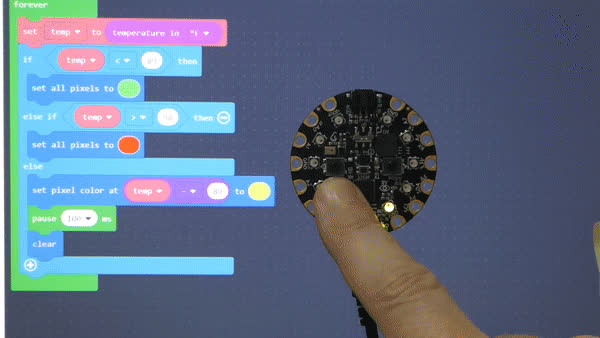

## Parts List

For using IR transmit and receive with MakeCode, you will need two Circuit Playground Express boards.

[Circuit Playground Express](https://www.adafruit.com/product/3333) Circuit Playground Express is the next step towards a perfect introduction to electronics and programming. We've taken the original Circuit Playground Classic and... [https://www.adafruit.com/product/3333](https://www.adafruit.com/product/3333)

[Mini Remote Control](https://www.adafruit.com/product/389) This little remote control would be handy for controlling a robot or other project from across the room. It has 21 buttons and a layout we thought was handy: directional buttons and... [https://www.adafruit.com/product/389](https://www.adafruit.com/product/389)

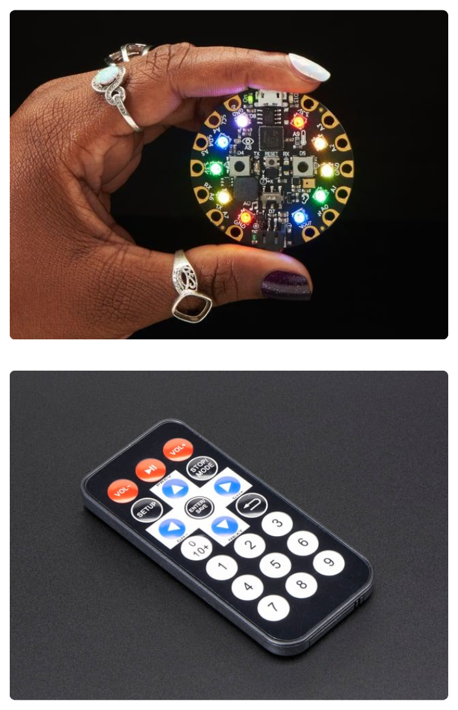

# <a id="pdf-dest-2"></a>Setting Up Your Programming Environment

If you are using Microsoft MakeCode or CircuitPython, you'll need to do a couple of basic things to set things up.

# For MakeCode

[In Makecode, the editor is located at https://makecode.adafruit.com/ (https://adafru.it/](https://makecode.adafruit.com/) wmd)


# For CircuitPython

See this guide page (<https://adafru.it/AFI>) from Introducing Adafruit Circuit Playground Express on setting up your CircuitPython environment.

Adafruit suggests using the Mu editor to edit your code and have an interactive REPL in [CircuitPython. You can learn about Mu and installation in this tutorial (https://](https://learn.adafruit.com/welcome-to-circuitpython/installing-mu-editor) adafru.it/ANO).


# <a id="pdf-dest-3"></a>Using the Onboard Switches

Switches are the most common sensor around us. The Circuit Playground Express has three switches: two pushbuttons and one slide switch.

There are two large **A** and **B** buttons, connected to digital #4 (Left) and #5 (Right) each. These are unconnected when not pressed, and connected to 3.3V when pressed, so they read HIGH. Set the pins #4 and #5 to use an internal pull-down resistor when reading these pins so they will read LOW when not pressed.

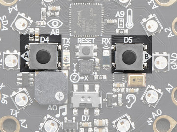

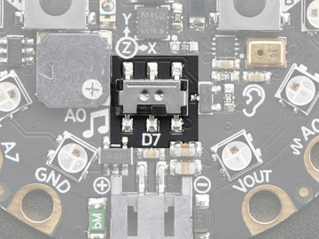

There is a single slide switch near the center bottom of the Circuit Playground Express. It is connected to digital #7. The switch is unconnected when slid to the left and connected to ground when slid to the right. Set pin #7 to use an internal pull-up resistor so that the switch will read HIGH when slid to the left and LOW when slid to the right.

This is not an on-off switch, but you can use code to have this switch control how you want your project to behave.

Note that you need to use an internal *pull-up* for the slide switch, but an internal *pull-* *down* for the pushbuttons.

The following pages will show you how to quickly use these switches first in MakeCode then in CircuitPython.

# <a id="pdf-dest-4"></a>MakeCode

Makecode use of the switches could not be simpler. There are several ways to read the switches and use that action to trigger other actions in code.

First, each button has its own block in the **INPUT** blok group to do an action if a switch movement is detected:

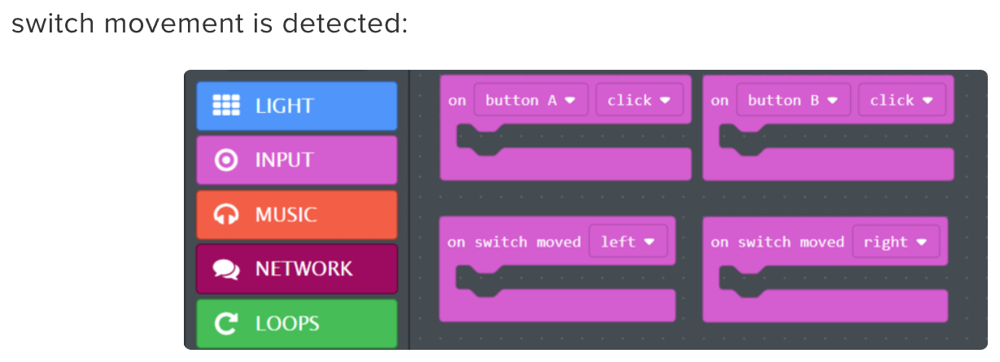

The on button blocks are the same, you just select button A for the left button, button B for the right button. The on switch moved block is used twice also, to detect a left or right movement of the switch.

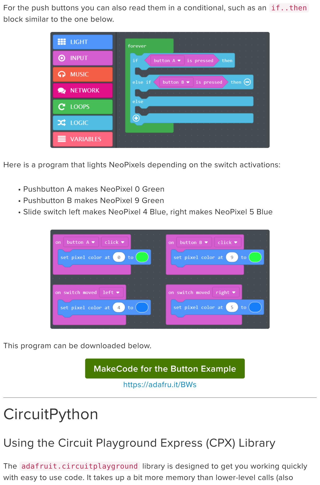

For the push buttons you can also read them in a conditional, such as an if..then block similar to the one below.

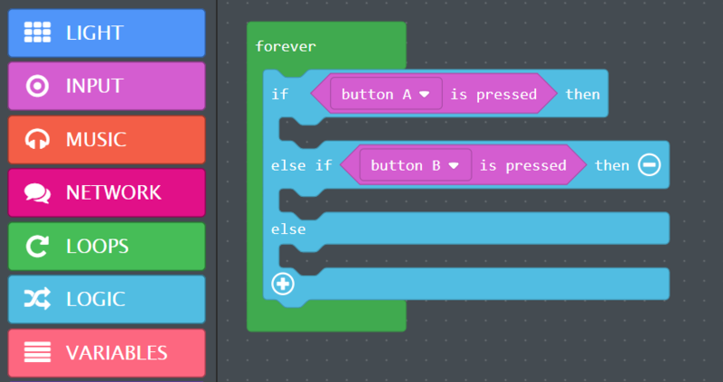

Here is a program that lights NeoPixels depending on the switch activations:

- Pushbutton A makes NeoPixel 0 Green

- Pushbutton B makes NeoPixel 9 Green

- Slide switch left makes NeoPixel 4 Blue, right makes NeoPixel 5 Blue

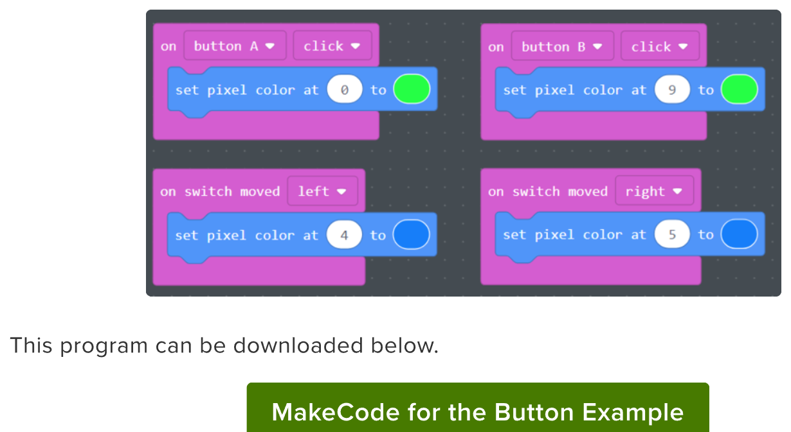

<https://adafru.it/BWs>

# <a id="pdf-dest-5"></a>CircuitPython

## Using the Circuit Playground Express (CPX) Library

The adafruit.circuitplayground library is designed to get you working quickly with easy to use code. It takes up a bit more memory than lower-level calls (also available in the next section). If you are using Crickit with the Circuit Playground Express and are having memory issues, try the code below, otherwise use the following code to get started.

Here is code to read Buttons A, B, and the slide switch.

from adafruit_circuitplayground.express import cpx if cpx.button_a: # do something pass if cpx.button_b: # do something else pass if cpx.switch: # do more like silence a sound, etc. pass

Here is an example which lights certain NeoPixels when the switches are triggered:

# SPDX-FileCopyrightText: 2018 Anne Barela for Adafruit Industries

```
#
# SPDX-License-Identifier: MIT

from adafruit_circuitplayground.express import cpx

while True:
    if cpx.button_a:
        cpx.pixels[0] = (0, 30, 0)
    else:
        cpx.pixels[0] = (0, 0, 0)

    if cpx.button_b:
        cpx.pixels[9] = (0, 30, 0)
    else:
        cpx.pixels[9] = (0, 0, 0)

    if cpx.switch:
        cpx.pixels[4] = (0, 0, 30)
        cpx.pixels[5] = (0, 0, 0)
    else:
        cpx.pixels[4] = (0, 0, 0)
        cpx.pixels[5] = (0, 0, 30)
```

Press Button A and NeoPixel 0 lights up, press B and NeoPixel 9 lights up. If the slide switch is left, NeoPixel 4 is blue, if the switch is to the right, NeoPixel 5 is blue.

## Using Lower-Level Library Calls to Save Memory

The following code is very lightweight for reading the switches. It is perfect for when you want to add additional code such as Crickit or other library modules which may require a lot of memory.

Reading keys uses the following libraries:

- digitalio - we use DigitalInOut, Pull, Direction

- board - we use board definitions for the switches

The bare code to set up all three switches is as follows. You can comment out or delete any button that you don't plan to use.

# SPDX-FileCopyrightText: 2018 Anne Barela for Adafruit Industries

```
#
# SPDX-License-Identifier: MIT

from digitalio import DigitalInOut, Pull, Direction
import board

button_a = DigitalInOut(board.BUTTON_A)
button_a.direction = Direction.INPUT
button_a.pull = Pull.DOWN

button_b = DigitalInOut(board.BUTTON_B)
button_b.direction = Direction.INPUT
button_b.pull = Pull.DOWN

switch = DigitalInOut(board.SLIDE_SWITCH)
switch.direction = Direction.INPUT
switch.pull = Pull.UP

# Get the values of the switches now
last_buttona = button_a.value
last_buttonb = button_b.value
last_switch = switch.value
```

Here is sample code using the buttons to light the same LEDs as in the MakeCode button example. This requires also adding the neopixel library.

# SPDX-FileCopyrightText: 2018 Anne Barela for Adafruit Industries

```
#
# SPDX-License-Identifier: MIT

from digitalio import DigitalInOut, Pull, Direction
import board
import neopixel

# NeoPixel setup and blank out
pixels = neopixel.NeoPixel(board.NEOPIXEL, 10, brightness=1)
pixels.fill((0, 0, 0))

# button setup: A, B, and slide switch
button_a = DigitalInOut(board.BUTTON_A)
button_a.direction = Direction.INPUT
button_a.pull = Pull.DOWN

button_b = DigitalInOut(board.BUTTON_B)
button_b.direction = Direction.INPUT
button_b.pull = Pull.DOWN

switch = DigitalInOut(board.SLIDE_SWITCH)
switch.direction = Direction.INPUT
switch.pull = Pull.UP
```

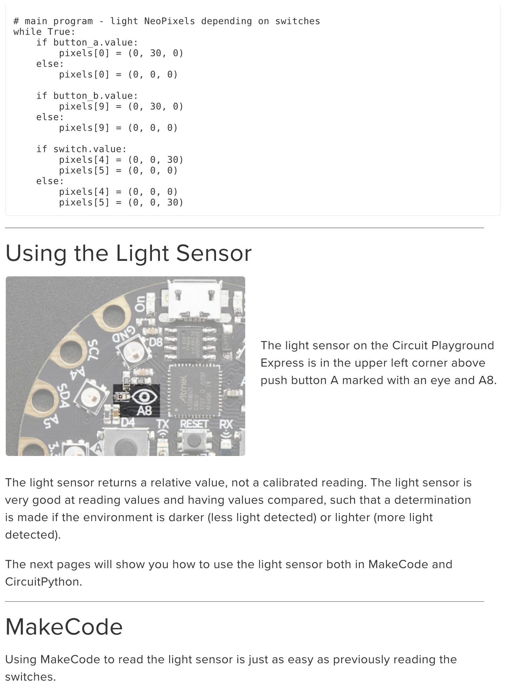

```
# main program - light NeoPixels depending on switches
while True:
    if button_a.value:
        pixels[0] = (0, 30, 0)
    else:
        pixels[0] = (0, 0, 0)

    if button_b.value:
        pixels[9] = (0, 30, 0)
    else:
        pixels[9] = (0, 0, 0)

    if switch.value:
        pixels[4] = (0, 0, 30)
        pixels[5] = (0, 0, 0)
    else:
        pixels[4] = (0, 0, 0)
        pixels[5] = (0, 0, 30)
```

# <a id="pdf-dest-6"></a>Using the Light Sensor

The light sensor on the Circuit Playground Express is in the upper left corner above push button A marked with an eye and A8.

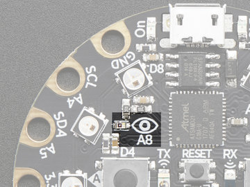

The light sensor returns a relative value, not a calibrated reading. The light sensor is very good at reading values and having values compared, such that a determination is made if the environment is darker (less light detected) or lighter (more light detected).

The next pages will show you how to use the light sensor both in MakeCode and CircuitPython.

# <a id="pdf-dest-7"></a>MakeCode

Using MakeCode to read the light sensor is just as easy as previously reading the switches.

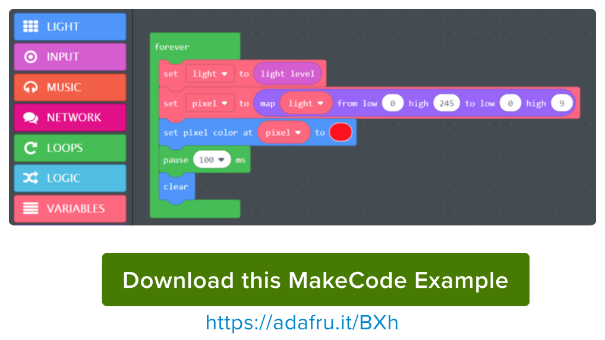

<https://adafru.it/BXh>

The code above is a bit longer to ensure it can is easy to understand. A variable called light gets the value of the sensor from the **INPUT** group light level block value. The value that the light level block returns is 0 to 255 (which is different than in CircuitPython).

The code will use the NeoPixel LEDs as the indicator. There are ten LEDs, numbered 0 to 9. The map block is used to take the value of light and change it from 0-255 to 0-9. Then that pixel is displayed red.

The code will pause 0.1 seconds (100 milliseconds), then clear the NeoPixel and start again, forever .

The map in the example uses 245 instead of 255. My flashlight could not get the 10th NeoPixel to light under bright light so I lowered the value. Feel free to raise or lower the values to get the light range you want.

## Using Light as a Trigger

There are additional blocks in MakeCode to have code run based on whether the light is below a dark threshold or above a light threshold. Use the set .. light threshold to block from the **INPUT** group at the start of your code for both light and dark.

With those set you can use the on light bright and on light dark to perform any action you want when the light gets bright or dark.

The example code below sets a NeoPixel green when dark , red when light . NeoPixel 6 is furthest away from the light sensor so readings would not be affected by the indicator.

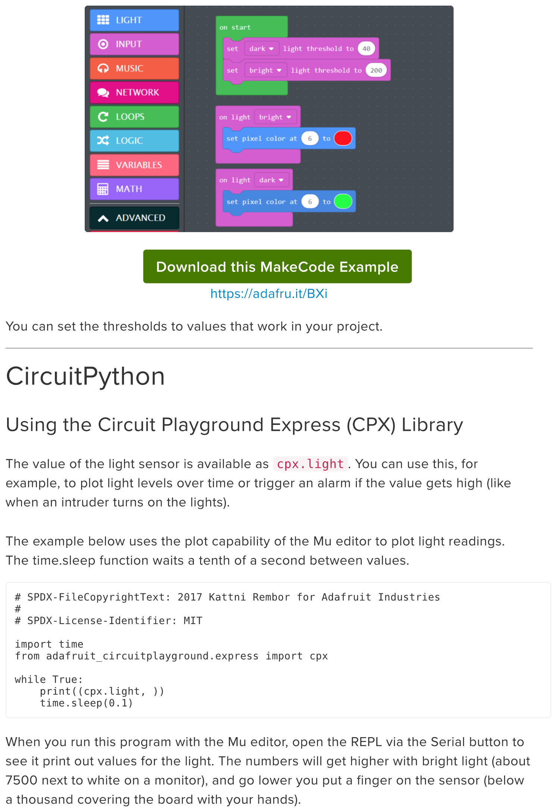

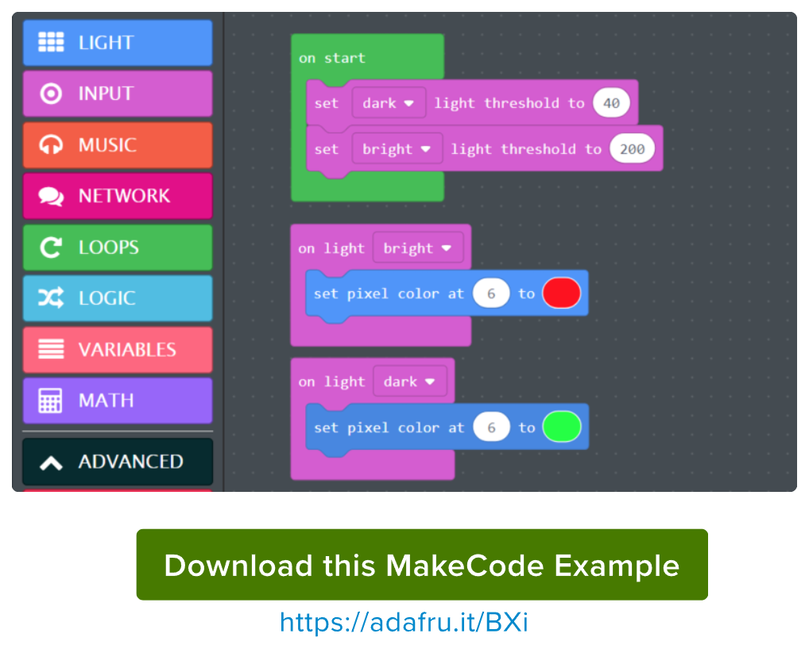

<https://adafru.it/BXi>

You can set the thresholds to values that work in your project.

# <a id="pdf-dest-8"></a>CircuitPython

## Using the Circuit Playground Express (CPX) Library

The value of the light sensor is available as cpx.light . You can use this, for example, to plot light levels over time or trigger an alarm if the value gets high (like when an intruder turns on the lights).

The example below uses the plot capability of the Mu editor to plot light readings. The time.sleep function waits a tenth of a second between values.

# SPDX-FileCopyrightText: 2017 Kattni Rembor for Adafruit Industries

```
#
# SPDX-License-Identifier: MIT

import time
from adafruit_circuitplayground.express import cpx

while True:
    print((cpx.light, ))
    time.sleep(0.1)
```

When you run this program with the Mu editor, open the REPL via the Serial button to see it print out values for the light. The numbers will get higher with bright light (about 7500 next to white on a monitor), and go lower you put a finger on the sensor (below a thousand covering the board with your hands).

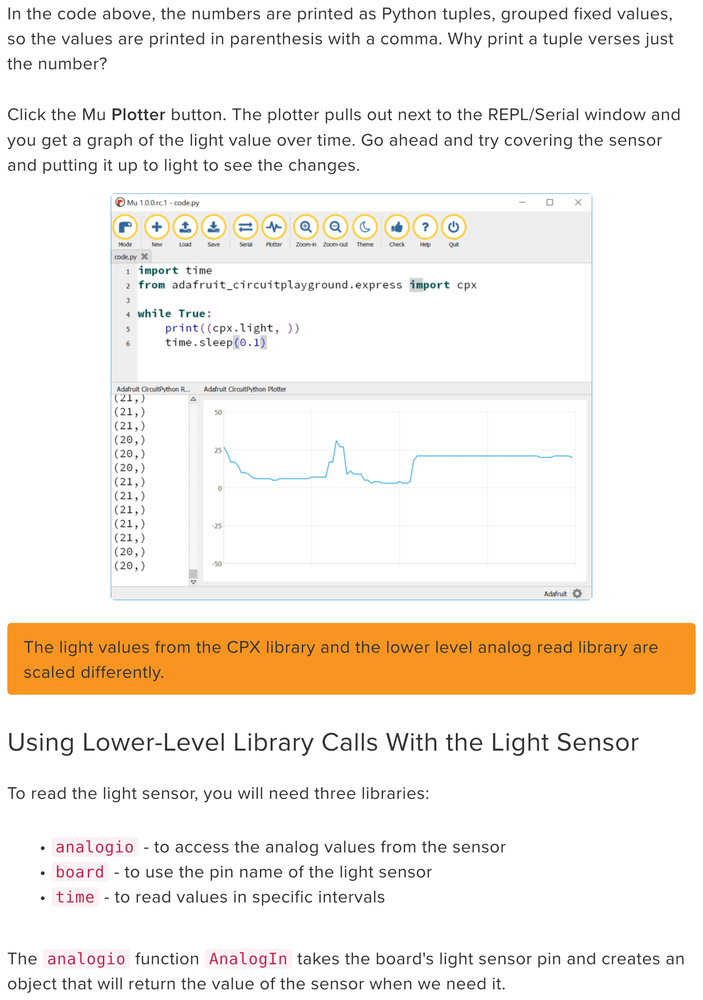

In the code above, the numbers are printed as Python *tuples,* grouped fixed values, so the values are printed in parenthesis with a comma. Why print a tuple verses just the number?

Click the Mu **Plotter** button. The plotter pulls out next to the REPL/Serial window and you get a graph of the light value over time. Go ahead and try covering the sensor and putting it up to light to see the changes.

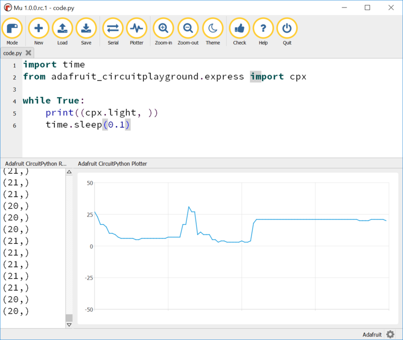

The light values from the CPX library and the lower level analog read library are scaled differently.

## Using Lower-Level Library Calls With the Light Sensor

To read the light sensor, you will need three libraries:

- analogio - to access the analog values from the sensor

- board - to use the pin name of the light sensor

- time - to read values in specific intervals

The analogio function AnalogIn takes the board's light sensor pin and creates an object that will return the value of the sensor when we need it.

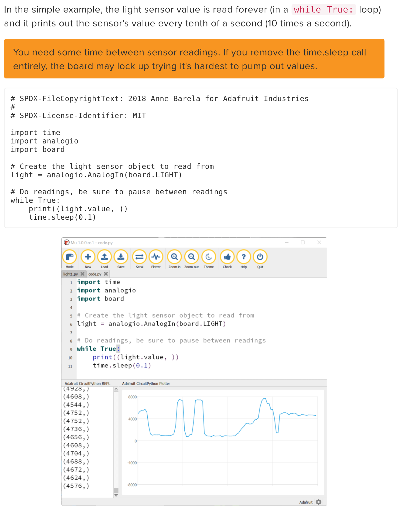

In the simple example, the light sensor value is read forever (in a while True: loop) and it prints out the sensor's value every tenth of a second (10 times a second). You need some time between sensor readings. If you remove the time.sleep call entirely, the board may lock up trying it's hardest to pump out values.

# SPDX-FileCopyrightText: 2018 Anne Barela for Adafruit Industries

```
#
# SPDX-License-Identifier: MIT

import time
import analogio
import board

# Create the light sensor object to read from
light = analogio.AnalogIn(board.LIGHT)

# Do readings, be sure to pause between readings
while True:
    print((light.value, ))
    time.sleep(0.1)
```

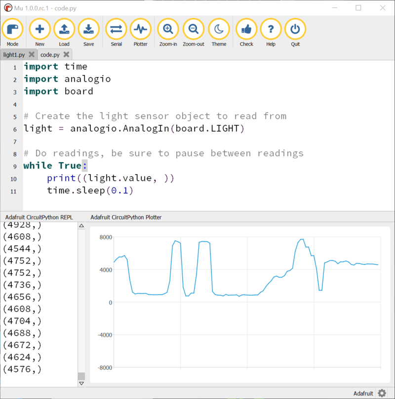

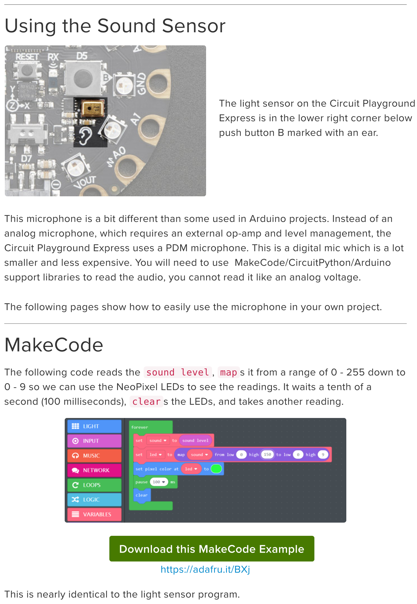

# <a id="pdf-dest-9"></a>Using the Sound Sensor

The light sensor on the Circuit Playground Express is in the lower right corner below push button B marked with an ear.

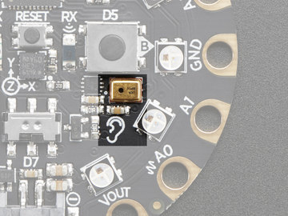

This microphone is a bit different than some used in Arduino projects. Instead of an analog microphone, which requires an external op-amp and level management, the Circuit Playground Express uses a PDM microphone. This is a digital mic which is a lot smaller and less expensive. You will need to use MakeCode/CircuitPython/Arduino support libraries to read the audio, you cannot read it like an analog voltage.

The following pages show how to easily use the microphone in your own project.

# <a id="pdf-dest-10"></a>MakeCode

The following code reads the sound level , map s it from a range of 0 - 255 down to 0 - 9 so we can use the NeoPixel LEDs to see the readings. It waits a tenth of a second (100 milliseconds), clear s the LEDs, and takes another reading.

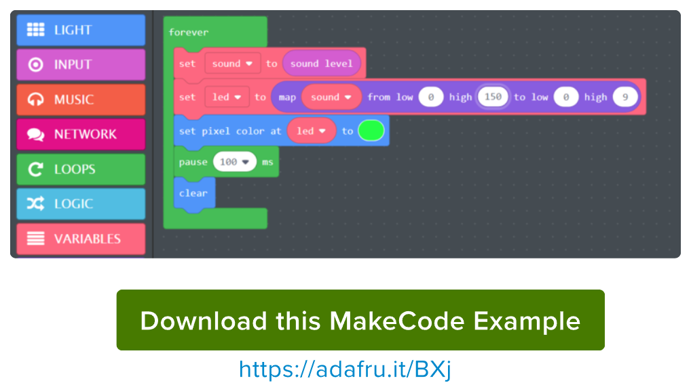

<https://adafru.it/BXj>

This is nearly identical to the light sensor program.

And again in this example the value 255 is not in there, it's been lowered to 150 . I could not whistle high enough to register a 255 so it was lowered to get a bigger range of values. You can change this to your own desired value.

## Using Sound as a Trigger

There are additional blocks in MakeCode to run code based on whether the sound is above a set threshold. Use the on loud sound block from the **INPUT** group at the start of your code to indicate whether it has detected a loud sound.

The example sets NeoPixel 9 green on a loud sound. Pushing button A clears the light to start again. When the code is run, the green LED may light, press button A to begin, MakeCode may have a bug when starting the sound detector.

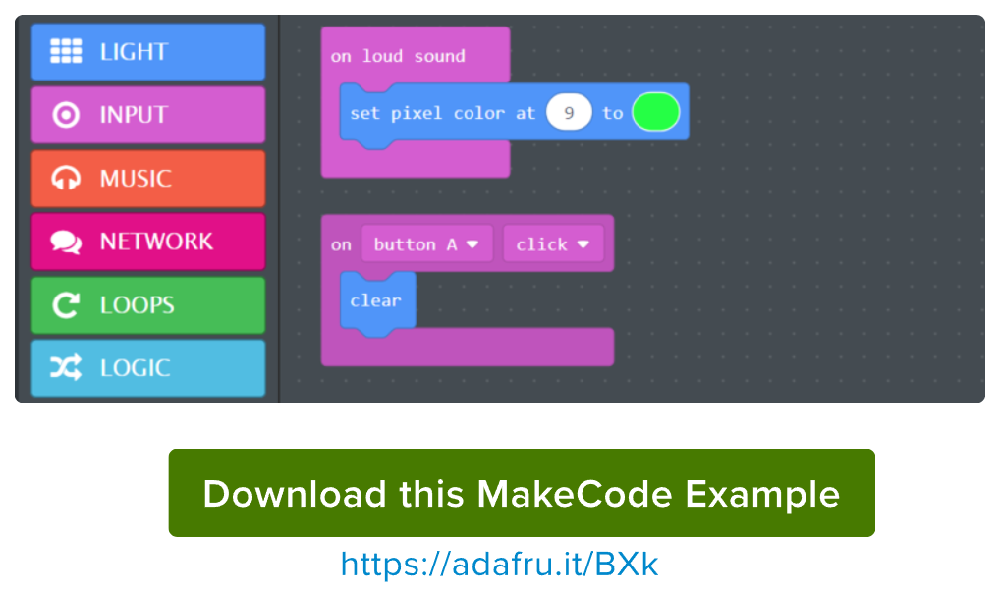

# <a id="pdf-dest-11"></a>CircuitPython

Using the sound sensor in CircuitPython is a bit more involved, because the sensor provides the actual sound data so we have to do math to turn it into loudness.

We're going to use CircuitPython, Mu and the sound sensor to plot sound levels. We'll run this code on Circuit Playground Express and use Mu to plot the data in the Serial window with Mu.

Save the following as **code.py** on your Circuit Playground Express board, using the Mu editor:

# SPDX-FileCopyrightText: 2018 Kattni Rembor for Adafruit Industries

# # SPDX-License-Identifier: MIT import array

```
import math
import time

import audiobusio
import board

def mean(values):
    return sum(values) / len(values)

def normalized_rms(values):
    minbuf = int(mean(values))
    sum_of_samples = sum(
        float(sample - minbuf) * (sample - minbuf)
        for sample in values
    )

    return math.sqrt(sum_of_samples / len(values))

mic = audiobusio.PDMIn(
    board.MICROPHONE_CLOCK,
    board.MICROPHONE_DATA,
    sample_rate=16000,
    bit_depth=16
)
samples = array.array('H', [0] * 160)
mic.record(samples, len(samples))

while True:
    mic.record(samples, len(samples))
    magnitude = normalized_rms(samples)
    print(((magnitude),))
    time.sleep(0.1)
```

This code imports the audiobusio , time , board , array and math libraries. There are also two helper functions. The first one uses math to return a mean, or average. It is used in the second helper. The second felper function uses math to return a normalised rms average (<https://adafru.it/Bf5>). These functions are then used to take multiple sound samples really quickly and average them to get a more accurate reading.

Next the microphone object and the samples variable are set. Then initialization of the mic object so it's ready for use.

The mic object starts taking sound samples. The normalised rms is used to find the average of a given set of samples, and that is the magnitude . Last, print the magnitude to the serial console.

Press the Serial button to see the values being printed out. Press the Plotter icon to have Mu plot those values also. Note that the Mu plotter looks for **tuple** values to print. Tuples in Python come in parentheses () with comma separators. If you have two values, a tuple would look like (1.0, 3.14) Since we have only one value, we need to have it print out like (1.0,) note the parentheses *around* the number, and the *comma* after the number. Thus the extra parentheses and comma

in print(((magnitude),)) .

Once you have everything setup and running, try speaking towards the Circuit Playground Express, and watch the plotter immediately react! Move further away from the board to cause smaller changes in the plotter line. Move closer to the board to see bigger spikes!

It's a really easy way to test your microphone and see how it reads sound changes on the Circuit Playground Express!

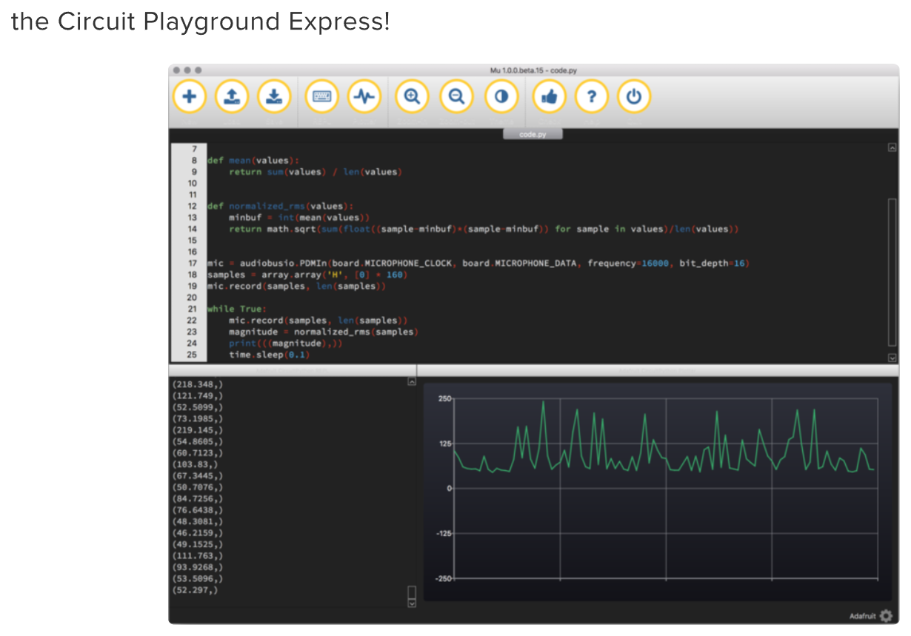

## Advanced - an Analog Sound Meter

Some Makers look to build a classic sound meter - the rainbow meter that measures sound with sample normalization and logarithmic scaling.

If this is the type of code you're looking to implement, see this guide for the CircuitPython code (<https://adafru.it/BXq>).

# <a id="pdf-dest-12"></a>Using the Temperature Sensor

The temperature sensor on the Circuit Playground Express is in the lower right corner below push button B marked with an ear.

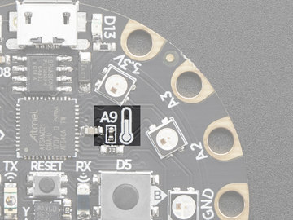

The sensor is analog, and like most other Circuit Playground sensors, it is easy to read in both MakeCode and CircuitPython. See the following pages to get started with this sensor.

# <a id="pdf-dest-13"></a>MakeCode

The value of the temperature sensor can be read in degrees, either Fahrenheit or Celsius via the **INPUT** group temperature in block. The example is coded for Fahrenheit.

Rather than use map for this project, an if..then..else block is used. Lower than 89 degrees, it lights all green. Between 89 and 98 degrees, there is one yellow dot corresponding to the temperature minus 89 degrees. Above 98 degrees, it displays all red.

At a cool room temperature all NeoPixels should be green. Pressing a finger on the sensor should warm it up to a flashing yellow depending on the temperature value. Most likely a finger will not get the sensor above 98 degrees, but taking it out on a hot day will.

Feel free to adjust the values to change the ranges.

# <a id="pdf-dest-14"></a>CircuitPython

## Using the Circuit Playground Express (CPX) Library

The temperature may be easily obtained in Celsius via the

adafruit_circuitplayground value cpx.temperature .

You can get the value in Fahrenheit as temperature_f = cpx.temperature * 1.8

+ 32

Here is a sample program printing out the temperature every quarter of a second (0.25 seconds)

# SPDX-FileCopyrightText: 2017 Kattni Rembor for Adafruit Industries

```
#
# SPDX-License-Identifier: MIT

import time
from adafruit_circuitplayground.express import cpx

while True:
    print((cpx.temperature, ))
    time.sleep(0.1)
```

Try placing your finger over the sensor (you'll see the thermometer icon on the board) and watch the readings change. As the temperature is in Celsius, it will not make a huge change over time unless you have a fever.

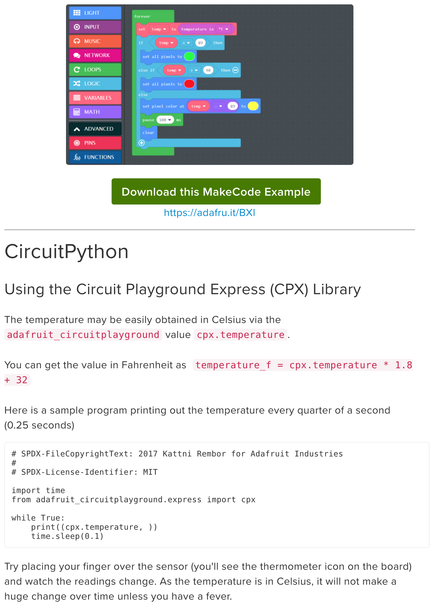

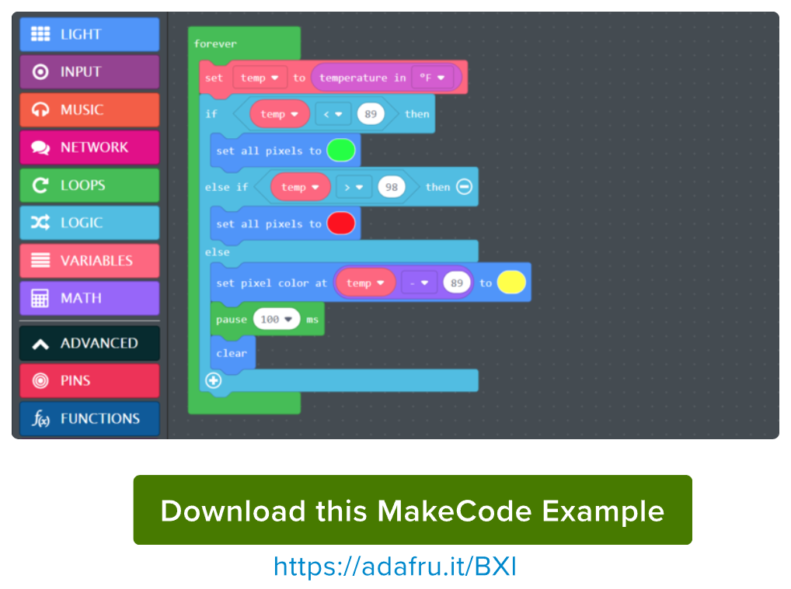

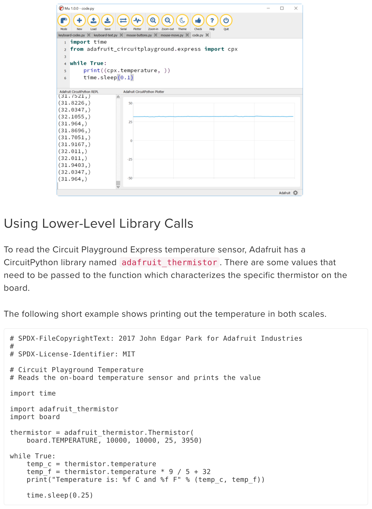

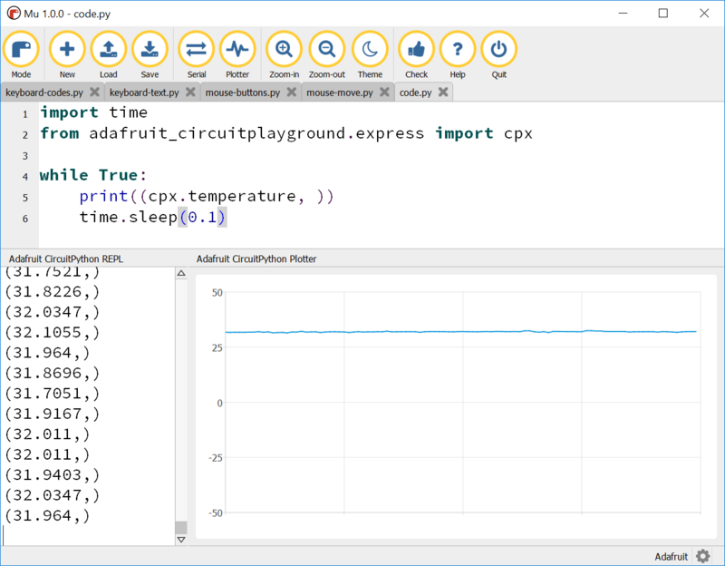

## Using Lower-Level Library Calls

To read the Circuit Playground Express temperature sensor, Adafruit has a CircuitPython library named adafruit_thermistor . There are some values that need to be passed to the function which characterizes the specific thermistor on the board.

The following short example shows printing out the temperature in both scales.

# SPDX-FileCopyrightText: 2017 John Edgar Park for Adafruit Industries

```
#
# SPDX-License-Identifier: MIT

# Circuit Playground Temperature
# Reads the on-board temperature sensor and prints the value

import time

import adafruit_thermistor
import board

thermistor = adafruit_thermistor.Thermistor(
    board.TEMPERATURE, 10000, 10000, 25, 3950)

while True:
    temp_c = thermistor.temperature
    temp_f = thermistor.temperature * 9 / 5 + 32
    print("Temperature is: %f C and %f F" % (temp_c, temp_f))

    time.sleep(0.25)
```

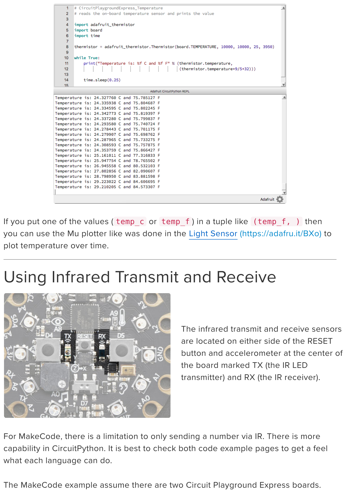

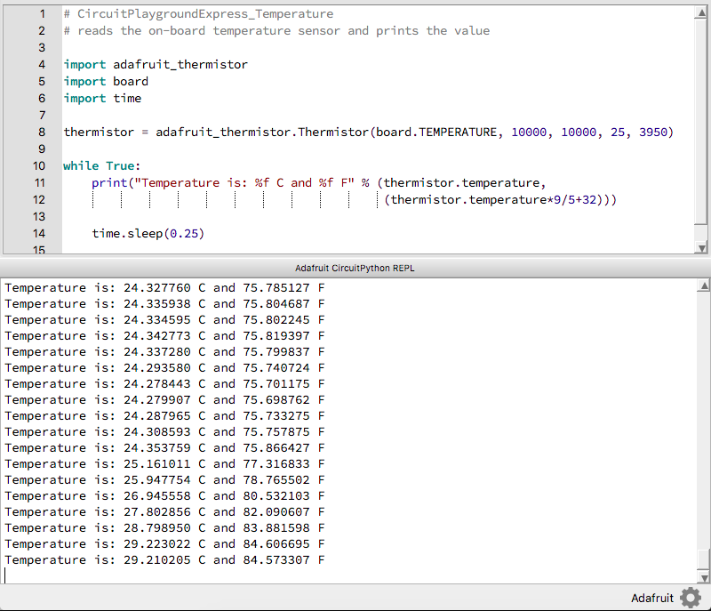

If you put one of the values ( temp_c or temp_f ) in a tuple like (temp_f, ) then you can use the Mu plotter like was done in the Light Sensor (<https://adafru.it/BXo>) to plot temperature over time.

# <a id="pdf-dest-15"></a>Using Infrared Transmit and Receive

The infrared transmit and receive sensors are located on either side of the RESET button and accelerometer at the center of the board marked TX (the IR LED transmitter) and RX (the IR receiver).

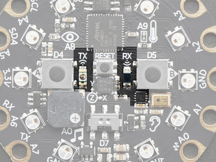

For MakeCode, there is a limitation to only sending a number via IR. There is more capability in CircuitPython. It is best to check both code example pages to get a feel what each language can do.

The MakeCode example assume there are two Circuit Playground Express boards.

The CircuitPython example uses one Circuit Playground Express and an Adafruit mini IR remote control (<http://adafru.it/389>).

# <a id="pdf-dest-16"></a>MakeCode

## Sending an Indication to Another Circuit Playground Express

In MakeCode, the infrared communications blocks are in the **NETWORK** block group.

You can send a number of your choice over infrared with the infrared send number block. On the receive side, a trigger block, on infrared receive runs code blocks when the board detects an infrared signal. The variable num has the numeric value received.

You can compare the numbers sent and received to determine if that is the signal you were looking for or not. With a simple one-on-one conversation, the number can be anything. In a whole classroom of Circuit Playground Express boards, you may only want to trigger when you get a special number received by the instructor or your friend.

## An Example

The example below has the Circuit Playground Express lights all set to green in the

forever loop.

If button A is pressed, the number 9 (an arbitrary number) is sent via IR.

If a Circuit Playground Express receives any number, it will run two blocks: set all pixels to red and wait for 1,000,000 microseconds (1 second).

Normally the lights would immediately turn green again due to the forever loop. But the wait doesn't let that happen (it *blocks* other code from running until it finishes waiting) so you will see the red lights indicating a detection for the wait period. Then the NeoPixels will turn back green. Another receive starts the red display for an additional second.

Load the code below on two or more Circuit Playground Expresses.

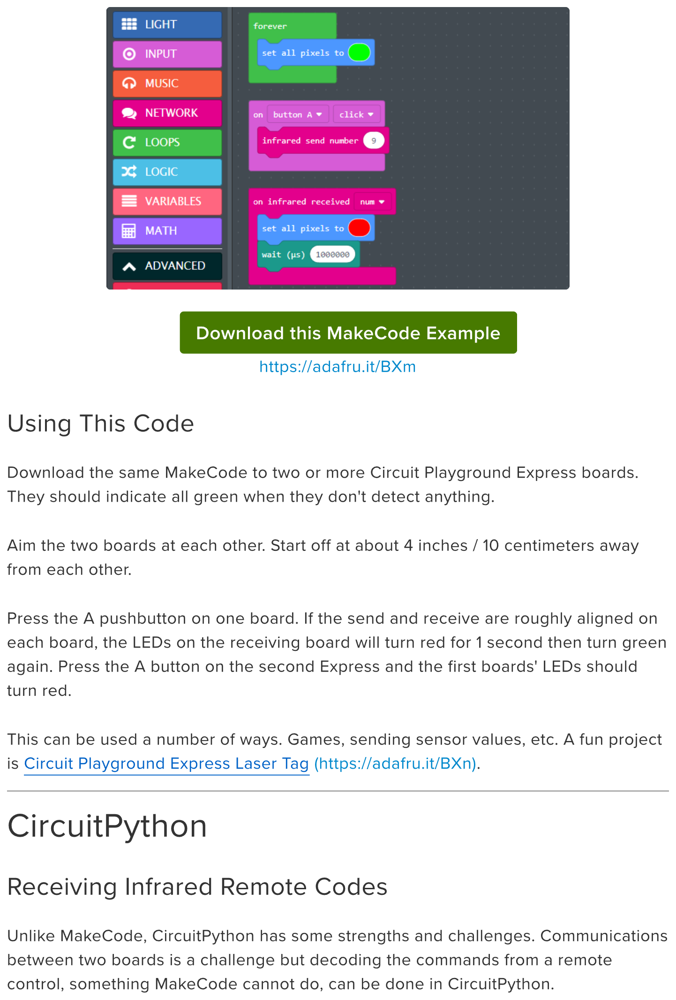

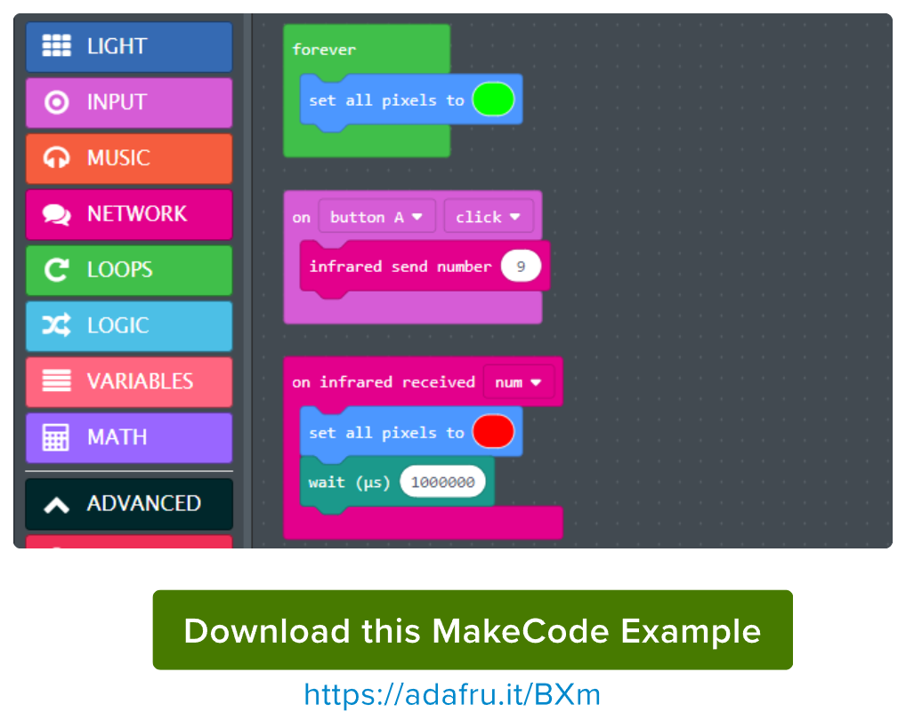

## Using This Code

Download the same MakeCode to two or more Circuit Playground Express boards. They should indicate all green when they don't detect anything.

Aim the two boards at each other. Start off at about 4 inches / 10 centimeters away from each other.

Press the A pushbutton on one board. If the send and receive are roughly aligned on each board, the LEDs on the receiving board will turn red for 1 second then turn green again. Press the A button on the second Express and the first boards' LEDs should turn red.

This can be used a number of ways. Games, sending sensor values, etc. A fun project [is Circuit Playground Express Laser Tag (https://adafru.it/BXn).](https://learn.adafruit.com/circuit-playground-express-laser-tag?view=all)

# <a id="pdf-dest-17"></a>CircuitPython

## Receiving Infrared Remote Codes

Unlike MakeCode, CircuitPython has some strengths and challenges. Communications between two boards is a challenge but decoding the commands from a remote control, something MakeCode cannot do, can be done in CircuitPython.

[This example uses the Adafruit mini remote control (http://adafru.it/389). Different](https://www.adafruit.com/product/389) remotes send differing remote commands with possibly different encodings (the television industry has fractured the remote encoding methodologies, let's point at them). The Adafruit remote sends codes defined by the TV maker NEC. The codes it sends are known and will be in our program.

If you have another remote, you can learn how to read the codes sent using this guide (<https://adafru.it/BXr>).

## Libraries

Adafruit has developed CircuitPython libraries to read IR signals and to translate them to remote codes. The pulseio library reads pulses in from any source pin. The adafruit_irremote library does the decoding.

The example will use the neopixel library again to light the NeoPixels on the Circuit Playground Express from 0 to 9 depending on the number pressed on the remote. IR codes are represented by a Python list of 20 numbers, called a *mapping,* where each remote button is in a certain place in a list and we look in that list to find which button was pressed by where the number is in the list.

## Code

Here is the code for reading the remote. The example is considerably longer than previous examples in this guide. This is due to comments on the keycodes and the decoding and error checking during the "get key press" process.

# SPDX-FileCopyrightText: 2017 John Edgar Park for Adafruit Industries

# # SPDX-License-Identifier: MIT # Read Adafruit Remote Codes with Circuit Playground Express # # Simplified code based on <https://learn.adafruit.com/remote->

```
# control-tree-ornament-with-circuit-playground-express?view=all
#
import adafruit_irremote
import board
import neopixel
import pulseio

pixels = neopixel.NeoPixel(board.NEOPIXEL, 10)

# Set up the reading of pulses on the IR receiver and the IR library
pulsein = pulseio.PulseIn(board.REMOTEIN, maxlen=120, idle_state=True)
decoder = adafruit_irremote.GenericDecode()

# Example works with the Adafruit mini IR remote #389
# The size below must match what you are decoding! For NEC use 4
received_code = bytearray(4)
```

```
# IR Remote Mapping
'''
 1: [255, 2, 247, 8]
 2: [255, 2, 119, 136]
 3: [255, 2, 183, 72]
 4: [255, 2, 215, 40]
 5: [255, 2, 87, 168]
 6: [255, 2, 151, 104]
 7: [255, 2, 231, 24]
 8: [255, 2, 103, 152]
 9: [255, 2, 167, 88]
 0: [255, 2, 207, 48]

^ : [255, 2, 95, 160]
v : [255, 2, 79, 176]
> : [255, 2, 175, 80]
< : [255, 2, 239, 16]

Enter: [255, 2, 111, 144]
Setup: [255, 2, 223, 32]
Stop/Mode: [255, 2, 159, 96]
Back: [255, 2, 143, 112]

Vol - : [255, 2, 255, 0]
Vol + : [255, 2, 191, 64]

Play/Pause: [255, 2, 127, 128]
'''
# Use the third value in mappings above to identify each key in a list
keys = [207, 247, 119, 183, 215, 87, 151, 231, 103, 167, 207, 95,
        79, 175, 239, 111, 223, 159, 143, 255, 191, 127]

last_command = None

while True:
    try:
        pulses = decoder.read_pulses(pulsein)
    except MemoryError as e:
        print("Memory error: ", e)
        continue
    command = None
    try:
        code = decoder.decode_bits(pulses, debug=False)
        if len(code) > 3:
            command = code[2]
        print("Decoded:", command)
    except adafruit_irremote.IRNECRepeatException: # repeat command
        command = last_command
    except adafruit_irremote.IRDecodeException: # failed to decode
        pass

    if not command:
        continue
    last_command = command

    key_pressed = keys.index(command)
    if key_pressed <= 9: # if the keys 0-9 pressed
        pixels[key_pressed] = (0, 30, 0) # make the neopixel green
    else:
        pixels.fill((0, 0, 0)) # clear on any non-numeric key
```

## Use

Aim the remote at the Circuit Playground Express. Press any of the number keys and the NeoPixel corresponding to that number will light up. Pressing Enter, Back, or any other button will blank the lights to start again.

For a more involved project using these concepts, see the following Adafruit guides:

• [Infrared Receive and Transmit with Circuit Playground Express (https://adafru.it/](https://learn.adafruit.com/infrared-ir-receive-transmit-circuit-playground-express-circuit-python) BX3) • [Remote Control Tree Ornament with Circuit Playground Express (https://adafru.it/](https://learn.adafruit.com/remote-control-tree-ornament-with-circuit-playground-express?view=all) BXs) • [Hacking Ikea Lamps with Circuit Playground Express (https://adafru.it/BXt)](https://learn.adafruit.com/hacking-ikea-lamps-with-circuit-playground-express)

# <a id="pdf-dest-18"></a>Using Capacitive Touch

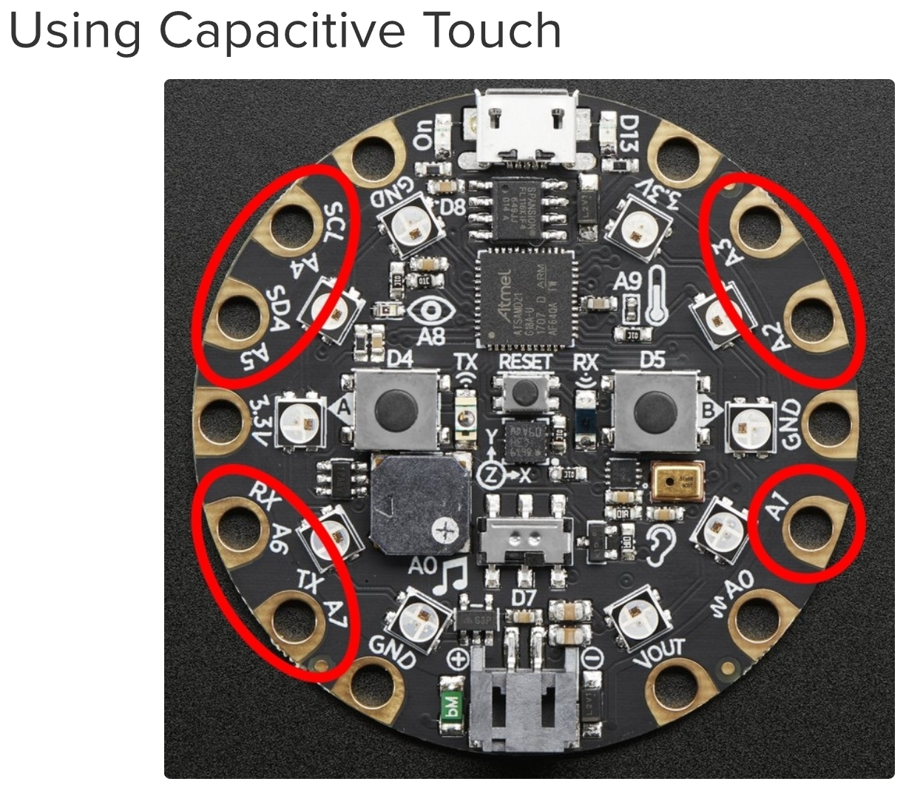

Capacitive Touch provides you with 7 additional switch inputs that you may have not known are available.

How do they work? The microcontroller has built-in circuitry to measure the capacitance of each of the pads A1 to A7. They are calibrated when the

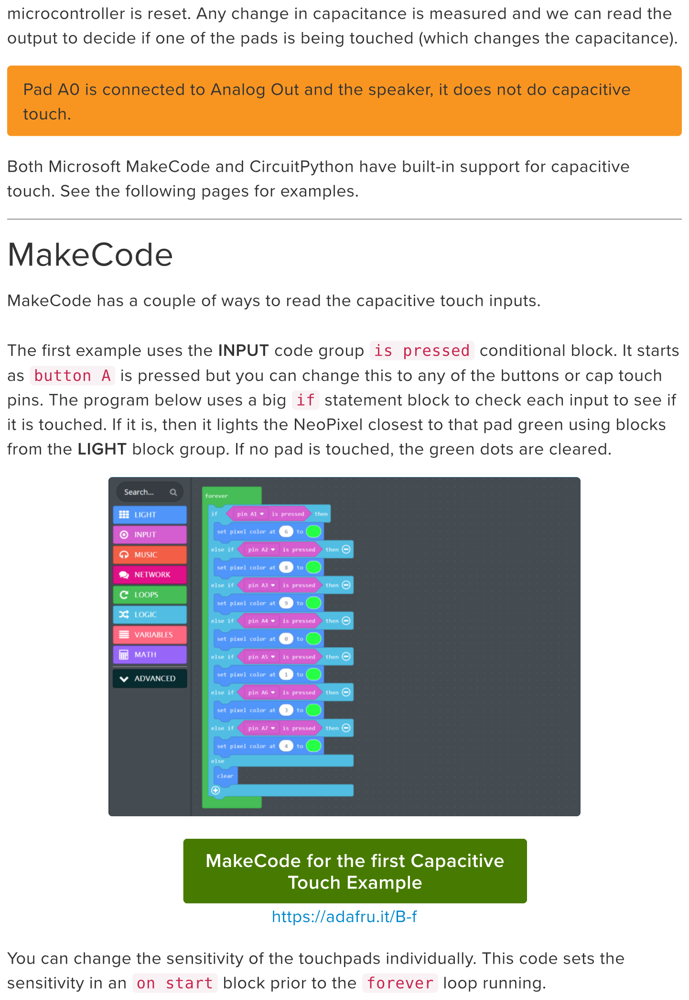

# touch.

microcontroller is reset. Any change in capacitance is measured and we can read the output to decide if one of the pads is being touched (which changes the capacitance).

Pad A0 is connected to Analog Out and the speaker, it does not do capacitive

Both Microsoft MakeCode and CircuitPython have built-in support for capacitive touch. See the following pages for examples.

# <a id="pdf-dest-19"></a>MakeCode

MakeCode has a couple of ways to read the capacitive touch inputs.

The first example uses the **INPUT** code group is pressed conditional block. It starts as button A is pressed but you can change this to any of the buttons or cap touch pins. The program below uses a big if statement block to check each input to see if it is touched. If it is, then it lights the NeoPixel closest to that pad green using blocks from the **LIGHT** block group. If no pad is touched, the green dots are cleared.

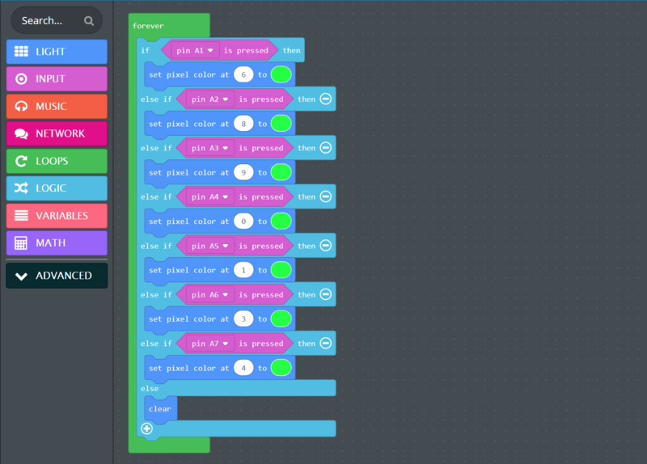

[MakeCode for the first Capacitive Touch Example](https://makecode.com/_c39WAvEj9dHX)

<https://adafru.it/B-f>

You can change the sensitivity of the touchpads individually. This code sets the sensitivity in an on start block prior to the forever loop running.

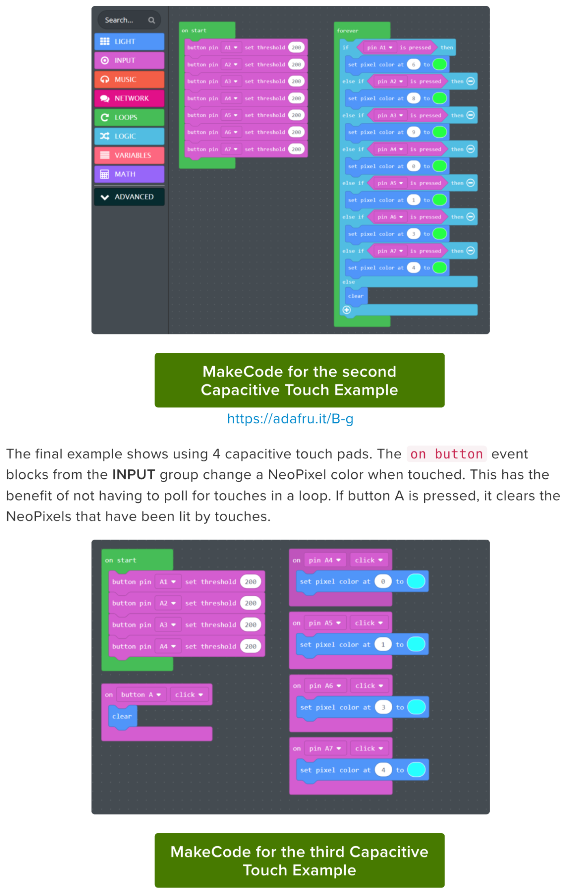

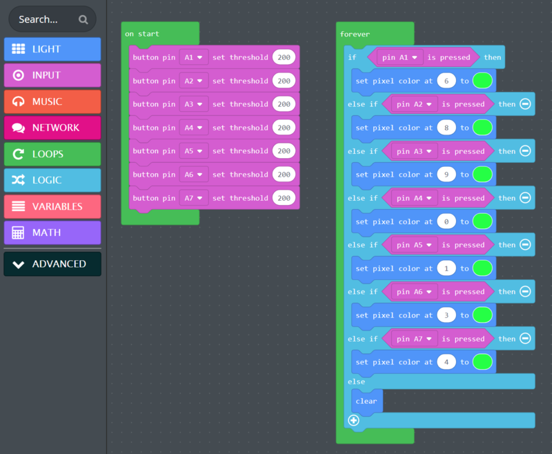

[MakeCode for the second Capacitive Touch Example](https://makecode.com/_46w78sWba5T0)

<https://adafru.it/B-g>

The final example shows using 4 capacitive touch pads. The on button event blocks from the **INPUT** group change a NeoPixel color when touched. This has the benefit of not having to poll for touches in a loop. If button A is pressed, it clears the NeoPixels that have been lit by touches.

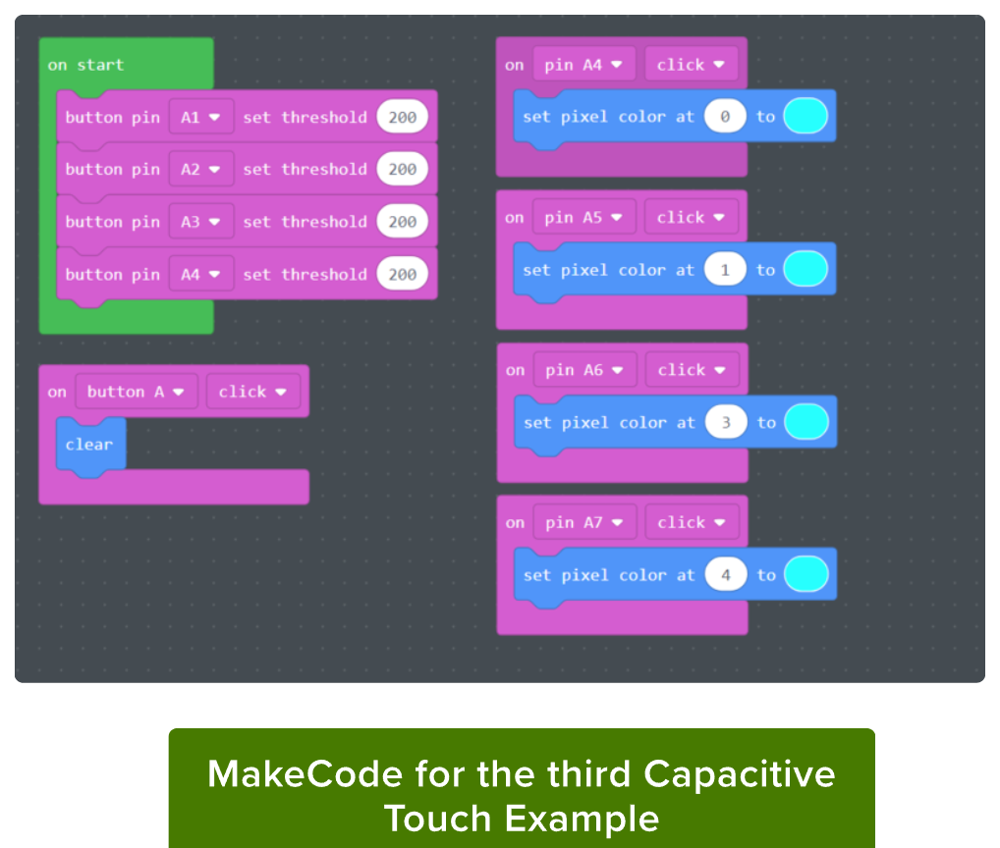

<https://adafru.it/B-h>

# <a id="pdf-dest-20"></a>CircuitPython

Similar to reading the standard buttons, the capacitive touch buttons can be checked to see if they have been touched to perform some action.

Using the adafruit_circuitplayground.express library, there are 7 touch buttons: cpx.touch_A1 through cpx.touch_A7 . The sensitivity of the touchpads is one value for all pads set via cpx.adjust_touch_threshold . Setting the threshold is not required if the default sensitivity is ok.

Below is an example of turning on NeoPixels green if pads A4 through A7 are touched. Pressing Button A clears the lights.

# SPDX-FileCopyrightText: 2018 Anne Barela for Adafruit Industries

```
#
# SPDX-License-Identifier: MIT

from adafruit_circuitplayground.express import cpx

# NeoPixel blank out
cpx.pixels.fill( (0, 0, 0) )

# Set sensitivity of all touch pads
cpx.adjust_touch_threshold(200)

# Check for touch, if so light the nearby NeoPixel green
while True:
    if cpx.touch_A4:
        cpx.pixels[0] = (0, 30, 0)
    if cpx.touch_A5:
        cpx.pixels[1] = (0, 30, 0)
    if cpx.touch_A6:
        cpx.pixels[3] = (0, 30, 0)
    if cpx.touch_A7:
        cpx.pixels[4] = (0, 30, 0)
    if cpx.button_a: # blank lights on Button A
        cpx.pixels.fill( (0, 0, 0) )
```

## Using Lower-Level Library Calls to Save Memory

The following code is very lightweight for reading the capacitive touch pads. It is perfect for when you want to add additional code such as Crickit or other library modules which may require a lot of memory.

Reading keys uses the following libraries:

- touchio - contains the touch functions

- board - we use board definitions for the switches


- time - contains the sleep function to pause between readings

The code to set up four cap touch switches and print their values is as follows:

# SPDX-FileCopyrightText: 2018 Kattni Rembor for Adafruit Industries

# # SPDX-License-Identifier: MIT

The documentation for touchio can be found here (<https://adafru.it/B-i>). There is not a current setting for sensitivity.

---

## Repeated content (headers / footers / watermarks)

> Page-edge and repeated content was moved out of the body to keep reading order clean — kept here, not deleted.

- ©Adafruit Industries Page 1 of 33 · ©Adafruit Industries Page 2 of 33 · ©Adafruit Industries Page 3 of 33 · ©Adafruit Industries Page 4 of 33 · ©Adafruit Industries Page 5 of 33 · ©Adafruit Industries Page 6 of 33 · ©Adafruit Industries Page 7 of 33 · ©Adafruit Industries Page 8 of 33 · ©Adafruit Industries Page 9 of 33 · ©Adafruit Industries Page 10 of 33 · ©Adafruit Industries Page 11 of 33 · ©Adafruit Industries Page 12 of 33 · ©Adafruit Industries Page 13 of 33 · ©Adafruit Industries Page 14 of 33 · ©Adafruit Industries Page 15 of 33 · ©Adafruit Industries Page 16 of 33 · ©Adafruit Industries Page 17 of 33 · ©Adafruit Industries Page 18 of 33 · ©Adafruit Industries Page 19 of 33 · ©Adafruit Industries Page 20 of 33 · ©Adafruit Industries Page 21 of 33 · ©Adafruit Industries Page 22 of 33 · ©Adafruit Industries Page 23 of 33 · ©Adafruit Industries Page 24 of 33 · ©Adafruit Industries Page 25 of 33 · ©Adafruit Industries Page 26 of 33 · ©Adafruit Industries Page 27 of 33 · ©Adafruit Industries Page 28 of 33 · ©Adafruit Industries Page 29 of 33 · ©Adafruit Industries Page 30 of 33 · ©Adafruit Industries Page 31 of 33 · ©Adafruit Industries Page 32 of 33 · ©Adafruit Industries Page 33 of 33  *(pp.1–33)*
- ©Adafruit Industries  *(pp.1–33)*